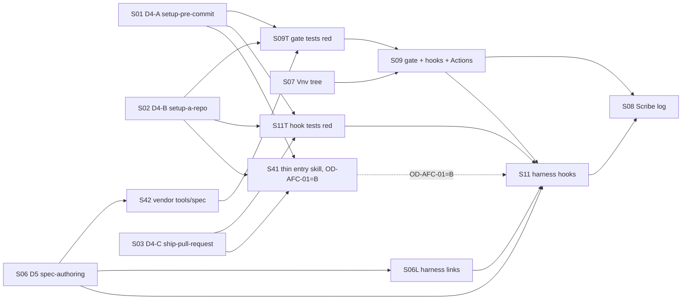
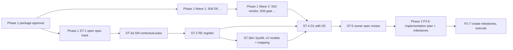

# Amazon Fantasy Companion — Technical Plan (Phase 1)

## Outcome

The owner changed the order of work at the integrated review
(DEC-AFC-SD-023): the specification comes first, then implementation
planning. This package is **Phase 1**. When it is done:

- **D5** — one shared, repo-agnostic `spec-authoring` skill exists in the
  owner's shared skills. It is generalized from the GridMarket spec kit:
  template, build, lint and diagram tooling that runs in any repository
  without a project-specific Python environment, with nothing
  GridMarket-specific (SD-022). The Phase 1 spec track writes the product
  specification D1 with it (ST-4).
- **D4** — the shared, repo-agnostic CI/CD capability exists (SD-018 to
  SD-021): `setup-pre-commit`, `setup-a-repo` and `ship-pull-request` are
  extended, and harness hooks call the one gate entrypoint.
- **This repository can use them.** It has one gate entrypoint with `spec`,
  `docs` and `hygiene` areas, called by local git hooks and GitHub Actions.
  It has a vendored copy of the D5 tools, so public CI can build a
  specification. It has a Vnv guidance tree for the Phase 1 areas.
- **Scribe developer-feedback log started** (issue #1 Scribe contract,
  SD-011). From its first row it carries every field the Devpost rules ask
  for (DEC-AFC-SD-025), so entries are captured as they happen.
- **Phase 1 also runs the spec track (ST-1..ST-5), planned here as a
  sequence, not as slices.** It covers the requirements register
  (Requirements Engineer), the SysML v2 models (Systems Modeler: structure,
  interfaces, states, data), D1 assembly with D5 and the owner's spec
  review. Its entry criteria and dependencies are explicit (§Phase 1 spec
  track and Phase 2 sequence). Register and model work start right after
  this package is approved, in parallel with the D5/D4 waves. Only D1
  assembly (ST-4) waits for D5.
- **Phase 2 follows the approved spec.** It plans implementation from the
  approved spec, then creates the full-detail milestones (D3) after that
  plan is approved, then implements (P2-6, P2-7).

Phase 1 contains no TV app, backend, device spike or other product
implementation slice.
Everything from issue #1 that the f885e48 package planned is still
accounted for, in §Deferred to the spec track or Phase 2.

## Requirements register

No requirements register exists. The repository is greenfield
(`workspace.md` Observed Systems; `repository-map.md`), and this Lifecycle
(the D5/D4 waves of Phase 1) is not a specification Lifecycle: it builds
shared tooling and this repository's gate. Every requirement below is
Lifecycle-local (`AC-*` / `RISK-*`). The product register is a Phase 1
spec-track deliverable written under the spec-track plan directory
(§Phase 1 spec track and Phase 2 sequence, step ST-2): the Markdown register
`docs/plans/2026-10-12-amazon-fantasy-companion-phase-2/requirements-register.md`
(DEC-AFC-SD-027). Sources are:

- the confirmed decisions DEC-AFC-001, DEC-AFC-002 and
  DEC-AFC-SD-001..SD-024, except SD-013, which SD-022 supersedes (written
  `SD-nnn` below);
- DEC-AFC-PROFILE-001;
- the typed conditionals C1..C14 and the coverage ledger of
  `scope-decision-batch.md`;
- issue #1 (cited as `#1 §<heading>`).

IDs are kept from f885e48. A row whose statement changed is marked
*(amended)*. A row new in this revision is marked *(new)*.

## Glossary

### Quantity definitions (copied verbatim from the Scope Definition final batch)

| Name | Formula / value | Population / denominator | Units | Source |
|---|---|---|---|---|
| T_deadline | Devpost submission close | Single event | 2026-10-23T19:00:00Z | Issue #1 |
| T_yahoo | Manual-entry trigger | Single event | 2026-10-16T19:00:00Z | SD-007 |
| spike_panel_max | Elapsed time from first app install on the stick to the panel-route verdict | One spike | ≤ 24 h | SD-006 |
| min_sdk | Lowest supported Android API level | One APK | API 25 | SD-003 |
| T_judge_access | Last date judges must reach the repo and backend | Single date | 2026-11-20 | Issue #1 |
| aws_free_window | The earlier of 6 months after opening or credits used up | One account | Months | aws.amazon.com/free |
| impl_agent_cap | Concurrent implementation agents per orchestrating session; reviewers excluded | Per session | 5 | Rule 17 |
| gh_private_minutes | Included GitHub Actions minutes per month for a GitHub Free account's private repos; public repos use standard runners free | Per account per month | 2,000 min | GitHub billing docs |
| skill_size_max | Size limit for `SKILL.md`, frontmatter included | Per skill | < 60 lines and < 650 words | `create-lean-skill` |

The Lifecycle-local product design quantities of f885e48 (feed_poll_interval
… panel_refresh) are product design and move to the spec track
(§Deferred to the spec track or Phase 2). Phase 1 defines no new quantities.

### Terms

| Term | Meaning |
|---|---|
| Phase 1 | The first phase of the spec-first order (DEC-AFC-SD-023): this package's D5/D4 waves (D5, D4, this repository's gate and Vnv tree, the Scribe log start) plus the spec track. |
| spec track | The Phase 1 specification work ST-1..ST-5: requirements register → SysML v2 models → D1 with D5 → owner spec review. It runs as planning-role sessions under its own plan directory, not as slices of this Lifecycle, and is planned here only as a sequence with entry criteria. ST-1..ST-5 replace the IDs P2-1..P2-5 of the earlier draft of this revision (OR-01). |
| Phase 1 closeout | The closeout of this Lifecycle's D5/D4 waves (DoD Manifest closeout). The spec track continues under its own plan and ends at ST-5. |
| Phase 2 | Implementation planning from the approved spec, the full-detail GitHub milestones (D3) created after that plan is approved, and product execution (P2-6, P2-7). |
| Vnv guidance tree | `docs/vnv/AGENTS.md` plus one `docs/vnv/<area>/AGENTS.md` per area naming Scope, Tools, Review Focus and findings target (SD-014). |
| gate entrypoint | The one script that a repository's local hooks, Actions workflow and harness hooks all invoke (`tools/ci/gate.sh` here). |
| shared skills | The owner's skills in the Alphazedehq repository `skills/` directory, linked into each harness (SD-018). |
| spec-authoring skill | The D5 shared skill `skills/spec-authoring/` in Alphazedehq (SD-022). |
| vendored spec tools | The D5 scripts copied into this repository's `tools/spec/` by the skill's vendor step. `VENDORED.md` names the source commit. Alphazedehq is private, so public CI cannot reach the skill itself (OD-AFC-09). |
| typed gap | A recorded result saying a check could not run (missing tool, missing hook surface, missing Vnv tree), with its exact evidence. It is never counted as a pass. |

## Requirements (Lifecycle-local)

Allocation names the Phase 1 slice and the component. Components are
allocated against the D4/D5 candidate placements in the Systems Modeler
placement receipt (`specialists/systems-modeler-receipt.md` §D4 shared CI/CD,
§D5 shared spec-authoring skill). The receipt's product placements are
spec-track input (ST-3).

### Deliverable D5 — shared spec-authoring skill (Alphazedehq)

| ID | Statement | Source | Verification | Allocation |
|---|---|---|---|---|
| AC-AFC-D5-01 | The Alphazedehq repository shall contain one shared skill `skills/spec-authoring/` holding a `SKILL.md` within skill_size_max, a specification template, and build, lint and diagram scripts that run with `uv run --script` (PEP 723 inline dependencies) and Graphviz `dot`, without any project-specific Python environment, and shall retain the GridMarket MIT copyright and permission notice. | SD-022, C10, `create-lean-skill` | test, inspection | S06; D5 skill directory |
| AC-AFC-D5-02 | The spec-authoring skill’s operational text, templates and tool invocation shall contain no GridMarket product name, document id or `--project backend` flag; GridMarket references shall occur only in retained license, attribution and provenance records, and the skill shall contain no absolute local path; building and linting its shipped template in a temporary directory outside any git repository shall exit 0. | SD-022 ("nothing GridMarket-specific"), SD-019, C7 | test | S06; D5 skill directory |
| AC-AFC-D5-03 | The spec-authoring skill description shall name SDoc and Requirements System documents as non-triggers and shall cite `requirements-engineering` by reference without restating its checklist, so that a request to author and build a Markdown specification selects spec-authoring and a request to publish an SDoc revision to the Requirements System selects `use-requirements-system`. | `create-lean-skill`, C10 | test, inspection | S06; D5 skill description |
| AC-AFC-D5-04 | The skill's vendor step shall copy its scripts to `<repo>/tools/spec/` with a `VENDORED.md` naming the source repository, commit and MIT notice, and shall refuse to overwrite a vendored copy whose files differ from that recorded commit. | SD-022, SD-010 | test | S06; D5 vendor script |
| AC-AFC-D5-05 | The program shall land the spec-authoring skill in Alphazedehq through its own pull request merged by rebase or merge commit, shall then link it into every harness skill directory that already links the shared skills, and shall have the D4 hook installer link it for the remaining harnesses of SD-021 or record each as a typed gap. | SD-022, workspace rule (never squash), coverage ledger (Muse skills gap) | inspection | S06 (PR), S06L (links), S11 (Muse/AGY links or typed gaps) |

### Deliverable D4 — shared CI/CD capability (Alphazedehq shared skills)

| ID | Statement | Source | Verification | Allocation |
|---|---|---|---|---|
| AC-AFC-D4-01 | The shared `setup-pre-commit` skill shall define one repo-agnostic gate entrypoint contract, shall ship a template gate script and an installer for local git hooks that invoke it, shall state that GitHub Actions invoke the same entrypoint, shall contain no `[TODO]` text, and its `SKILL.md` shall be within skill_size_max. | SD-018, SD-021, DX-007, C10 | test, inspection | S01; D4-A |
| AC-AFC-D4-02 | The shared `setup-a-repo` skill shall reference a workflow-authoring guide stating the rules of AC-AFC-CI-02 plus free hosted runners on public repositories and the gh_private_minutes budget (C11), and shall ship a checker script that exits non-zero on a workflow violating any of those rules; its `SKILL.md` shall be within skill_size_max. | SD-017, SD-019, SD-021, C11, C14 | test | S02; D4-B |
| AC-AFC-D4-03 | The shared `ship-pull-request` skill shall run `vnv-review` when the repository has a Vnv guidance tree (`docs/vnv/AGENTS.md` or `Vnv/AGENTS.md`) and otherwise record REFUSED_NO_VNV, never a pass; its `references/GATES.md` shall gain a shared-gate row and an amazon-fantasy-companion row; its `SKILL.md` shall be within skill_size_max. | SD-020, SD-021, C10, C12 | test, inspection | S03; D4-C |
| AC-AFC-D4-04 | When AC-AFC-D4-01..03 are merged (C13), one shared hook script shall run the current repository's gate entrypoint before an agent-initiated `git commit` or `git push` in every harness named in SD-021 that exposes a pre-tool hook; the installer shall record each harness without one as a typed gap with its exact evidence, and shall expose the D4 skills in Muse's skill directory. | SD-021, C13, coverage ledger (Muse skills gap) | test, demonstration | S11T, S11; D4-E |
| AC-AFC-D4-05 | The program shall land each D4 skill change in Alphazedehq through its own pull request merged by rebase or merge commit, after the skill is exercised against one matching and one non-matching request. | SD-021, create-lean-skill, workspace rule (never squash) | inspection | S01, S02, S03, S11, S41; D4 PRs |
| AC-AFC-D4-06 | The D4 skill and hook text shall name no repository, owner, pilot or exclusion that scopes the capability. | SD-019 | inspection | S01, S02, S03, S11, S41; D4 text |

### This repository's gate, vendored spec tools and Vnv tree

| ID | Statement | Source | Verification | Allocation |
|---|---|---|---|---|
| AC-AFC-CI-01 *(amended)* | The repository shall have one gate entrypoint `tools/ci/gate.sh` with the areas `spec`, `docs` and `hygiene`; the local pre-commit and pre-push hooks and the Actions workflow shall invoke that entrypoint with the same area arguments, and each area shall exit non-zero when any of its checks fails. | SD-016, SD-021, DEC-AFC-SD-023 (Phase 1 areas; Phase 2 adds product areas) | test | S09T, S09; repo gate |
| AC-AFC-CI-02 | The Actions workflow shall trigger on `pull_request` and `push` to `main` only (never `pull_request_target`), shall use a concurrency group per workflow and ref with cancel-in-progress, shall run an area only when its paths change, shall report one stable check name per area, shall pin every action to a full commit SHA, shall grant `contents: read` only, shall expose no secret to fork pull requests, and shall run on GitHub-hosted runners. | SD-017, SD-021, C14 | test | S09T, S09, S08; repo gate workflow |
| AC-AFC-CI-03 | The `hygiene` area shall reject tracked files matching an absolute user-home path shape or the repository’s documented credential-detection rules for Yahoo client secrets, OAuth tokens, AWS credentials and device tokens, and shall identify each finding by file and rule identifier without printing the matched secret. | Cross-repo rule 12, SD-010, C7 | test | S09T, S09; repo gate hygiene area |
| AC-AFC-CI-04 *(new)* | The `spec` area shall run the vendored spec lint, figure lint and a byte-identical rebuild for every `spec/<name>/` source directory and, while none exists, shall build and lint the vendored template in a temporary directory; the `docs` area shall fail when a Vnv guidance area file lacks any of Scope, Tools, Review Focus or findings target, or when a tracked Markdown file links to a repository-relative path that does not exist. | DEC-AFC-SD-023 (repo gate for spec/docs areas), SD-014, SD-022 | test | S09T, S09; repo gate spec and docs areas |
| AC-AFC-SPEC-01 *(amended)* | When the D5 pull request (AC-AFC-D5-01..05) is merged, the program shall vendor `tools/spec/` with the D5 vendor step, with `VENDORED.md` naming the merged Alphazedehq commit and `THIRD_PARTY_NOTICES.md` carrying the GridMarket MIT notice. | SD-022, SD-009, OD-AFC-09 | inspection | S42; vendored spec tools and notices |
| AC-AFC-VNV-01 *(amended)* | The repository shall contain the Vnv guidance tree: `docs/vnv/AGENTS.md` and one `docs/vnv/<area>/AGENTS.md` for each Phase 1 area (ci-cd, spec, developer-feedback), each naming Scope, Tools, Review Focus and findings target. | SD-014, DEC-AFC-SD-023 (product areas move to Phase 2) | inspection | S07; Vnv guidance tree |

### Scribe developer feedback (issue #1 contract)

| ID | Statement | Source | Verification | Allocation |
|---|---|---|---|---|
| AC-AFC-DX-01 | The program shall give every dispatch packet and every return in this Lifecycle a `developer_feedback` section that lists observations with IDs and evidence, or states "no new observations" and names the tools exercised. | #1 §Scribe contract | inspection | All Phase 1 slices; dispatch/return records and Scribe log |
| AC-AFC-DX-02 *(amended)* | The repository shall contain the running observation log `docs/developer-feedback/observations.md` with the AC-AFC-DX-04 tables, carrying DX-001..DX-007 and every Phase 1 observation as one row each in which every column holds a value, `n/a` or `unknown`, and passing the `hygiene` area. | #1 §Scribe contract, SD-011, DEC-AFC-SD-023 (log start in Phase 1; submission assembly in Phase 2), DEC-AFC-SD-025 | inspection | S08; developer-feedback log |
| AC-AFC-DX-04 *(new)* | The observation log shall define an observations table whose header carries the issue #1 Scribe contract columns (ID, timestamp, reporting role, task or packet, tool/API/SDK, version, device/OS, evidence, classification), the Devpost Product Feedback columns (used for, what worked well, what needs work, onboarding from zero to hello world, would build again Yes/No and why, AWS services used and how) and the Devpost Friction Log Entry columns (task attempted, steps taken, expected result, actual result, severity rating, workaround used, actionable suggestion), and a feature-requests table whose header carries ID, tool, description, why it matters to this project and priority, with every priority value one of Critical, Important or Nice-to-have. | DEC-AFC-SD-025; Devpost rules and resources (evidence/devpost-feedback-rules.md, HTTP 200 on 2026-10-12); #1 §Scribe contract | inspection | S08; developer-feedback log |

### Program plan

| ID | Statement | Source | Verification | Allocation |
|---|---|---|---|---|
| AC-AFC-PLAN-01 *(amended)* | The technical plan shall define the Phase 1 waves, each slice belonging to exactly one wave with no wave scheduling more than impl_agent_cap concurrent implementation agents, and shall define the Phase 1 spec track and Phase 2 sequence with each step's entry criteria and dependencies; no GitHub milestone shall be created during Phase 1. | SD-012, DEC-AFC-SD-023, Rule 17 | inspection | Planning; this plan §Program plan and §Phase 1 spec track and Phase 2 sequence |
| AC-AFC-PLAN-03 *(new)* | When Phase 1 closes out, the program shall record a spec-track entry receipt naming the D5 merge commit, the D4 merge commits, the vendored `tools/spec/` commit on `main`, the gate run on `main` with each area's result, and the status of each spec-track and Phase 2 entry criterion (met, not met, or owner action pending). | DEC-AFC-SD-023 | inspection | Integration Engineer execution session at Phase 1 closeout; spec-track entry receipt |

### Lifecycle-level requirements

| ID | Statement | Source | Verification | Allocation |
|---|---|---|---|---|
| AC-AFC-LAND-01 | The program shall land each phase's lane branches on `main` through pull requests merged by rebase or merge commit after one Reviewer review, at most one repair round and a green gate entrypoint run, with no squash merge, force-push or commit on local `main`. | Workspace cross-repo rules 4 and 9; Worktrees "Never squash-merge" | inspection | Phase 1 landing records, Reviewer/repair receipts and gate evidence |
| AC-AFC-REV-01 | The program shall put OCR in delegation mode (`ocr delegate preview`, `ocr delegate rule`) into every Reviewer packet together with either Reverify (claims about the built APK) or `Reverify: not applicable — <reason>`, and shall record an OCR or Reverify run that cannot complete as a typed gap with its exact error. | Cross-repo rule 15, frozen profiles (`review.coverage_assist`, `deterministic_verification.reverify`) | inspection | Every Phase 1 Reviewer packet; OCR/Reverify capability records |
| AC-AFC-PATH-01 | The program shall commit no file in this Lifecycle that contains an absolute local home path; plan artifacts shall use repository-relative paths or `<PLANNING_WORKTREE>` / `$HOME` placeholders. | Cross-repo rule 12, SD-010, C7 | test | Planning and all Phase 1 slices; repo hygiene gate |

In Phase 1, Reverify is not applicable: no APK or other compiled binary is
built. Every Phase 1 Reviewer packet states
`Reverify: not applicable — Phase 1 changes are skill text, shell and Python scripts and workflow YAML; no compiled binary is built or claimed`.

### Risks

| ID | Statement (control) | Source | Verification | Allocation | Risk (rationale) | Response |
|---|---|---|---|---|---|---|
| RISK-AFC-07 | If a selected route reaches a confirmed usage or rate limit, then the Orchestrator shall record the limit evidence and activate only the next approved fallback in the frozen profile with a class B receipt preserving the selected coverage-assist and Reverify settings, or queue the slice when no approved fallback remains; other invocation, configuration, authentication or runtime errors shall not trigger a route switch. | DEC-AFC-PROFILE-001, frozen profile fallback order | inspection | All Phase 1 dispatches; route-activation receipts | A frozen route's usage window runs out mid-wave (observed: Muse HTTP 429 on 2026-10-11, reset 2026-10-12T00:00:00Z). | Activate the next approved fallback; queue the slice when all are exhausted. |
| RISK-AFC-08 | If private-repository Actions usage exhausts gh_private_minutes, then the program shall stop hosted workflow runs and retain local gate evidence without enabling paid overage unless the owner authorizes it. | SD-017, C11, AC-AFC-CI-02 | inspection | S09 workflow; Actions budget control | Actions minutes on the private repository run out (C11). | Hosted runs stop; local gate evidence continues; no paid overage without the owner. |
| RISK-AFC-11 | When a secret, personal account detail or absolute local path is detected in material intended for the public repository, the program shall block its merge or publication until sanitized; if exposure has already occurred, it shall record the affected artifact without reproducing the sensitive value and notify the owner for credential rotation or other protected remediation. | Cross-repo rules 2 and 12, SD-010, C7, AC-AFC-CI-03, AC-AFC-PATH-01 | test, inspection | S09 hygiene area; Orchestrator scrub of `specialists/` before each planning commit | A secret, account detail or absolute local path reaches the public repository. | Remove before merge; credential rotation is the owner's action. |
| RISK-AFC-12 | If Muse or AGY exposes no supported pre-tool hook, then the D4 installer shall record that harness as a typed gap with exact capability evidence and retain local git hooks invoking the shared gate, without treating those hooks as proof of the missing harness integration. | SD-021, C13, AC-AFC-D4-04 | inspection, demonstration | S11; hook installer `--verify` report | Muse or AGY exposes no pre-tool hook surface. | Record the gap; git hooks still run the gate locally. |
| RISK-AFC-13 *(amended)* | The program shall obtain a scan-software-supply-chain receipt before first use of each external software acquisition (uv, Graphviz, the GridMarket source at its pinned commit, each pinned GitHub Action), and refuse use on BLOCK or INDETERMINATE. | Cross-repo rule 10 | inspection | S06, S09, S11; acquisition receipts | Imported software or a pinned action is compromised. | Fail closed on BLOCK or INDETERMINATE. |
| RISK-AFC-15 | If matching and non-matching request checks expose a trigger collision between the D5 skill and `use-requirements-system`, then the program shall record the failing requests and repair the D5 trigger boundary under AC-AFC-D5-03; any reciprocal edit to `use-requirements-system` shall follow the OD-AFC-07 disposition recorded at integrated review. | SD-022, C10, AC-AFC-D5-03, OD-AFC-07 | inspection | S06; trigger-check receipts | Both skills trigger on "architecture specification" requests. | Narrow the descriptions in the D5 repair round; never merge two skills. |
| RISK-AFC-16 *(amended)* | If D5 lands later than planned, then spec-track D1 assembly (ST-4) shall wait for the D5 merge and the S42 vendoring, the spec-track entry receipt shall record the slip, and the program shall not revert to the superseded project-local GridMarket kit; spec-track requirements and model work (ST-2, ST-3) shall continue. | SD-022 superseding SD-013, DEC-AFC-SD-023, AC-AFC-PLAN-03 | inspection | S06, S42; spec-track entry receipt | D5 lands late and delays D1. | D1 waits; register and model work proceeds; no fallback to copying the GridMarket kit. |
| RISK-AFC-17 *(new)* | When the Phase 2 plan is approved (P2-6), it shall state the remaining days to T_deadline and the live NFL windows still available, and shall present any scope reduction as an owner decision at the Phase 2 integrated review rather than cutting scope silently. | DEC-AFC-SD-023, T_deadline, #1 §Development setup | inspection | spec-track entry receipt; Phase 2 plan | Spec-first moves product implementation later; the deadline is fixed. Moving all product slices out of Phase 1 also drops the f885e48 plan to capture ESPN fixtures from the Monday 2026-10-12 US game. | Spec-track requirements and model work start at approval in parallel with the D5/D4 waves; the Phase 2 plan re-plans spikes and fixture capture against the remaining windows (Thu 10-15, Sun 10-18, Mon 10-19, Thu 10-22 US time); owner decides cuts. |

## Exclusions

- All product implementation work in Phase 1: TV app, backend, device
  spikes, ESPN capture, submission material (DEC-AFC-SD-023). It moves to
  Phase 2. Product requirements, models and D1 move to the spec track. Both
  are listed in §Deferred to the spec track or Phase 2.
- GitHub milestone creation in Phase 1. D3 is created only after the
  Phase 2 plan is approved (DEC-AFC-SD-023).
- Copying the GridMarket kit into this repository as project-local skills
  (SD-013, superseded by SD-022). This repository gets only the vendored
  scripts of the shared D5 skill.
- Messaging, message boards, community rooms, shared chat and watch-party
  social features (issue #1, owner 2026-10-10). This still holds for
  the spec track and Phase 2.
- Paid Actions overage (C11).
- Any owner-only action: license choice, visibility flip, external
  feedback, credential creation (C9).

## Program plan — Phase 1 waves

Times are UTC. Phase 1 is one phase. The Reviewer cadence is `phase`.
Phase 1's review boundaries are its integration steps IE-P1-1..IE-P1-11
(`specialists/integration-plan.md`). Each Phase 1 pull request is
reviewed once at its own integration step, after its slice reaches its
stop condition. It then gets at most one repair and the deterministic gate
before it merges. The Reviewer packet declares that step as the cadence
boundary (IE-P1-F01; owner item OA-AFC-A3). Ready, independent work is dispatched at
once. Work is serialized only on a dependency, a shared interface, a
write-set overlap, a shared mutable resource, or impl_agent_cap.

Shared mutable resources and their leases:

| Lease | Resource |
|---|---|
| `alphazedehq-skills/<skill>` | One Alphazedehq skill directory per slice. |
| `harness-configs` | The harness configurations. |
| `alphazedehq-main-checkout` | The Alphazedehq main checkout that every harness skill link resolves to. It is a reader-writer lease: S06L, S42 and the IE-P1-10 live install read it; the Orchestrator's fast-forward takes it exclusively, only when no reader holds it and no pull request is being opened or landed. HEAD is recorded in each later packet (IE-P1-F02). |

The slice table, dependencies and write sets are in
`specialists/slice-graph.md` and, after integration, `implementation.json`.

Target: the Phase 1 D5/D4 waves exit by 2026-10-13T23:00:00Z, the f885e48 M1 date. No
GitHub milestone is created for it. Phase 1 has 13 slices, tracked in
`implementation.json` and in the DoD Manifest. A GitHub milestone would
duplicate them without adding a gate. D3 milestones are planned and
created in Phase 2 (P2-6, P2-7).

### Lanes

| Lane | Frozen profile | Strategy | Slices |
|---|---|---|---|
| spec-and-docs | tech-writing | single_implementer | S01, S02, S03, S06, S07, S41 (conditional) (D4/D5 skill text and tooling, Vnv tree; OA-AFC-A2) |
| ci (repository gate and harness hooks) | primary (the `backend` lane profile of DEC-AFC-PROFILE-001) | tdd | S09T, S09, S11T, S11 |
| light work | lane profile's Light Implementer route | light | S06L, S42 |
| Scribe side lane | primary (Scribe route) | — | S08 |

### Waves and dispatch order (impl_agent_cap = 5)

| Wave | Slices | Dispatch order and serialization |
|---|---|---|
| Wave 1 | S01 S02 S03 S06 S07 | All five at approval. They touch disjoint skill directories (`alphazedehq-skills/<skill>` leases; S06 also holds `use-requirements-system`, edited in alphazede/requirements-system, DEC-AFC-SD-028) and `docs/vnv/` in this repository. |
| Wave 2 | S06L S42 S09T S09 S11T S11 S41 S08 | S06L and S42 after S06 merges (S06L holds `harness-configs` and `alphazedehq-main-checkout`). S09T after S01, S02 and S42 merge. S09 after S09T and S07. S11T after S01..S03 merge (C13). S11 after S11T, S09, S06 and S06L (and S41 when OD-AFC-01 = B, so the new skill is linked into Muse; IE-P1-F05), and holds `harness-configs`. Its live install runs at IE-P1-10 from the Alphazedehq main checkout after merge (IE-P1-F04). S41 only if OD-AFC-01 = B. S08 (Scribe, not counted) commits the log after S09 merges and S11 and S41 have returned, so it carries every Phase 1 observation and the hygiene area checks it (IE-P1-F06). Scribe observations accumulate from Wave 1 dispatch onward. |

## Phase 1 spec track and Phase 2 sequence (planned here; not sliced)

The spec track is Phase 1 work under DEC-AFC-SD-023: the requirements
register, the SysML v2 models, D1 assembly with D5 and the owner's spec
review. It runs as planning-role sessions, not as slices of this
Lifecycle. It opens its own plan directory,
`docs/plans/<open-date>-amazon-fantasy-companion-phase-2/` (path kept from
AUTH-AFC-2026-10-11-002; the same directory later holds the Phase 2
implementation plan), with `journey_type: specification`. It carries this
Lifecycle's confirmed decisions forward by reference. No step below is a
slice of this Lifecycle. Step ST-1 needs only this package's approval, and
ST-2 and ST-3 follow it in parallel with the D5/D4 waves: they are
planning-role work and need no D5. Only ST-4, D1 assembly, waits for the
D5/D4 wave outputs (S06, S42, S09). Phase 2 (P2-6, P2-7) starts only after
the owner approves the spec at ST-5.

ID mapping (OR-01): ST-1..ST-5 replace P2-1..P2-5, and ST-3a and ST-3b/c
replace P2-3a and P2-3b/c, with unchanged content, roles and dependencies.
P2-6 and P2-7 keep their IDs and stay in Phase 2. Names that still carry
"phase2" or "phase-2" are stable identifiers and are not renamed: the plan
directory glob, `evidence/phase2-entry-receipt.json`, PROC-PHASE2-ENTRY,
PROC-PHASE2-PLAN-INSPECT and DES-AFC-PHASE2.

| Step | Work | Role and route | Entry criteria | Depends on | Exit |
|---|---|---|---|---|---|
| ST-1 | Open the spec-track plan directory and its journey. It references DEC-AFC-001..SD-024, the frozen profiles and issue #1. | Orchestrator | Owner approves this Phase 1 package. | — | Spec-track journey exists; intake/alignment carried by reference. |
| ST-2 | Product requirements register: UID, statement, rationale, verification method and allocation for every retained item 1, 2, 3, 4 and 6 of issue #1, plus the right-side lineup panel. It gives full coverage of the customer controls (#1 item 6 and every setting the panel and alerts expose), the conditionals C1..C9, SD-001..SD-011 and SD-024. It is a Markdown register in this repository, `docs/plans/2026-10-12-amazon-fantasy-companion-phase-2/requirements-register.md`: one table with the columns UID, statement, rationale, verification method, allocation and sources. The Requirements Engineer gates it. It is not bound to the Requirements System host; the .sdoc register is for Alphazedehq only (DEC-AFC-SD-027, closes OD-AFC-12). The f885e48 product rows (§Deferred to the spec track or Phase 2) are non-binding input and are re-derived, not copied. | Requirements Engineer (planning primary: Muse Code / Muse Spark 1.3 / max) | ST-1. The Systems Modeler contextual pass (ST-3a) is consumed before the first register draft (allocation inputs rule 1). | ST-1, ST-3a | Requirements Engineer PASS receipt on the register. |
| ST-3 | SysML v2 models in `sysml-v2` mode: (a) contextual placement pass; (b) structure (parts, ports), interface (TV app ↔ backend API, backend ↔ ESPN, backend ↔ Yahoo, TV app ↔ provider app launch), state (alert lifecycle, panel modes A/B, device link) and data (GameEvent, alert, lineup, panel state, settings) models with view metadata; (c) mapping finalization after the register PASSes; (d) SysON parse check after (b) and again after (c): CMD-MODEL-SYSON imports every `.sysml` under `models/` into a new project of its own in the local SysON (SysON's own textual SysML import), records the project id, the model digests and the import diagnostics, and its exit status is the verdict; a parse or name-resolution error is repaired by the Systems Modeler in the spec track and imported again into a new project; no Requirements System registry or checkout and no keyed tool is used, and no other SysON project or the active Maestro checkout is touched (DEC-AFC-SD-032). | Systems Modeler (planning primary: Muse Code / Muse Spark 1.3 / max) | ST-1 | (a) ST-1; (c) ST-2 PASS; (d) (b) or (c) done; the local SysON answering (environments syson) | Model revision and digest recorded; every register UID allocated to a model element; CMD-MODEL-SYSON PASS on the final model digest, with its SysON project id recorded. |
| ST-4 | D1 product specification `spec/amazon-fantasy-companion/`, written with the D5 `spec-authoring` skill from the gated register and the models. Sections cite register UIDs, not restated text. Figures come from views of the SysON-imported model revision (ST-3 (d)). Built and linted by the `spec` gate area. | Planning and Design with the tech-writing lane's spec author, per the spec-track plan | D5 merged (S06); `tools/spec/` vendored on `main` (S42); repo gate on `main` (S09); ST-2 PASS; ST-3 (c) done; ST-3 (d) CMD-MODEL-SYSON PASS on the final model digest (DEC-AFC-SD-032) | ST-2, ST-3, Phase 1 S06, S42, S09 | Spec built; `gate.sh spec` PASS; byte-identical rebuild. |
| ST-5 | Owner reviews the specification. This is the owner's requested spec-first stop (DEC-AFC-SD-023), not an added gate. It closes the Phase 1 spec track. | Owner | ST-4 exit | ST-4 | Owner approves or changes the spec; a change loops to ST-2..ST-4. |
| P2-6 | Phase 2: implementation plan and full-detail milestones (D2, D3 definitions): slices, waves, spikes, SEIT and integration from the approved spec. One integrated owner review. | Planning and Design with its specialists | ST-5 approval | ST-5 | Phase 2 package approved. |
| P2-7 | Phase 2: create the GitHub milestones in `1wgrumph/amazon-fantasy-companion`, then execute Phase 2. | Orchestrator | P2-6 approval | P2-6 | `gh api` readback equals the approved milestone table. |

Owner actions that Phase 2 product work will need can be done now. They do
not wait for the D5/D4 waves or the spec track:

- locate the stick, confirm its model and enable ADB debugging;
- create the AWS Free-plan account and a named CLI profile;
- submit the Yahoo application (T_yahoo stays 2026-10-16T19:00:00Z,
  SD-007);
- sign in to a provider app on the stick.

Visual-review screenshots for Phase 2 UI work are committed under the
top-level `evidence/visual/` (DEC-AFC-SD-024, no account or customer data).
Phase 2 carries this.

## Deferred to the spec track or Phase 2

Nothing below is dropped. Each item moved because DEC-AFC-SD-023 puts
product requirements and models in the Phase 1 spec track, and
implementation planning after the approved specification. The spec track
re-derives the product requirements, models and D1 through ST-2..ST-4;
Phase 2 re-plans implementation at P2-6. The f885e48 text is the
non-binding input.

| f885e48 item | What moved | Why it moved |
|---|---|---|
| AC-AFC-PROF-01..04, MON-01..04, FEED-01..03, ALERT-01..05, WATCH-01..03, CTRL-01..03, PANEL-01..05 | Product requirements for issue #1 items 1, 2, 3, 4, 6 and the lineup panel, including customer controls. | They become register UIDs in the Phase 1 spec track (ST-2), backed by models in ST-3. They should not be planned before a register exists. |
| AC-AFC-SPIKE-01..02, SEC-01..04, LW-01 | Spikes SP-1..SP-7, product security controls, lightweight-device rules. | Product scope: spec-track register (ST-2); spike execution is Phase 2. Spike timing is re-planned against the remaining live windows (RISK-AFC-17). |
| AC-AFC-SPEC-02, SPEC-03 | D1 build quality and the revision that records spike verdicts. | D1 is spec-track ST-4 (Phase 1); the spike-verdict revision follows the Phase 2 spikes. |
| AC-AFC-PLAN-02 | D3 milestone creation and readback. | Milestones are created only after the Phase 2 plan is approved (P2-7). |
| AC-AFC-DX-02 (submission assembly), DX-03 | Submission-time assembly from the log: per-tool Product Feedback (tools, APIs and SDKs and what for; what worked well; what needs work; onboarding from zero to hello world; would build again Yes/No and why; AWS services used and how, for AWS Builder), optional Feature Requests (description, why it matters, priority Critical/Important/Nice-to-have) and sanitized Friction Log entries, which Stage 1 can reward with a bonus of up to 10% (evidence/devpost-feedback-rules.md). DX-03 checks them against the rules current at submission. | They cover tools used through submission. Phase 1 starts the log, with every field the rules ask for (AC-AFC-DX-04, DEC-AFC-SD-025). |
| AC-AFC-SUB-01..04 | README, owner checklist, demo clips, voice claims. | Submission. |
| AC-AFC-VIS-01 | On-device visual review of TV UI. | No UI exists in Phase 1. In Phase 2 its evidence path becomes `evidence/visual/` (DEC-AFC-SD-024). |
| RISK-AFC-01..06, 09, 10, 14 | Device, notification, deep-link, panel mode, ESPN, Yahoo, AWS budget, identity-match and live-window risks. | Product risks; re-stated in the Phase 2 plan. |
| Gate areas `android`, `backend`; Vnv areas tv-app, backend, device-integration | Product build and test gates and their Vnv guidance. | Added when Phase 2 creates `tv-app/` and `backend/`. The gate contract does not change. |
| Product design (f885e48 `design.md` DES-AFC-ARCH, TV, ALERTPATH, WATCH, PANEL, FEED, LINEUP, POLICY, AUTH, INFRA, SPIKES, SPEC, SUB; CONTRACT-AFC-API, EVENT, ALERT, LAUNCH, PROVIDERS, PANEL, LINEUPSOURCE, TABLES) and the design quantities | Architecture and contracts. | Replaced by the spec-track SysML v2 models (ST-3) and D1 (ST-4), in Phase 1. |
| Views MODEL-AFC-V1..V3 (diagram-assisted product views) | Context, use-case and operational-flow views of the product. | Superseded by the spec-track `sysml-v2` models (ST-3). The files stay in `views/` as reference input. |
| Slices S04, S05, S10, S12..S40 and waves 3..5; milestones M1..M5 | The f885e48 implementation graph. | Re-planned at P2-6 from the approved spec. |
| Open items OD-AFC-02 (AI commentary), OD-AFC-03 (Alexa stretch), OD-AFC-04 (spikes evidence-only), OD-AFC-05 (design quantities), OA-AFC-A1 (frontend-design skill path) | Product owner decisions. | They only bind product slices. They return at the Phase 2 integrated review. |
| OD-AFC-11 (visual evidence store) | — | Closed by DEC-AFC-SD-024: `evidence/visual/`, committed. |

The f885e48 Integration Engineer findings that concern product lanes
(`specialists/integration-plan.md` IE-F01..IE-F18) remain Phase 2 input.
Findings that concern D4/D5 and the gate are re-applied in this package
through the Phase 1 Integration Engineer run.

## Entry criteria

1. The owner approves this Phase 1 package at the integrated review,
   including the open owner items below.
2. The Orchestrator commits the planning package on
   `plan/2026-10-11-amazon-fantasy-companion`. It first scrubs absolute
   local paths from `specialists/` prompts and logs (SD-010, SD-011), then
   lands the package on `main` through a pull request before any lane
   branches from `main`.
3. Every imported tool passes scan-software-supply-chain before first use
   (RISK-AFC-13).

## Exit criteria

1. Every Phase 1 AC-AFC row has passing evidence named by its SEIT row, or
   a recorded typed gap (RISK-AFC-12) shown to the owner.
2. Every D4 and D5 pull request is merged in Alphazedehq by rebase or merge
   commit. Alphazedehq's CI path filters do not run the D4/D5 suites. So
   each D4/D5 merge commit also carries a local rerun receipt of its suite
   (CMD-AZHQ-SKILL-TESTS), and the Phase 1 closeout reruns every suite at
   the final Alphazedehq commit (IE-P1-F09). This repository's gate pull
   request is merged with the `gate / spec`, `gate / docs` and
   `gate / hygiene` checks green.
3. Each Phase 1 pull request is reviewed once (OCR included), repaired at
   most once, verified deterministically and landed.
4. The spec-track entry receipt (AC-AFC-PLAN-03) is recorded. The Assurance
   Test Engineer and the Integration Engineer execution session return
   their verdicts on the Phase 1 candidate.
5. The DoD Manifest closeout is appended.

These criteria close this Lifecycle (the D5/D4 waves). The Phase 1 spec
track closes at ST-5, the owner's spec approval, under its own plan.
Phase 2 starts only after it.

## Rollback or repair

- A failing slice returns to its lane implementer inside Phase 1. There is
  one repair round after review, then deterministic verification.
- A merged change that breaks `main` is reverted by a revert pull request
  (no force-push), repaired on the lane branch and relanded.
- D4 and D5 changes in Alphazedehq are reverted by a revert pull request in
  that repository. Harness hook wiring is restored from the configuration
  backup that S11 writes before editing. Harness skill links (S06L) are
  removed by deleting the symlinks recorded in `evidence/skill-links.txt`.
- A third evidence-changing correction round of any planning gate is a
  class C owner question (owner-stops).

## Accountable controller

The Bearing Lite Orchestrator for AFC-2026-10-11 controls dispatch,
landing, leases, owner stops and the opening of the spec track and of
Phase 2. It runs on Claude
Code / Claude Opus 5.5 and is the checkout-lease controller in
`journey.json`. William Rumph holds every owner-only action.

## Open owner items for the integrated review

| ID | Decision | Recommendation |
|---|---|---|
| OD-AFC-01 | D4 form: extend the existing shared skills only (SD-018), or extend them and add one thin shared entry-point skill (the owner's latest words were "Just create the shared skill please"). | **A — extensions only.** `setup-pre-commit` becomes the shared CI/CD gate skill and is already linked into every harness. A second entry-point skill would only route to the three extended skills and duplicate their trigger surface, which C10 forbids. If "the shared skill" meant one new named skill, option B costs one judgement slice (S41, `skills/ci-cd/SKILL.md`, a router under 25 lines) and changes nothing else. |
| OD-AFC-06 | `.gitignore` `*.log` hides specialist logs that are cited as evidence. | Add a negation for `docs/plans/**/specialists/*.log` in the planning commit so the evidence is tracked (SD-011), after the Orchestrator scrubs absolute local paths. |
| OD-AFC-07 | D5 trigger boundary: add the reciprocal non-trigger to `use-requirements-system`'s description in the same D5 pull request? | Yes. Today both descriptions match "write the architecture specification". One line in each removes the collision (RISK-AFC-15). Without it, S06 edits only the new skill and records the remaining collision. |
| OD-AFC-08 | D5 shape: one skill `spec-authoring` (figure and lint detail in `references/`), or three skills mirroring GridMarket. | One skill. The three share one trigger surface and one toolchain (C10). |
| OD-AFC-09 | Vendor the D5 scripts into this repository's `tools/spec/` so public CI can run the `spec` area, given that Alphazedehq is private (S42). | Yes. The scripts derive from public MIT code. SD-011 already makes this repository public. The MIT notice travels in `VENDORED.md` and `THIRD_PARTY_NOTICES.md`. |
| OD-AFC-10 | In a repository without a Vnv guidance tree, does `ship-pull-request`'s `REFUSED_NO_VNV` block the merge? | No. Record it as a non-pass gate row (C12) and let the repository's required checks decide. Blocking would stop merges in every repository the owner touches (SD-019). This repository has a tree, so it always runs `vnv-review`. |
| OA-AFC-A2 | Lane for the D4/D5 skill-authoring slices (S01, S02, S03, S06). **A:** spec-and-docs = tech-writing profile (single_implementer; Reviewer with OCR still applies). **B:** keep SKILL.md and references text on tech-writing, and move the executable parts (gate template, hook installer, workflow checker, D5 scripts) to the primary profile with tdd. | **A** for the schedule. B's risk stays visible: the executable shared tooling gets no Assurance Test Engineer pass, only the Reviewer and the scripts' own tests. Phase 1 has more slack than f885e48 had, so B is now affordable: it costs about one day and a slice-graph/SEIT regeneration. |
| OA-AFC-A3 *(new)* | Review cadence boundary in Phase 1 (IE-P1-F01). The frozen profiles say Reviewer cadence `phase`, and Phase 1 is one phase. Wave 2 needs Wave 1 pull requests merged, and merging needs the review. So a single end-of-phase review deadlocks. **A:** keep `cadence: phase` and treat each integration step IE-P1-1..IE-P1-11 as Phase 1's review boundary, so each pull request is reviewed once at its own step. **B:** an owner amendment of the frozen cadence to `slice` for Phase 1. | **A.** The review count is the same as one review per pull request at phase end (13 or fewer), only earlier, and the frozen profile is unchanged. If the owner reads A as a cadence change, B records it explicitly; nothing else in the plan changes. |
| OD-AFC-13 *(closed: DEC-AFC-SD-031; method DEC-AFC-SD-032)* | How the spec-track models are parse-checked (CMD-MODEL-LOAD could not load a package the Requirements System model registry does not bind). | Owner, 2026-10-12: first a standalone syside parser (DEC-AFC-SD-031); then, replacing it, a direct import into the local SysON as a new project of its own, with no Requirements System registry or checkout and no keyed tool (DEC-AFC-SD-032). CMD-MODEL-SYSON replaces CMD-MODEL-LOAD and CMD-MODEL-PARSE; the Requirements System host model-load action stays removed from authority.json. |
| OD-AFC-12 *(closed: DEC-AFC-SD-027)* | Spec-track register form (ST-2). | Owner, 2026-10-12: a Markdown register `docs/plans/2026-10-12-amazon-fantasy-companion-phase-2/requirements-register.md` in this repository (UID, statement, rationale, verification method, allocation, sources), gated by the Requirements Engineer and not bound to the Requirements System host; the .sdoc register is for Alphazedehq only. D1 cites its UIDs. |

Closed since f885e48: OD-AFC-11 (DEC-AFC-SD-024); after approval, OD-AFC-12 (DEC-AFC-SD-027) and OD-AFC-13 (DEC-AFC-SD-031, method DEC-AFC-SD-032). Phase 2-only items
(OD-AFC-02..05, OA-AFC-A1) are listed in §Deferred to the spec track or Phase 2. Phase 1
milestones: none requested (§Program plan).
