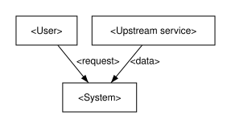

# <System> Architecture Specification

**Document ID:** <DOC-ID>
**Revision:** 0.1 (<YYYY-MM-DD>)

> Generated by `spec_build.py` from the section sources; edit those, not this file.

## Revision History

| Rev | Date | Author | Summary | Changed sections | Links |
|---|---|---|---|---|---|
| 0.1 | <YYYY-MM-DD> | <Author> | Initial draft |  |  |

## Table of Contents

- [1 Introduction](#1-introduction)
  - [1.1 Background](#11-background)
    - [Identification](#identification)
    - [System context](#system-context)
  - [1.2 Baseline](#12-baseline)
    - [Baselines](#baselines)
  - [1.3 Feature Set](#13-feature-set)
  - [1.4 Scope and Non-Goals](#14-scope-and-non-goals)
    - [Purpose and scope](#purpose-and-scope)
    - [Stakeholders and their concerns](#stakeholders-and-their-concerns)
  - [1.5 Assumptions and Constraints](#15-assumptions-and-constraints)
  - [1.6 Terms and Referenced Documents](#16-terms-and-referenced-documents)
    - [Requirements](#requirements)
- [2 Open Items](#2-open-items)
  - [Risks and unresolved evidence](#risks-and-unresolved-evidence)
- [3 Use Model](#3-use-model)
  - [Operational concept](#operational-concept)
- [4 Feature Architecture](#4-feature-architecture)
  - [4.1 Feature Decomposition](#41-feature-decomposition)
    - [4.1.1 <Feature name>](#411-feature-name)
    - [Allocation](#allocation)
  - [4.2 Feature Interfaces](#42-feature-interfaces)
    - [4.2.1 Internal Interfaces](#421-internal-interfaces)
    - [4.2.2 External Interfaces](#422-external-interfaces)
    - [Interfaces and contracts](#interfaces-and-contracts)
  - [4.3 Data Model](#43-data-model)
  - [4.4 Performance](#44-performance)
  - [4.5 Fault Behavior](#45-fault-behavior)
  - [Architecture views](#architecture-views)
  - [Model correspondence](#model-correspondence)
  - [Rationale](#rationale)
- [5 Security](#5-security)
  - [5.1 Considerations](#51-considerations)
  - [5.2 Features](#52-features)
  - [5.3 Interfaces](#53-interfaces)
- [6 Programming Model](#6-programming-model)
- [7 Verification Approach](#7-verification-approach)
  - [Verification approach](#verification-approach)
- [Appendix A — Requirement Traceability Matrix](#appendix-a--requirement-traceability-matrix)

## List of Tables

- Table 1 (T8): Glossary — 1.6 Terms and Referenced Documents
- Table 2 (T7): Open items — 2 Open Items
- Table 3 (T1): Requirement allocation — Allocation
- Table 4 (T2): Internal interface signatures — 4.2.1 Internal Interfaces
- Table 5 (T5): Data dictionary — 4.3 Data Model
- Table 6 (T3): Performance budget — 4.4 Performance
- Table 7 (T4): Trade study — Rationale
- Table 8 (T6): Threats and controls — 5.1 Considerations

## List of Figures

- Figure 1 (F1): System context — System context

## 1 Introduction

<One assertive sentence: what the system is and why this specification exists.>

<Prose with no word limit: what the system is and why this specification exists. Bind at most 5 requirements in the front
matter. Add one captioned table (T1-T8) when 3 or more items share 2 or more
attributes, and one captioned figure (F1-F8) when 3 or more entities have a
relationship, a time order, or states.>

### 1.1 Background

<One assertive sentence: the problem and history that motivate the system.>

<Prose with no word limit: the problem and history that motivate the system. Bind at most 5 requirements in the front
matter. Add one captioned table (T1-T8) when 3 or more items share 2 or more
attributes, and one captioned figure (F1-F8) when 3 or more entities have a
relationship, a time order, or states.>

#### Identification

<One assertive sentence: the system, its version, the authority for this document, and its status.>

<Prose with no word limit: the system, its version, the authority for this document, and its status. Bind at most 5 requirements in the front
matter. Add one captioned table (T1-T8) when 3 or more items share 2 or more
attributes, and one captioned figure (F1-F8) when 3 or more entities have a
relationship, a time order, or states.>

#### System context

<One assertive sentence: the system boundary and the external entities across it.>

<Prose with no word limit: the system boundary and the external entities across it. Bind at most 5 requirements in the front
matter. Add one captioned table (T1-T8) when 3 or more items share 2 or more
attributes, and one captioned figure (F1-F8) when 3 or more entities have a
relationship, a time order, or states.>

**Figure 1 (F1): System context**

### 1.2 Baseline

<One assertive sentence: the starting point this specification changes.>

<Prose with no word limit: the starting point this specification changes. Bind at most 5 requirements in the front
matter. Add one captioned table (T1-T8) when 3 or more items share 2 or more
attributes, and one captioned figure (F1-F8) when 3 or more entities have a
relationship, a time order, or states.>

#### Baselines

<One assertive sentence: the current state and the target state.>

<Prose with no word limit: the current state and the target state. Bind at most 5 requirements in the front
matter. Add one captioned table (T1-T8) when 3 or more items share 2 or more
attributes, and one captioned figure (F1-F8) when 3 or more entities have a
relationship, a time order, or states.>

### 1.3 Feature Set

<One assertive sentence: the features this specification delivers.>

<Prose with no word limit: the features this specification delivers. Bind at most 5 requirements in the front
matter. Add one captioned table (T1-T8) when 3 or more items share 2 or more
attributes, and one captioned figure (F1-F8) when 3 or more entities have a
relationship, a time order, or states.>

### 1.4 Scope and Non-Goals

<One assertive sentence: what is in scope and what is deliberately out.>

<Prose with no word limit: what is in scope and what is deliberately out. Bind at most 5 requirements in the front
matter. Add one captioned table (T1-T8) when 3 or more items share 2 or more
attributes, and one captioned figure (F1-F8) when 3 or more entities have a
relationship, a time order, or states.>

#### Purpose and scope

<One assertive sentence: what the specification governs and what it does not.>

<Prose with no word limit: what the specification governs and what it does not. Bind at most 5 requirements in the front
matter. Add one captioned table (T1-T8) when 3 or more items share 2 or more
attributes, and one captioned figure (F1-F8) when 3 or more entities have a
relationship, a time order, or states.>

#### Stakeholders and their concerns

<One assertive sentence: who the specification is written for and what each needs from it.>

<Prose with no word limit: who the specification is written for and what each needs from it. Bind at most 5 requirements in the front
matter. Add one captioned table (T1-T8) when 3 or more items share 2 or more
attributes, and one captioned figure (F1-F8) when 3 or more entities have a
relationship, a time order, or states.>

### 1.5 Assumptions and Constraints

<One assertive sentence: what is assumed true and what limits the design.>

<Prose with no word limit: what is assumed true and what limits the design. Bind at most 5 requirements in the front
matter. Add one captioned table (T1-T8) when 3 or more items share 2 or more
attributes, and one captioned figure (F1-F8) when 3 or more entities have a
relationship, a time order, or states.>

### 1.6 Terms and Referenced Documents

<One assertive sentence: the vocabulary and the documents this specification depends on.>

<Prose with no word limit: the vocabulary and the documents this specification depends on. Bind at most 5 requirements in the front
matter. Add one captioned table (T1-T8) when 3 or more items share 2 or more
attributes, and one captioned figure (F1-F8) when 3 or more entities have a
relationship, a time order, or states.>

**Table 1 (T8): Glossary**

| Term | Definition | Source |
|---|---|---|
| <term> | <definition> | <source> |

#### Requirements

<One assertive sentence: the requirements this specification binds, or a reference to the register that owns them.>

<Prose with no word limit: the requirements this specification binds, or a reference to the register that owns them. Bind at most 5 requirements in the front
matter. Add one captioned table (T1-T8) when 3 or more items share 2 or more
attributes, and one captioned figure (F1-F8) when 3 or more entities have a
relationship, a time order, or states.>

## 2 Open Items

<One assertive sentence: the decisions and questions still open.>

<Prose with no word limit: the decisions and questions still open. Bind at most 5 requirements in the front
matter. Add one captioned table (T1-T8) when 3 or more items share 2 or more
attributes, and one captioned figure (F1-F8) when 3 or more entities have a
relationship, a time order, or states.>

**Table 2 (T7): Open items**

| Item | Owner | Due | Impact |
|---|---|---|---|
| <item> | <owner> | <due> | <impact> |

### Risks and unresolved evidence

<One assertive sentence: what is known to be unsettled.>

<Prose with no word limit: what is known to be unsettled. Bind at most 5 requirements in the front
matter. Add one captioned table (T1-T8) when 3 or more items share 2 or more
attributes, and one captioned figure (F1-F8) when 3 or more entities have a
relationship, a time order, or states.>

## 3 Use Model

<One assertive sentence: who uses the system and how.>

<Prose with no word limit: who uses the system and how. Bind at most 5 requirements in the front
matter. Add one captioned table (T1-T8) when 3 or more items share 2 or more
attributes, and one captioned figure (F1-F8) when 3 or more entities have a
relationship, a time order, or states.>

### Operational concept

<One assertive sentence: how the system is used, by whom, to what end.>

<Prose with no word limit: how the system is used, by whom, to what end. Bind at most 5 requirements in the front
matter. Add one captioned table (T1-T8) when 3 or more items share 2 or more
attributes, and one captioned figure (F1-F8) when 3 or more entities have a
relationship, a time order, or states.>

## 4 Feature Architecture

<One assertive sentence: how the features are structured and connected.>

<Prose with no word limit: how the features are structured and connected. Bind at most 5 requirements in the front
matter. Add one captioned table (T1-T8) when 3 or more items share 2 or more
attributes, and one captioned figure (F1-F8) when 3 or more entities have a
relationship, a time order, or states.>

### 4.1 Feature Decomposition

<One assertive sentence: the features and the elements that realize them.>

<Prose with no word limit: the features and the elements that realize them. Bind at most 5 requirements in the front
matter. Add one captioned table (T1-T8) when 3 or more items share 2 or more
attributes, and one captioned figure (F1-F8) when 3 or more entities have a
relationship, a time order, or states.>

#### 4.1.1 <Feature name>

<One assertive sentence: one feature; copy this file once per feature as 04.1.n (n below 99).>

<Prose with no word limit: one feature; copy this file once per feature as 04.1.n (n below 99). Bind at most 5 requirements in the front
matter. Add one captioned table (T1-T8) when 3 or more items share 2 or more
attributes, and one captioned figure (F1-F8) when 3 or more entities have a
relationship, a time order, or states.>

#### Allocation

<One assertive sentence: each requirement assigned to the elements that realize it.>

<Prose with no word limit: each requirement assigned to the elements that realize it. Bind at most 5 requirements in the front
matter. Add one captioned table (T1-T8) when 3 or more items share 2 or more
attributes, and one captioned figure (F1-F8) when 3 or more entities have a
relationship, a time order, or states.>

**Table 3 (T1): Requirement allocation**

| Requirement | Element | Verification |
|---|---|---|
| <requirement> | <element> | <verification> |

### 4.2 Feature Interfaces

<One assertive sentence: what crosses each feature boundary.>

<Prose with no word limit: what crosses each feature boundary. Bind at most 5 requirements in the front
matter. Add one captioned table (T1-T8) when 3 or more items share 2 or more
attributes, and one captioned figure (F1-F8) when 3 or more entities have a
relationship, a time order, or states.>

#### 4.2.1 Internal Interfaces

<One assertive sentence: interfaces between features inside the system.>

<Prose with no word limit: interfaces between features inside the system. Bind at most 5 requirements in the front
matter. Add one captioned table (T1-T8) when 3 or more items share 2 or more
attributes, and one captioned figure (F1-F8) when 3 or more entities have a
relationship, a time order, or states.>

**Table 4 (T2): Internal interface signatures**

| Interface | Producer | Consumer | Payload |
|---|---|---|---|
| <interface> | <producer> | <consumer> | <payload> |

#### 4.2.2 External Interfaces

<One assertive sentence: interfaces across the system boundary; an F3 (SysML IBD) figure when one exists.>

<Prose with no word limit: interfaces across the system boundary; an F3 (SysML IBD) figure when one exists. Bind at most 5 requirements in the front
matter. Add one captioned table (T1-T8) when 3 or more items share 2 or more
attributes, and one captioned figure (F1-F8) when 3 or more entities have a
relationship, a time order, or states.>

#### Interfaces and contracts

<One assertive sentence: what crosses each boundary, under what agreement.>

<Prose with no word limit: what crosses each boundary, under what agreement. Bind at most 5 requirements in the front
matter. Add one captioned table (T1-T8) when 3 or more items share 2 or more
attributes, and one captioned figure (F1-F8) when 3 or more entities have a
relationship, a time order, or states.>

### 4.3 Data Model

<One assertive sentence: the persistent and exchanged data.>

<Prose with no word limit: the persistent and exchanged data. Bind at most 5 requirements in the front
matter. Add one captioned table (T1-T8) when 3 or more items share 2 or more
attributes, and one captioned figure (F1-F8) when 3 or more entities have a
relationship, a time order, or states.>

**Table 5 (T5): Data dictionary**

| Field | Type | Unit | Meaning |
|---|---|---|---|
| <field> | <type> | <unit> | <meaning> |

### 4.4 Performance

<One assertive sentence: compute, memory and storage, network, timing, and scale and throughput budgets.>

<Prose with no word limit: compute, memory and storage, network, timing, and scale and throughput budgets. Bind at most 5 requirements in the front
matter. Add one captioned table (T1-T8) when 3 or more items share 2 or more
attributes, and one captioned figure (F1-F8) when 3 or more entities have a
relationship, a time order, or states.>

**Table 6 (T3): Performance budget**

| Resource | Budget | Measured | Margin |
|---|---|---|---|
| <resource> | <budget> | <measured> | <margin> |

### 4.5 Fault Behavior

<One assertive sentence: how each feature fails and recovers.>

<Prose with no word limit: how each feature fails and recovers. Bind at most 5 requirements in the front
matter. Add one captioned table (T1-T8) when 3 or more items share 2 or more
attributes, and one captioned figure (F1-F8) when 3 or more entities have a
relationship, a time order, or states.>

### Architecture views

<One assertive sentence: each view with its stated viewpoint: what it shows, for which concern.>

<Prose with no word limit: each view with its stated viewpoint: what it shows, for which concern. Bind at most 5 requirements in the front
matter. Add one captioned table (T1-T8) when 3 or more items share 2 or more
attributes, and one captioned figure (F1-F8) when 3 or more entities have a
relationship, a time order, or states.>

### Model correspondence

<One assertive sentence: how specification elements map to the formal model, where one exists.>

<Prose with no word limit: how specification elements map to the formal model, where one exists. Bind at most 5 requirements in the front
matter. Add one captioned table (T1-T8) when 3 or more items share 2 or more
attributes, and one captioned figure (F1-F8) when 3 or more entities have a
relationship, a time order, or states.>

### Rationale

<One assertive sentence: why the architecture is as it is, for decisions a reader would otherwise question.>

<Prose with no word limit: why the architecture is as it is, for decisions a reader would otherwise question. Bind at most 5 requirements in the front
matter. Add one captioned table (T1-T8) when 3 or more items share 2 or more
attributes, and one captioned figure (F1-F8) when 3 or more entities have a
relationship, a time order, or states.>

**Table 7 (T4): Trade study**

| Option | Benefit | Cost | Decision |
|---|---|---|---|
| <option> | <benefit> | <cost> | <decision> |

## 5 Security

<One assertive sentence: how the system protects its assets.>

<Prose with no word limit: how the system protects its assets. Bind at most 5 requirements in the front
matter. Add one captioned table (T1-T8) when 3 or more items share 2 or more
attributes, and one captioned figure (F1-F8) when 3 or more entities have a
relationship, a time order, or states.>

### 5.1 Considerations

<One assertive sentence: threats and the controls that answer them.>

<Prose with no word limit: threats and the controls that answer them. Bind at most 5 requirements in the front
matter. Add one captioned table (T1-T8) when 3 or more items share 2 or more
attributes, and one captioned figure (F1-F8) when 3 or more entities have a
relationship, a time order, or states.>

**Table 8 (T6): Threats and controls**

| Threat | Asset | Control | Residual risk |
|---|---|---|---|
| <threat> | <asset> | <control> | <residual risk> |

### 5.2 Features

<One assertive sentence: the security features the system provides.>

<Prose with no word limit: the security features the system provides. Bind at most 5 requirements in the front
matter. Add one captioned table (T1-T8) when 3 or more items share 2 or more
attributes, and one captioned figure (F1-F8) when 3 or more entities have a
relationship, a time order, or states.>

### 5.3 Interfaces

<One assertive sentence: the trust boundaries and what crosses them.>

<Prose with no word limit: the trust boundaries and what crosses them. Bind at most 5 requirements in the front
matter. Add one captioned table (T1-T8) when 3 or more items share 2 or more
attributes, and one captioned figure (F1-F8) when 3 or more entities have a
relationship, a time order, or states.>

## 6 Programming Model

<One assertive sentence: how developers build on or extend the system.>

<Prose with no word limit: how developers build on or extend the system. Bind at most 5 requirements in the front
matter. Add one captioned table (T1-T8) when 3 or more items share 2 or more
attributes, and one captioned figure (F1-F8) when 3 or more entities have a
relationship, a time order, or states.>

## 7 Verification Approach

<One assertive sentence: how the specification is shown to hold.>

<Prose with no word limit: how the specification is shown to hold. Bind at most 5 requirements in the front
matter. Add one captioned table (T1-T8) when 3 or more items share 2 or more
attributes, and one captioned figure (F1-F8) when 3 or more entities have a
relationship, a time order, or states.>

### Verification approach

<One assertive sentence: how each requirement will be shown to hold, and at which level.>

<Prose with no word limit: how each requirement will be shown to hold, and at which level. Bind at most 5 requirements in the front
matter. Add one captioned table (T1-T8) when 3 or more items share 2 or more
attributes, and one captioned figure (F1-F8) when 3 or more entities have a
relationship, a time order, or states.>

## Appendix A — Requirement Traceability Matrix

| Requirement | Sections |
|---|---|
| None | — |
