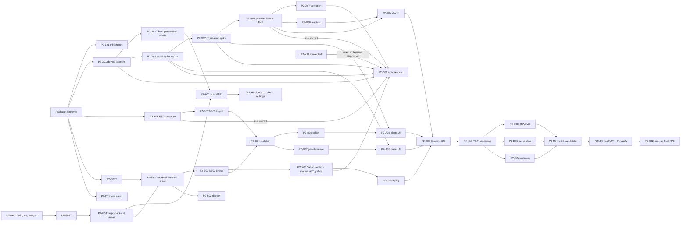

# Amazon Fantasy Companion — Technical Plan (Phase 2)

## Outcome

Phase 2 builds and submits the product the approved specification describes
(`spec/amazon-fantasy-companion/amazon-fantasy-companion.md`, owner approval
DEC-AFC-APPROVAL-ST5). When it is done:

- **A Fire TV app** (Kotlin/Gradle, from the starter
  `AmazonAppDev/hello-world-fire-tv`, minSdk 25) runs on the owner's 2018
  stick on Fire OS (SD-001, SD-003). It links to the backend by device code,
  holds the customer's profile and every customer control, shows a heads-up
  alert with Watch and Dismiss over a provider app's playback, opens the
  resolved provider game or channel and reports the routing outcome, and
  shows the right-side lineup panel beside provider video, or the
  full-screen panel when the spike shows that route does not exist
  (AFC-PR-047, DEC-AFC-SD-035).
- **An AWS serverless backend** on the owner's new Free-plan account
  (SD-005, C4) ingests ESPN's unofficial public JSON (SD-004) with labeled
  replay (C2), reads the lineup from Yahoo or labeled manual entry after
  T_yahoo (C6) with the PPR / Half-PPR presets (AFC-PR-065), matches
  identities, applies the alert policy (close game within 8 points in the
  4th quarter or overtime, stale after 60 s, excitement Off / Mild / Hype),
  resolves the provider and channel and serves the panel.
- **Spikes run first and are time-boxed.** Each writes a verdict that
  records exactly which routes work on the real stick (issue #1
  §Development integration obligation). Their verdicts select the panel
  mode, the provider link contracts and the notification route before
  product code depends on them.
- **The submission is ready before T_deadline:** README and setup
  instructions, judge access through T_judge_access, a demo video plan
  under three minutes, a write-up (with the YouTube TV Fantasy View
  differentiation and the DEC-AFC-SD-036 future direction, cited,
  discussion only), and the developer feedback assembled from the Scribe
  log (DEC-AFC-SD-025). The owner submits.
- **Every landed slice is visible in the revision record** (DEC-AFC-SD-038):
  a `CHANGELOG.md` `[Unreleased]` entry linking its pull request, and one
  release per technical wave prepared through the `release-process` skill. The
  owner authorizes each publication.
- **GitHub milestones M01..M13** (D3) are defined here and created only after
  this package is approved (P2-7).

Every slice traces register UIDs (`requirements-register.md`) and spec
sections. Phase 2 adds no product requirement; Lifecycle-local criteria
below cover write sets, seams, gates, schedule, submission and the revision
record only.

## Current task boundary

The owner requested planning completion and GitHub issue/milestone
organization, and appointed this Codex session planning lead (DEC-AFC-SD-039).
The integrated review approves the proposed plan and, if stated in the
approval, P2-L01 tracking setup. It does not start the app, backend, device
spikes, deployment or submission. Those remain on an explicit execution hold
until the owner requests the subsequent execution stage. This is the current
task boundary, not an additional plan-review round. Releases, credentials,
public export and other protected actions retain their separate authority.

## Requirements register

A requirements register exists: the Markdown register
`docs/plans/2026-10-12-amazon-fantasy-companion-phase-2/requirements-register.md`
(DEC-AFC-SD-027), 66 UIDs AFC-PR-001..066, gated by the Requirements
Engineer (`specialists/re-st2-receipt.md`, `re-st2b-receipt.md`,
`re-sd035-receipt.md`, and the Phase 2 allocation delta
`specialists/re-p2-delta-receipt.md`). AFC-PR-049, -050 and -051 are
withdrawn (DEC-AFC-SD-035) and get no Phase 2 work. The 63 active UIDs are
referenced by identity; their text is not restated here. Each slice lists
the UIDs it realizes; `seit.json` binds each active UID to its register
verification case VCASE-AFC-PR-NNN, method, environment and
positive/negative criteria.

This is an implementation Lifecycle phase, not a specification Lifecycle:
the register is Markdown and is not bound to the Requirements System host.
`authority.json` records the register path and sha256 as the baseline;
companion artifacts cite it by reference.

The SysML v2 models (`models/`) are aligned with the amended register by
the Phase 2 Systems Modeler delta (`specialists/sm-p2-delta-receipt.md`):
`tvApp.player` is removed, `PanelMode.modeA` becomes
`PanelMode.fullScreen`, and AFC-PR-066 is allocated. Slices trace to the
aligned element names.

## Glossary

### Quantity definitions (copied verbatim from the Scope Definition final batch)

| Name | Formula / value | Population / denominator | Units | Source |
|---|---|---|---|---|
| T_deadline | Devpost submission close | Single event | 2026-10-23T19:00:00Z | Issue #1 |
| T_yahoo | Manual-entry trigger | Single event | 2026-10-16T19:00:00Z | SD-007 |
| spike_panel_max | Elapsed time from first app install on the stick to the panel-route verdict | One spike | ≤ 24 h | SD-006 |
| min_sdk | Lowest supported Android API level | One APK | API 25 | SD-003 |
| T_judge_access | Last date judges must reach the repo and backend | Single date | 2026-11-20 | Issue #1 |
| aws_free_window | The earlier of 6 months after opening or credits used up | One account | Months | aws.amazon.com/free |
| impl_agent_cap | Concurrent implementation agents per orchestrating session; reviewers excluded | Per session | 5 | Rule 17 |
| gh_private_minutes | Included GitHub Actions minutes per month for a GitHub Free account's private repos; public repos use standard runners free | Per account per month | 2,000 min | GitHub billing docs |
| skill_size_max | Size limit for `SKILL.md`, frontmatter included | Per skill | < 60 lines and < 650 words | `create-lean-skill` |

### Owner-decided product parameters (DEC-AFC-SD-035, recorded in the register)

| Name | Formula / value | Population / denominator | Units | Source |
|---|---|---|---|---|
| close_game_margin | Largest score difference in the 4th quarter or overtime that counts as a close game | Per game | 8 points | DEC-AFC-SD-035 P1; AFC-PR-014 |
| excitement_levels | Customer-selectable commentary levels | Per customer | Off / Mild / Hype | DEC-AFC-SD-035 P2; AFC-PR-023 |
| stale_after | Age of a displayed value, from its last successful source fetch, at which it is labeled stale | Per displayed value | 60 s | DEC-AFC-SD-035 P3; AFC-PR-040 |
| legibility_min | Minimum rendered text size on the panel at 1080p | Per text class | body ≥ 24 px; scores ≥ 32 px | DEC-AFC-SD-035 Q3; AFC-PR-045 |
| scoring_presets | Manual-lineup scoring tables | Per customer | PPR, Half-PPR (default Half-PPR) | DEC-AFC-SD-035 D1; AFC-PR-065, -066 |

### Lifecycle-local design quantities (proposals; OD-AFC-05)

These are proposed engineering constants for contracts the specification
leaves open (spec §2.1, §4.2.3). None redefines a quantity above. They take
effect only when the owner approves OD-AFC-05.

| Name | Formula / value | Population / denominator | Units | Source |
|---|---|---|---|---|
| feed_poll_interval | Period between two backend fetches of one in-progress game's ESPN summary | Per in-progress game | 15 s | Planning and Design proposal |
| feed_fail_limit | Consecutive failed or schema-invalid fetches of one game before that game's values are marked stale | Per game | 3 fetches | Planning and Design proposal |
| alert_poll_wait | Longest time one `GET /v1/alerts` long-poll waits before returning empty | Per request | 20 s | Planning and Design proposal; API Gateway HTTP API 30 s limit |
| alert_min_gap | Customer frequency setting: minimum time between two released alerts for the same game | Per customer per game | 0–600 s, default 120 s | Planning and Design proposal; #1 item 6 |
| spoiler_delay | Customer spoiler delay between alert creation and release | Per customer | 0–120 s, default 0 s | Planning and Design proposal; #1 item 6 |
| device_code_ttl | Lifetime of one device-link code | Per code | 600 s | Planning and Design proposal |
| red_zone_yards | Exclusive distance boundary for the registered inside-20 red-zone criterion (19 qualifies; 20 and 21 do not) | Per play | 20 yards | AFC-PR-014 verification; TE-P2-F04 |
| panel_refresh | Period between two panel requests while the panel is visible | Per device | 30 s | Planning and Design proposal |
| alert_queue_max | Alerts retained on the TV for display and history | Per device | 20 alerts | Planning and Design proposal; AFC-PR-062 |
| api_timeout | TV client timeout per API request (long poll: alert_poll_wait + 5 s) | Per request | 10 s | Planning and Design proposal |
| api_retry_max | TV client retries per idempotent request, exponential backoff from 1 s | Per request | 3 retries | Planning and Design proposal; spec §4.2.3 |

### Terms

| Term | Meaning |
|---|---|
| Phase 2 | Implementation planning (P2-6, this package), milestone creation (P2-7) and product execution to submission (DEC-AFC-SD-023). |
| spike | A time-boxed investigation on the real stick or live feed that writes `spikes/<sp>/VERDICT.md` naming the routes that work, the routes that fail, the exact evidence and the conditional it triggers. A verdict is evidence, not product code (OD-AFC-04). |
| verdict | The spike's typed result: `WORKS`, `PARTIAL` (route and limit named), `FAILS`, or `TIMEBOX` (stopped at its time limit). |
| live window | A scheduled NFL game time usable for live evidence: Thu 2026-10-15 (TNF, ~2026-10-16T00:15Z), Sun 2026-10-18 (~17:00Z, ~20:05Z, ~2026-10-19T00:20Z), Mon 2026-10-19 (~2026-10-20T00:15Z), Thu 2026-10-22 (TNF, ~2026-10-23T00:15Z). Kickoffs are US Eastern times converted to UTC and are re-checked against the ESPN scoreboard at capture. |
| aws-afc-dev | The backend deployment in the owner's Free-plan account, reached through the owner-configured named CLI profile `afc-dev`. Agents never read, print or copy credential values. |
| fire-tv-stick | The owner's single 2018 Fire TV stick, reached by `adb` over the local network. |
| revision record | `CHANGELOG.md` (Keep a Changelog) plus releases cut through `release-process` (DEC-AFC-SD-038, cross-repo rule 21). |
| typed gap | A recorded result saying a check could not run, with its exact evidence. It is never counted as a pass. |
| Phase 1 gate | `tools/ci/gate.sh` with areas `spec`, `docs`, `hygiene`, local hooks (`core.hooksPath=.githooks`) and `.github/workflows/ci.yml`; landed by Phase 1 S09 (origin/main 17b40b4, 2026-10-12). |

## Requirements (Lifecycle-local)

Product requirements are the register's 63 active UIDs (by reference). The
rows below are Lifecycle-local criteria about the program, its gates, seams,
write sets and submission. Allocation names Phase 2 slices.

### Spikes and integration evidence

| ID | Statement | Source | Verification | Allocation |
|---|---|---|---|---|
| AC-AFC-P2-SPIKE-01 | Before any product slice depends on a device, provider, feed, lineup or voice route, the program shall run the spike for that route on the real target and land `spikes/<sp>/VERDICT.md` stating the verdict, the exact route tried, the observed result with evidence paths, the conditional it triggers (C1, C2, C5, C6, C8) and the register UIDs it unblocks. | #1 §Development integration obligation, §Development setup; SD-001; spec §2.1 | inspection | P2-X01..P2-X07, P2-X11 (conditional on OD-AFC-03) |
| AC-AFC-P2-SPIKE-02 | The panel-beside-provider-video spike shall return its verdict within spike_panel_max of the first app install on the stick (recorded by P2-X01), and the verdict shall select `PanelMode.modeB` only with on-device evidence of simultaneous provider video and panel with no overlap or crop; otherwise it shall select `PanelMode.fullScreen` (AFC-PR-047). | SD-006, DEC-AFC-SD-035 Q4, C5, AFC-PR-041, -047 | inspection, demonstration | P2-X01, P2-X04 |
| AC-AFC-P2-SPIKE-03 | The provider-link spike shall try Prime Video (TNF), ESPN app, DirecTV Stream app and YouTube TV in that order plus local-broadcast channel display, and shall record for each provider the package identity, the supported launch URI or intent with its documentation source, the observed routing outcome from the six-value vocabulary, and whether game arrival was observed; it shall invent no URI format. | DEC-AFC-SD-035 Q5, AFC-PR-029..031, spec §4.1.8 | inspection, demonstration | P2-X03 |

### Repository gate, Vnv and landing

| ID | Statement | Source | Verification | Allocation |
|---|---|---|---|---|
| AC-AFC-P2-GATE-01 | The gate entrypoint `tools/ci/gate.sh` shall gain the areas `tvapp` (Gradle unit tests, Android lint and debug assemble under `tv-app/`) and `backend` (pytest and SAM template validation under `backend/`), invoked by the same local hooks and Actions workflow with path filters, stable check names and pinned actions per AC-AFC-CI-02; each area shall exit non-zero on any failing check, shall record a missing tool as a typed gap with its exact error and exit non-zero, and shall report `PASS` with the detail `no <dir>/ tree` only when its directory does not exist. | DEC-AFC-SD-023 (Phase 2 adds product areas), Phase 1 AC-AFC-CI-01/02, CONTRACT-AFC-GATE | test | P2-G01T, P2-G01 |
| AC-AFC-P2-VNV-01 | The Vnv guidance tree shall gain `docs/vnv/tv-app/AGENTS.md`, `docs/vnv/backend/AGENTS.md` and `docs/vnv/device-integration/AGENTS.md`, each naming Scope, Tools, Review Focus and findings target, and the index `docs/vnv/AGENTS.md` shall list them. | SD-014, Phase 1 deferred table | inspection | P2-D01 |
| AC-AFC-P2-LAND-01 | The program shall land each Phase 2 slice on `main` through a pull request merged by rebase or merge commit after one Reviewer review at its integration step, at most one repair round and a green gate run, with no squash merge, force-push or commit on local `main`. | Cross-repo rules 4 and 9; DEC-AFC-APPROVAL-001 (OA-AFC-A3 = A) | inspection | All slices; landing records |
| AC-AFC-P2-REV-01 | Every Reviewer packet shall carry OCR in delegation mode (`ocr delegate preview --from <base> --to <head>`, `ocr delegate rule <files>`) and either a Reverify run for any claim about a built APK or `Reverify: not applicable — <reason>`; an OCR or Reverify run that cannot complete shall be recorded as a typed gap with its exact error. | Cross-repo rule 15; frozen `review.coverage_assist`, `deterministic_verification.reverify` | inspection | All Reviewer packets |
| AC-AFC-P2-VIS-01 | Every slice that changes rendered TV UI shall be reviewed on the real stick before merge: each changed screen and state captured with `adb exec-out screencap -p` at the device's output resolution under `evidence/visual/<slice>/`, judged against the spec and AFC-PR-043/-045, with no account or customer data in captures. | Cross-repo rule 16; DEC-AFC-SD-024; AFC-PR-045 | demonstration | P2-A01..P2-A05, P2-X09 |
| AC-AFC-P2-BUG-01 | Every defect found during Phase 2 (failing gate or landing, acceptance check, flaky test, review finding) shall be triaged with `bug-hunter-triage` and its fix and review dispatched on the bug-triager routes, with a packet carrying reproduction, origin and escape, product vs test-only classification, a red-then-green regression and a prevention check; a packet that keeps a lane route states `BUG_ROUTE: <reason>`. | DEC-AFC-SD-037; cross-repo rule 20 | inspection | Defects lane (on demand) |
| AC-AFC-P2-PATH-01 | The program shall commit no file containing an absolute local home path; plan artifacts and evidence use repository-relative paths or `$HOME` / `<PHASE2_PLAN_WORKTREE>` placeholders. | Cross-repo rule 12; SD-010; C7; AFC-PR-056 | test | All slices; `hygiene` area |
| AC-AFC-P2-SUPPLY-01 | The program shall obtain a scan-software-supply-chain receipt before first use of each external acquisition (Android SDK command-line tools and platform-tools, the starter repository at its pinned commit, Gradle wrapper and plugin versions, AWS SAM CLI, cfn-lint, Python test dependencies, each pinned GitHub Action) and refuse use on BLOCK or INDETERMINATE. | Cross-repo rule 10 | inspection | P2-X01, P2-A01, P2-B01, P2-G01 |

### Revision record and releases

| ID | Statement | Source | Verification | Allocation |
|---|---|---|---|---|
| AC-AFC-P2-REL-01 | Every Phase 2 pull request that lands shall add one `CHANGELOG.md` `## [Unreleased]` entry (Keep a Changelog section Added, Changed, Fixed or Removed) naming the change and linking the pull request; the first Phase 2 landing seeds `CHANGELOG.md` when it is absent. | DEC-AFC-SD-038; cross-repo rule 21 | inspection | Landing procedure (ship-pull-request) for every slice |
| AC-AFC-P2-REL-02 | At each technical-wave release checkpoint W1..W5 the program shall prepare a release through the `release-process` skill: version, tag name and release notes drawn from the changelog, with the `[Unreleased]` entries moved under the version heading; it shall publish the release only after the owner authorizes that publication. | DEC-AFC-SD-038; cross-repo rules 4 and 21 | inspection | P2-R1..P2-R5 |
| AC-AFC-P2-SPEC-01 | When the panel (P2-X04), provider (P2-X03) and notification (P2-X02) spike verdicts have landed, the D1 specification shall be revised to record every landed spike verdict from P2-X01..P2-X07 (plus P2-X11 when it runs), the verdict-selected panel mode and provider routes with every recorded limitation, the aligned model names (`PanelMode.fullScreen`, no `tvApp.player`, AFC-PR-066 allocation) and the Glossary Lifecycle-local design quantities as approved under OD-AFC-05, with a revision row listing the changed sections and linking the pull request and its diff, and `gate.sh spec` shall pass with a byte-identical rebuild. | DEC-AFC-SD-038; spec §2.1, §4.7; Phase 1 deferred AC-AFC-SPEC-03 | inspection, test | P2-D02 |

### Program plan and milestones

| ID | Statement | Source | Verification | Allocation |
|---|---|---|---|---|
| AC-AFC-P2-PLAN-01 | The technical plan shall define Phase 2 waves in which every slice belongs to exactly one wave, no wave schedules more than impl_agent_cap concurrent implementation agents, and serialization is declared only for dependencies, shared interfaces, write-set overlap, the leases `fire-tv-stick`, `aws-afc-dev`, `live-game-window`, `tv-app-manifest`, `tv-app-gradle`, `backend-template` and `main-landing`, or impl_agent_cap. | SD-012 (D2); rule 17 | inspection | Planning |
| AC-AFC-P2-MS-01 | After the owner approves this package, the program shall create GitHub milestones M01..M13 in `1wgrumph/amazon-fantasy-companion` whose title, due date (calendar date; the UTC due time is stated in the description) and description (entry criteria, exit criteria, issues in order) equal the approved table `GitHub milestones in order (D3; create only after approval)`, and shall record a `gh api` readback that matches it field for field; no milestone is created before approval. | SD-012 (D3); DEC-AFC-SD-023 (P2-7) | inspection | P2-L01 |
| AC-AFC-P2-SCHED-01 | The plan shall state the remaining days to T_deadline and the remaining live windows, schedule each spike before the live window it needs, and present any scope reduction as an owner decision rather than cutting scope silently. | Phase 1 RISK-AFC-17; #1 §Development setup | inspection | Planning; P2-6 integrated review |

### Submission and developer feedback

| ID | Statement | Source | Verification | Allocation |
|---|---|---|---|---|
| AC-AFC-P2-SUB-01 | The repository shall contain a README with a product description, fresh-setup instructions for the TV app and the backend (from a clean checkout, using only repository-relative paths and documented owner-supplied inputs), the judge-access route through T_judge_access, the known limitations recorded by the spike verdicts, and the voice/Alexa status (implemented and verified on the device, or not offered). | #1 §Acceptance; Phase 1 deferred AC-AFC-SUB-01 | inspection, demonstration | P2-D03 |
| AC-AFC-P2-SUB-02 | The program shall produce a demo video plan of at most 2 min 50 s covering the alert → Watch → correct game or channel moment and the lineup panel moment from issue #1 §Judging alignment, naming for each shot its source (on-device capture, owner camera capture, or labeled replay) and the register UIDs it shows; no shot claims behavior that has no passing evidence. | #1 §Judging alignment, §Acceptance (public video under three minutes) | inspection | P2-D05, P2-X12 |
| AC-AFC-P2-SUB-03 | The submission write-up shall describe the implemented Fire TV and AWS Builder integrations from their evidence, state the YouTube TV Fantasy View differentiation (roster scores beside the game there; tune-in alerts and cross-provider Watch here), and discuss the DEC-AFC-SD-036 future direction (AWS-powered analytics viewing on Prime Video; Amazon's NBA rights) with public citations, marked as external context and not product capability. | DEC-AFC-SD-035 (competitive), DEC-AFC-SD-036, SD-008 | inspection | P2-D04 |
| AC-AFC-P2-DX-01 | Every Phase 2 dispatch packet and return shall carry a `developer_feedback` section listing observations with IDs and evidence, or "no new observations" naming the tools exercised. | #1 §Scribe contract | inspection | All slices; Scribe log |
| AC-AFC-P2-DX-02 | Before W5 exit the Scribe shall assemble, from `docs/developer-feedback/observations.md`, a per-tool Product Feedback file (used for, what worked well, what needs work, onboarding from zero to hello world, would build again Yes/No and why, AWS services used and how), optional Feature Requests with priority Critical / Important / Nice-to-have, and a sanitized Friction Log with the Devpost entry fields, covering every tool, API, SDK and device used in Phase 2, with no credentials, account details or local paths, and shall check the Product Feedback file and the Friction Log against the official rules current at submission. | DEC-AFC-SD-025; #1 §Scribe contract | inspection | P2-SCR1 |
| AC-AFC-P2-SUB-04 | The program shall produce a submission checklist listing every owner-only action (OA-1..OA-11 and the §Exclusions owner-only actions) with its due time before T_deadline, and agents shall perform none of those actions. | #1 §Acceptance; Phase 1 deferred AC-AFC-SUB-02; DEC-AFC-SD-009 | inspection | P2-D05 |
| AC-AFC-P2-APK-01 | The submitted APK shall be built from a tagged commit on `main`, its sha256 recorded, and Reverify run on that exact APK for every claim the submission makes about it (minSdk 25, package identity, declared permissions and services), with a Reverify failure or unavailability recorded as a typed gap. | Cross-repo rule 15; frozen `deterministic_verification.reverify`; AFC-PR-053 | inspection | P2-L05 |

### Risks

| ID | Statement (control) | Source | Verification | Allocation | Risk (rationale) | Response |
|---|---|---|---|---|---|---|
| RISK-AFC-P2-01 | If P2-X01 finds Fire OS 5, an API level below min_sdk, or a stick that cannot run the provider apps, then the program shall stop dependent device slices and raise a class C owner stop; it shall not buy a device or switch platform. | C1, SD-003 | inspection | P2-X01 | The 2018 stick model is unconfirmed (Q6). | Owner decides; device-independent backend and docs work continues. |
| RISK-AFC-P2-02 | If P2-X02 shows no supported heads-up notification over provider playback, then the verdict shall name the exact limitation and the program shall raise a class C owner stop before AFC-PR-015 product code; it shall not substitute a phone screen or a companion-app-only alert silently. | #1 §Source review (Fire OS notifications); AFC-PR-015 | inspection, demonstration | P2-X02 | Fire OS notification behavior over third-party playback is documented only for 2020. | Owner decides scope; the rest continues. |
| RISK-AFC-P2-03 | If no supported provider game or channel link exists for a provider, then the resolver and launcher shall report the strongest observed outcome (`searchOpened`, `appHomeOpened`, `appAbsent`, `accessUnknown`, `playbackDenied`) honestly and the verdict shall record the missing interface as an integration gap; no outcome is relabeled `gameOpened`. | DEC-AFC-SD-035 Q5; AFC-PR-030, -031 | inspection | P2-X03, P2-B06, P2-A04 | Provider deep-link contracts may be private. | Honest outcome; integration gap documented for the write-up. |
| RISK-AFC-P2-04 | If the panel spike fails or reaches spike_panel_max, then the panel shall be built as `PanelMode.fullScreen` (AFC-PR-047) with alerts and Watch still routed to the real provider apps (AFC-PR-048). | C5; DEC-AFC-SD-035 Q4 | inspection | P2-X04, P2-A05 | Third-party video composition is not a documented public capability. | Full-screen panel; limitation stated. |
| RISK-AFC-P2-05 | If the ESPN endpoint is unavailable or its contract changes, then ingest shall serve labeled replay fixtures for every affected value (AFC-PR-013) and reject schema-invalid responses without mutation (AFC-PR-064); the ESPN terms question shall be presented to the owner before submission (C3). | C2, C3 | test, inspection | P2-X05, P2-B02 | Unofficial JSON can change without notice. | Labeled replay; owner reviews terms. |
| RISK-AFC-P2-06 | If Yahoo approval is absent at T_yahoo, then P2-X06 shall record a FAILS verdict for the Yahoo route selecting labeled manual entry, and the backend shall use labeled manual entry as the single active source (AFC-PR-006, -007). | C6; SD-007 | inspection | P2-X06, P2-B03 | Yahoo review time is outside our control (Q7 not yet submitted). | Manual lineup with presets. |
| RISK-AFC-P2-07 | If any AWS action would require a Paid plan, a paid service or a payment method change, then the slice shall stop and raise a class F owner stop; no agent upgrades the account. | C4; SD-005; AFC-PR-054 | inspection | P2-B01, P2-L02, P2-L03 | The Free plan may refuse a service or quota. | Owner decides. |
| RISK-AFC-P2-08 | If a live window is missed or a game produces no qualifying event, then the slice shall use labeled replay of captured fixtures for repeatability and schedule the live check in the next live window; replay never stands in for live notification or provider behavior evidence. | #1 §Judging alignment; C2 | inspection | P2-X03, P2-X05, P2-X09, P2-X10 | Only four live windows remain after approval. | Replay for logic; live windows reserved for device evidence. |
| RISK-AFC-P2-09 | If `adb` screencap or screenrecord returns black or blank frames for protected provider video, then the visual evidence shall combine the companion UI capture with window geometry from `dumpsys` and, if OD-AFC-P2-02 = A, an owner camera capture of the screen (OA-9); the demo plan shall mark any owner-filmed shots as owner-filmed and, if OD-AFC-P2-02 = B, shall use companion UI captures only for those shots. | Rule 16; AFC-PR-041; issue #1 demo | inspection | P2-X04, P2-X09, P2-X12, P2-D05 | Provider apps commonly use secure surfaces that screen capture cannot read. | Geometry plus owner camera capture under A, companion UI only under B (OD-AFC-P2-02). |
| RISK-AFC-P2-10 | If a selected route reaches a confirmed usage or rate limit, then the Orchestrator shall record the evidence and activate only the next approved fallback of the frozen profile with a class B receipt preserving coverage-assist and Reverify settings, or queue the slice; other errors shall not trigger a route switch. | Frozen profiles; owner-stops class B | inspection | All dispatches | Muse quota exhaustion occurred on 2026-10-11. | Next approved fallback or queue. |
| RISK-AFC-P2-11 | If Phase 1 slice S09 (gate entrypoint) has not merged when a Phase 2 slice is ready to land, then the slice shall wait for S09 and P2-G01; it shall not land without a green gate run, and development continues on its branch with local test evidence. | Phase 1 plan; AC-AFC-P2-LAND-01 | inspection | P2-G01; landing | S09 has merged; the Phase 2 product gate extension P2-G01 remains a prerequisite. | Landing waits; work does not. |
| RISK-AFC-P2-12 | When a secret, account detail, customer data or absolute local path is detected in material bound for the repository, release, video or submission, the program shall block that merge or publication until sanitized, and if exposure has occurred shall record the artifact without reproducing the value and notify the owner for rotation. | Rules 2 and 12; AFC-PR-055, -056; C9 | test, inspection | `hygiene` area; P2-D03..P2-D05, P2-SCR1 | Yahoo tokens, AWS profile names and provider account names can leak into captures and logs. | Block and sanitize; rotation is the owner's action. |
| RISK-AFC-P2-13 | If a technical-wave release checkpoint W1..W5 is at risk of missing its due time by more than 12 h, then the Orchestrator shall present the owner a scope-reduction decision using the priority order in §Program plan, not cut scope silently. | AC-AFC-P2-SCHED-01; Phase 1 RISK-AFC-17 | inspection | Orchestrator wave receipts | The deadline, device spikes and live windows constrain the schedule; the as-of remaining time is stated in Program plan. | Owner decides cuts. |

## Exclusions

- Messenger, message boards, community rooms, shared chat and watch-party
  social features (issue #1, AFC-PR-057).
- Mode A sample footage and any companion video player
  (DEC-AFC-SD-035 Q4; AFC-PR-049..051 withdrawn).
- Hardware performance benchmarking or measured latency/RAM claims
  (issue #1 §Lightweight device design).
- An LLM or any API-key service for commentary or anything else (owner:
  "We are not using anything that needs api keys"; OD-AFC-02).
- Alexa+ track, Open Source mini challenge (SD-008); Alexa voice beyond the
  conditional stretch of OD-AFC-03 (C8).
- New product requirements. A behavior the register does not hold returns
  to the owner as a scope question.
- Owner-only actions: credential creation or retrieval, AWS plan changes,
  repository visibility flip, license choice (already settled as Apache-2.0), release
  publication, video upload, external feedback, Devpost submission (C9).
- The engineering-methods S8 ledger restore (Q10): a separate Alphazedehq
  task, not this Lifecycle.

## Program plan (D2) — milestones, lanes and waves

Times are UTC. Schedule refreshed at 2026-10-13T04:00:00Z: **10 days and
15 hours remain to T_deadline** (2026-10-23T19:00:00Z). Remaining planned
live windows are Thu 2026-10-15 TNF, Sun 2026-10-18, Mon 2026-10-19 MNF,
and Thu 2026-10-22 TNF; kickoff times are rechecked before capture. The
October 12 window is no longer a prerequisite or promised live capture;
completed-game data may be used only as labeled historical/replay evidence.
T_yahoo is 2026-10-16T19:00:00Z. Milestone dates and full product scope remain
unchanged; losing that optional window is recorded schedule pressure.

Ready, independent work is dispatched at once. Work is serialized only on
a dependency, a shared interface, a write-set overlap, a lease or
impl_agent_cap (5 implementation agents, including Light Implementers and
repair runs; reviewers, the Scribe and planning roles are not counted).

Leases (held by the Orchestrator, granted to one slice at a time):

| Lease | Resource | Holders |
|---|---|---|
| `fire-tv-stick` | The single stick (adb, installs, provider sessions) | P2-X01..X04, X07, X09, X10, X11, X12; on-device visual review steps of P2-A01..A05 |
| `aws-afc-dev` | The Free-plan account deployment | P2-L02, P2-L03, deployed-API test runs, P2-X09, P2-X10 |
| `live-game-window` | A live NFL window | Shared by slices whose other leases are disjoint (P2-X05 host-only capture may hold it together with P2-X03, P2-X09, P2-X10 or P2-X12 on the stick); it serializes only competing demands on fire-tv-stick or aws-afc-dev during the game |
| `tv-app-manifest` | `tv-app/app/src/main/AndroidManifest.xml` | P2-A01T creates empty bootstrap manifest; P2-A01 completes every component and permission after verified red; then one of P2-A02..A05 at a time |
| `tv-app-gradle` | `tv-app/app/build.gradle.kts`, `tv-app/gradle/libs.versions.toml` | P2-A01T creates empty build/test harness; P2-A01 completes runtime/build and release-signing configuration after verified red; P2-A02..A05 own entries one at a time; P2-R1..R5 version bump |
| `backend-template` | `backend/template.yaml`, `backend/samconfig.toml`, `backend/requirements.txt`, `backend/requirements-dev.txt`, `backend/src/api/openapi.yaml`, `backend/src/store/`, `backend/src/pipeline/`, `backend/tests/conftest.py`, `backend/tests/deployed/conftest.py` | P2-B01T creates test/bootstrap/shared conftest under its bounded write set; P2-B01 creates the product shared artifacts; later authorized edits one at a time, declared in the PR body; module Test Implementers own distinct deployed directories and do not edit shared conftest without this lease. |
| `main-landing` | Merging to `main` and the `CHANGELOG.md` append | Landing procedure; one merge at a time; before each merge CMD-PR-CHECKS (every check on the head commit passes, including gate / hygiene and each path-selected gate / <area>); merge only with gh pr merge --rebase or --merge; delete the remote branch. While the repository is private, GitHub enforces no ruleset; after the OA-5 visibility flip the Orchestrator applies the main ruleset (PR-only, required checks, no squash). |

### Technical waves and release checkpoints (W1..W5)

| Checkpoint | Title | Due (UTC) | Entry criteria | Exit criteria | Slices |
|---|---|---|---|---|---|
| W1 | Foundations and device baseline | 2026-10-14T23:00:00Z | This package approved and landed (entry criterion 2); OA-1 (stick located, ADB enabled, model and Fire OS recorded) and OA-4 (Prime Video signed in) for P2-X01; Phase 1 S09 merged (met: origin/main 17b40b4). | Gate areas `tvapp` and `backend` on `main`; Vnv areas added; `tv-app/` scaffold builds and installs on the stick; backend skeleton with device-code link passes tests; P2-X01 verdict landed with first-install time; ESPN capture tool and first fixtures landed; milestones created and read back; release prepared (P2-R1). | P2-L01, P2-X01, P2-X05, P2-D01, P2-G01T, P2-G01, P2-A01T, P2-A01, P2-B01T, P2-B01, P2-R1 |
| W2 | Spike verdicts and backend baseline | 2026-10-17T01:00:00Z (T_yahoo + 6 h for the P2-X06 verdict pull request and P2-R2) | P2-X01 merged for P2-X04 and the device chain; P2-B01 merged for backend Wave 2 slices; P2-A01 merged for P2-A02; no blanket P2-R1 prerequisite for P2-X04; OA-3 (AWS account and `afc-dev` profile) and OA-10 (owner confirms the TV link code; no passphrase, DEC-AFC-SD-048) for P2-L02; OA-4 (ESPN, DirecTV Stream, YouTube TV signed in) for P2-X03. | Verdicts landed for panel (within spike_panel_max), notification, provider links (TNF check included), detection, ESPN live timing, Yahoo or manual; ingest and lineup slices merged; profile/settings UI merged with visual review; backend deployed to aws-afc-dev with link and profile smoke; release prepared (P2-R2). | P2-X04, P2-X02, P2-X03, P2-X07, P2-X06, P2-B02T, P2-B02, P2-B03T, P2-B03, P2-A02T, P2-A02, P2-L02, P2-R2 |
| W3 | End-to-end on the stick | 2026-10-19T12:00:00Z | W2 verdicts; T_yahoo outcome applied. | On Sun 2026-10-18 with simultaneous live games: alert over provider playback → Watch → recorded routing outcome on the stick; panel in the verdict's mode with live points and freshness; matcher, policy, resolver, panel service, alert, Watch and panel UI merged; release prepared (P2-R3). | P2-B04T, P2-B04, P2-B05T, P2-B05, P2-B06T, P2-B06, P2-B07T, P2-B07, P2-A03T, P2-A03, P2-A04T, P2-A04, P2-A05T, P2-A05, P2-L03, P2-X09, P2-R3 |
| W4 | Feature complete and hardened | 2026-10-21T23:00:00Z | W3 exit. | Corrections and starter changes verified live or by labeled replay plus live check on Mon 2026-10-19; every active register case has passing evidence or an owner-accepted typed gap; no unresolved actionable review defect at any priority without explicit owner acceptance of residual risk; D1 revision landed (AC-AFC-P2-SPEC-01); Alexa stretch verdict if OD-AFC-03 = yes; release prepared (P2-R4). | P2-X10, P2-D02, P2-X11 (conditional), P2-R4 |
| W5 | Submission ready | 2026-10-23T12:00:00Z | W4 exit; OA-5 (LICENSE file and visibility flip) before judge-access verification; OA-6 (ESPN terms) before the write-up is final. | README and setup verified from a clean checkout; write-up, demo plan and clips ready; developer feedback assembled and sanitized; final APK tagged, hashed and Reverify run; Assurance Test Engineer and Integration Engineer execution verdicts on the W5 candidate; release prepared (P2-R5); owner checklist for submission handed over. | P2-D03, P2-D04, P2-D05, P2-SCR1, P2-R5, P2-L05, P2-X12 |

W5 leaves 7 h before T_deadline for the owner's upload, publication and
submission. These five technical release checkpoints govern release prerequisites
independently of the 13 GitHub milestone groups below. X05 contributes only its
early historical-fixture checkpoint to W1; its live verdict remains later.

### GitHub milestones in order (D3; create only after approval)

Target three logical issues per milestone; allowed range two to six (DEC-AFC-SD-040).
Issue count is not an effort estimate. Dependencies and leases, not milestone
number alone, determine readiness. Exact UTC times accompany GitHub due dates.

| Milestone | Title | Due (UTC) | Entry criteria | Exit criteria | Issues in order |
|---|---|---|---|---|---|
| M01 | M01 Day one: tracking, verification guidance and product gate | 2026-10-14T20:00:00Z | Owner integrated approval recorded and planning PR merged to main (IE-P2-1). | 13 milestones and 39 issues created and read back (CMD-MILESTONES-READBACK, PROC-TRACKING-SETUP); Vnv areas pass CMD-GATE-DOCS; gate areas tvapp/backend on main with CMD-WORKFLOW-CHECK and supply-chain scan PASS. | P2-L01, P2-D01, P2-G01 |
| M02 | M02 Fire TV stick qualified and backend skeleton with device linking | 2026-10-14T20:00:00Z | Same start as M01 (planning PR merged); X01 is the time-critical item; only P2-B01 landing waits for P2-G01. | P2-X01 verdict landed with device identity, qualified host tools and first_install_at; backend skeleton with device-code link green (CMD-GATE-BACKEND, CMD-SAM-VALIDATE) and contracts.b01 recorded. | P2-X01, P2-B01 |
| M03 | M03 Panel spike, TV app scaffold and release v0.1.0 | 2026-10-14T23:00:00Z | P2-X01 merged (stick released to X04). | X04 verdict landed (modeB with geometry evidence, or TIMEBOX/fullScreen); tv-app scaffold green, installed and visually reviewed on the stick; X05 PR 1 fixtures on main; v0.1.0 release prepared (Wave 1 exit = release checkpoint W1). | P2-X04, P2-A01, P2-R1 |
| M04 | M04 Stick spikes and Thursday Oct 15 live checks | 2026-10-17T01:00:00Z | Stick released by P2-X04 and the P2-A01 review step (M03). | Final notification, provider-link (TNF included), detection and ESPN live-timing verdicts landed; registry.v2 and fixtures.v2 digests recorded. | P2-X02, P2-X03, P2-X07, P2-X05 |
| M05 | M05 Feed ingest, lineup sources and first AWS deploy | 2026-10-17T01:00:00Z | P2-B01 merged (runs in parallel with M03 and M04; backend lane). | Ingest and lineup slices merged; backend deployed to aws-afc-dev with link and profile smoke (deploy.1). | P2-B03, P2-L02, P2-B02 |
| M06 | M06 Profile settings, lineup-source verdict and release v0.2.0 | 2026-10-17T01:00:00Z | P2-A01 merged; M05 deploy available. | Profile/settings UI merged with visual review; Yahoo or manual verdict landed; v0.2.0 prepared (release checkpoint W2). | P2-A02, P2-X06, P2-R2 |
| M07 | M07 Event matching, alert policy and panel service | 2026-10-18T09:00:00Z | Wave 3 entry as written: W2 spike verdicts landed and T_yahoo outcome applied (M04, M06); B02/B03 merged (M05). | Matcher, policy and panel service merged with CMD-CONTRACT-FROZEN PASS. | P2-B04, P2-B05, P2-B07 |
| M08 | M08 Provider resolver, TV alerts and Watch | 2026-10-18T09:00:00Z | Wave 3 entry (same as M07); runs in parallel with M07. | Resolver, alert UI and Watch merged with instrumented runs and visual review on the stick. | P2-B06, P2-A03, P2-A04 |
| M09 | M09 TV lineup panel and integrated backend deploy | 2026-10-18T11:00:00Z | Wave 3 entry; A05T in parallel with M07/M08. | Panel UI merged in the verdict mode; aws-afc-dev redeployed at the Wave 3 backend head with deployed suite PASS. | P2-A05, P2-L03 |
| M10 | M10 Sunday Oct 18 live end-to-end and release v0.3.0 | 2026-10-19T12:00:00Z | M08 and M09 complete. | Sunday run record: alert over playback -> Watch -> recorded outcome; panel live; v0.3.0 prepared (release checkpoint W3). | P2-X09, P2-R3 |
| M11 | M11 Monday Oct 19 hardening, conditional Alexa, spec revision and release v0.4.0 | 2026-10-21T23:00:00Z | Wave 4 entry: Wave 3 exit (P2-R3 merged). | Corrections/starter changes verified; D1 revision landed; X11 disposition recorded; no unresolved actionable review defect without owner acceptance; v0.4.0 prepared (release checkpoint W4). | P2-X10, P2-X11, P2-D02, P2-R4 |
| M12 | M12 Submission documents and developer feedback | 2026-10-22T16:00:00Z | Wave 5 entry as written: Wave 4 exit (P2-R4 merged). | README, write-up, demo plan, owner checklist and sanitized developer feedback merged. | P2-D03, P2-D04, P2-D05, P2-SCR1 |
| M13 | M13 Release candidate v1.0.0, final APK, demo capture and handover | 2026-10-23T12:00:00Z | M12 complete; IE-P2-39 (OA-5) and IE-P2-40 (final deploy if backend changed) run here as non-issue steps. | Final APK built, hashed and Reverify run; demo manifest landed; Assurance Test Engineer and Integration Engineer verdicts (IE-P2-44); owner checklist handed over. | P2-R5, P2-L05, P2-X12 |

Early checkpoint CP-X05-HIST: X05 PR 1 historical fixtures land after B01 and
feed R1 (M03) and B02 (M05); X05 closes at the TNF live verdict in M04.
CP-X03-REG is the X03 PR 1 desk/registry checkpoint consumed before its live verdict.

Parallel lanes: M03, M05 and early M04 overlap as prerequisites allow; M07,
M08 and the start of M09 overlap under their exact dependencies. The stick
chain remains serial, and the five-agent cap and every existing lease remain.

Schedule risk: X04 holds the stick until its verdict or first_install_at +
24 hours; A01 review follows it before R1. A first install on October 14 with
the full timebox can miss R1 at 2026-10-14T23:00Z. Latest X01 start remains
2026-10-14T03:15Z; no cut-off, live window or release date is moved here.

### GitHub work organization (P2-L01)

After integrated approval and the planning PR landing, P2-L01 creates the
13 milestones and the 39 logical work issues defined by the frozen implementation
graph. One issue represents each logical deliverable; a Test Implementer
slice ending in T shares the Product Implementer's issue. Every slice maps
to exactly one issue, and each issue has one final-completion milestone;
P2-L01 itself tracks setup. X05 starts in Wave 1 and supplies W1's historical-
fixture checkpoint (R1 in M03), but its single issue belongs to M04 because the final
live-timing verdict is due there. Passing the W1 checkpoint does not close
that partially completed issue or claim live evidence.
An unselected conditional slice remains a labeled conditional issue, never
an implicitly authorized task. Existing matching issues are reused by stable
slice IDs; duplicate issues or milestones are not created.

The review package includes a derived issue/milestone payload with titles,
source slice IDs, scope, dependencies, requirement/proof references,
acceptance and evidence checks, milestone, and owner-only blockers. Issue
bodies use Origin, Harness / version, What, Current evidence, Expected, and
Acceptance sections. Product additions use enhancement; documentation-only
work uses documentation. Check the configured issue-label policy scope at action time. The current
personal repository is outside that helper's scope; use the repository-native
GitHub issue workflow after a read-only canonical-target/permission, body and
existing-label preflight. If policy then covers the repository, use its
mandatory helper dry-run and submit path instead. Never modify or bypass a
covered-repository guard. Create only after approval, inspect an uncertain
submission before any retry, and read back saved labels, bodies, milestone
assignments and issue URLs. Dependencies are linked
after all identities are known. The resulting slice-to-issue mapping is
recorded in journey.json. Publishing or executing the product is separate.

### Lanes

| Lane | Frozen profile | Strategy | Slices |
|---|---|---|---|
| device-integration-spikes | opensource-hackathon | tdd for product code; spikes evidence-only (OD-AFC-04) | P2-X01, X02, X03, X04, X05, X06, X07, X09, X10, X11 (conditional), X12 |
| backend | opensource-hackathon | tdd | P2-G01T, G01, B01T, B01, B02T, B02, B03T, B03, B04T, B04, B05T, B05, B06T, B06, B07T, B07 |
| tv-app-ui | opensource-hackathon | tdd | P2-A01T, A01, A02T, A02, A03T, A03, A04T, A04, A05T, A05 |
| spec-and-docs | opensource-hackathon | tdd for behavior changes; documentation-only slices retain their declared inspection method | P2-D01, D02, D03, D04, D05 |
| light work | Light Implementer route of the slice's lane profile | light | P2-L01 (spec-and-docs), L02, L03 (backend), L05 (tv-app-ui), R1..R5 (spec-and-docs) |
| defects | bug-triager | tdd | On demand per defect (DEC-AFC-SD-037); no pre-allocated slice |
| Scribe side lane | opensource-hackathon (Scribe route) | — | P2-SCR1; continuous ingestion at every return |

### Waves and dispatch order

Wave 1: P2-L01, P2-X01, P2-X05, P2-D01, P2-G01T, P2-G01, P2-A01T, P2-A01, P2-B01T, P2-B01, P2-R1
Wave 2: P2-X04, P2-X02, P2-X03, P2-X07, P2-X06, P2-B02T, P2-B02, P2-B03T, P2-B03, P2-A02T, P2-A02, P2-L02, P2-R2
Wave 3: P2-B04T, P2-B04, P2-B05T, P2-B05, P2-B06T, P2-B06, P2-B07T, P2-B07, P2-A03T, P2-A03, P2-A04T, P2-A04, P2-A05T, P2-A05, P2-L03, P2-X09, P2-R3
Wave 4: P2-X10, P2-D02, P2-X11, P2-R4
Wave 5: P2-D03, P2-D04, P2-D05, P2-SCR1, P2-R5, P2-L05, P2-X12

| Wave | Dispatch order and serialization (cap 5) |
|---|---|
| Wave 1 | At approval: P2-X01 (needs OA-1; holds `fire-tv-stick`; its first install starts the spike_panel_max clock), P2-X05 (ESPN capture; first live capture TNF 10-15; earlier captures are labeled historical), P2-B01T, P2-D01, P2-G01T. P2-A01T becomes ready after P2-X01 qualifies the host build tools. As slots free: P2-L01, then P2-A01 after A01T, P2-B01 after B01T, P2-G01T at once (Phase 1 S09 merged on 2026-10-12, origin/main 17b40b4), P2-G01 after G01T. P2-A01 and P2-B01 land after P2-G01; P2-X05 PR 1 lands after P2-B01. P2-R1 after every other Wave 1 slice has merged. |
| Wave 2 | P2-X04 holds fire-tv-stick from P2-X01's release until its verdict or first_install_at + spike_panel_max, without interruption; P2-A01's on-device review queues behind it and runs between P2-X04 and P2-X02. P2-X04 immediately after P2-X01 (stick), then P2-X02, P2-X03 PR 1 (desk evidence, then the stick is released) and P2-X07, all serialized on `fire-tv-stick`; P2-X03 PR 2 (Prime Video TNF check) holds the stick and `live-game-window` for the 2026-10-15 game only, while P2-X05 PR 2 captures the same game host-only; the stick chain counts as one agent. P2-B02T/B02 after P2-X05 PR 1 lands fixtures (completed games with historical provenance; no prior live-capture claim). P2-B03T/B03 after P2-B01. P2-A02T/A02 after P2-A01. P2-L02 after P2-B01 and OA-3. P2-X06: Yahoo path after P2-B03 is deployed (OA-2), manual path at T_yahoo; its verdict configures P2-L03. P2-R2 last (after P2-R1). |
| Wave 3 | Dispatch ready red slices under cap 5: P2-B04T first; P2-B05T after its verified red/shared-fixture handoff; P2-B06T, P2-A03T and P2-A05T when their own prerequisites hold. Greens follow their verified red receipts; P2-B07T/B07 and P2-A04T/A04 proceed as dependencies/leases permit. P2-A03 needs P2-X02; P2-A04 needs P2-X03 and P2-B06; P2-A05 needs P2-X04 and P2-B07. P2-L03 after B04..B07 merge. P2-X09 on Sun 2026-10-18 holds `fire-tv-stick`, `aws-afc-dev` and `live-game-window`. P2-R3 last. |
| Wave 4 | P2-X10 on Mon 2026-10-19 MNF (corrections, starter change, Sunday defects re-checked). P2-D02 after all required P2-X01..X07 verdicts and PR #10 merged, plus P2-X11 terminal disposition when selected; include every landed verdict through the specification freeze. P2-X11 only if OD-AFC-03 = yes and W3 exited on time; dropped at 2026-10-21T12:00:00Z if unverified. Defect slices dispatch per defect on bug-triager when their write set does not overlap a running slice. P2-R4 last. |
| Wave 5 | P2-D03, P2-D04, P2-D05 in parallel; P2-SCR1 after W4 (Scribe, not counted); P2-R5 after those four merge; P2-L05 at the P2-R5 merge commit; P2-X12 on the final APK in the Thu 2026-10-22 TNF window, landing a docs-only manifest PR after the candidate. |

Phase 1 RISK-AFC-08 (Actions minutes on the private repository, gh_private_minutes) continues to apply: the `tvapp` and `backend` jobs are path-filtered, and hosted runs stop rather than buy overage.

Scope-reduction priority (RISK-AFC-P2-13), cut last to first only by owner
decision: (1) alert over playback → Watch → routing outcome; (2) lineup
and scoring with Yahoo or manual presets; (3) panel (beside video or
full screen); (4) customer controls beyond alert types, quiet hours and
spoiler delay; (5) detection and viewing-context sensing; (6) Alexa stretch.

The full slice table (goal, role, register UIDs, spec sections, design and
SEIT IDs, write set, commands, leases, dependencies, stop rule) is in
`specialists/slice-graph.md` and, after integration, `implementation.json`.

## Owner-action entry criteria (not agent work)

| ID | Owner action | Needed by | Blocks if absent |
|---|---|---|---|
| OA-1 | Q6: stick located, ADB debugging enabled on the local network, model and Fire OS version recorded (P2-X01 reads `getprop` and the owner confirms). | P2-X01 dispatch (W1) | Every stick slice; RISK-AFC-P2-01 |
| OA-2 | Q7: Yahoo application submitted now; if approved, the owner stores the client id and secret as SSM SecureString parameters in aws-afc-dev and completes the OAuth consent in a browser. After P2-L02 reports the stack's ApiUrl, register the deployed /link callback as the Yahoo app redirect URI. | P2-X06 (by T_yahoo) | Yahoo path only; manual path proceeds (C6) |
| OA-3 | Q8: AWS Free-plan account created and the named CLI profile `afc-dev` configured on the development host. | P2-L02 (W2) | Deployed-API cases; local backend work proceeds |
| OA-4 | Provider apps installed and signed in on the stick: Prime Video; ESPN; DirecTV Stream (current subscription); YouTube TV if a subscription exists. | P2-X01's first install (Prime Video signed in at minimum; the spike_panel_max clock starts at that install); ESPN, DirecTV Stream and YouTube TV before P2-X03 | Provider routes without a session are recorded as `accessUnknown` or `appAbsent` |
| OA-5 | Authorize the exact public export and visibility change after the W5 history/content review. Apache-2.0 is already selected; P2-D03 prepares its standard LICENSE file as ordinary agent work. | W5 judge access | Public judge access; no public flip from a secrets scan alone |
| OA-6 | ESPN unofficial JSON terms reviewed for public submission (C3). | P2-D04 final (W5) | Final write-up wording |
| OA-7 | Devpost project draft, public demo video upload (YouTube or Vimeo), submission with Fire TV track and AWS Builder fields, before T_deadline; judge access kept through T_judge_access. | W5 handover | Submission |
| OA-8 | Authorize each release publication (P2-R1..R5) and any external feedback sending. | Each technical-wave release checkpoint | Release stays a prepared draft |
| OA-10 | Superseded by DEC-AFC-SD-048 (TV code only): no passphrase is stored. Confirm the TV code on the /link page on a phone or browser for the stick when P2-L02 smoke, P2-X09, P2-X10 or a data-clearing rollback needs a linked device. | P2-L02 link smoke (W2) | Deployed link confirmation; linked-device live runs |
| OA-11 (optional) | Supply a release signing keystore for the submitted APK. | P2-L05 (W5) | Debug signing configuration is used |
| OA-9 | Camera capture of the TV screen for shots where provider video is protected (RISK-AFC-P2-09), if OD-AFC-P2-02 = A. | P2-X12 (W5) | Those demo shots |

## Entry criteria

1. The owner approves this Phase 2 package at the single integrated review,
   including the open owner items below (DEC-AFC-SD-023, P2-6).
2. The Orchestrator lands PR #10 (with ST5-F1 and ST5-F2) first. S42
   content already landed as d259c169; PR #11 is a redundant open record,
   not another implementation prerequisite. Merge origin/main into
   plan/2026-10-12-afc-phase-2, commit sanitized planning artifacts and
   evidence (raw agent logs remain local), and land the package through a
   pull request that preserves CHANGELOG.md and adds its linked entry,
   before any Phase 2 lane branches from main.
3. Each owner action in §Owner-action entry criteria is met before the
   slices it blocks are dispatched; slices it does not block proceed.
4. Every imported tool passes scan-software-supply-chain before first use
   (AC-AFC-P2-SUPPLY-01).

## Exit criteria

1. Every active register UID has passing evidence named by its SEIT row, or
   a typed gap the owner accepted at a class C stop; every Lifecycle-local
   AC-AFC-P2 row has passing evidence.
2. GitHub milestones M01..M13 and technical release checkpoints W1..W5 exit criteria are met; each slice's pull request is
   reviewed once (OCR included), repaired at most once, verified by the
   gate and landed on `main` with its changelog entry.
3. The Assurance Test Engineer (Lifecycle cadence) and the Integration
   Engineer execution session (Lifecycle cadence) return their verdicts on
   the W5 candidate.
4. The owner checklist for publication and submission is handed over; the
   DoD Manifest closeout is appended. Owner-only actions are listed, not
   performed.

## Rollback or repair

- A failing slice returns to its implementer inside its milestone: one
  repair round after review, then deterministic verification. A defect
  found after merge is a bug and routes to bug-triager (AC-AFC-P2-BUG-01).
- A merged change that breaks `main` is reverted by a revert pull request
  (no force-push), repaired on a branch and relanded.
- A backend deployment that fails smoke checks is rolled back by
  redeploying the last green commit's SAM build to aws-afc-dev; stores are
  dev data only.
- An APK that fails on the stick is uninstalled and the last green
  wave-release APK reinstalled.
- A spike that fails yields a verdict, not a repair; its conditional
  (C1, C5, C6, C8) or a class C owner stop follows.
- A third evidence-changing correction round of any planning gate is a
  class C owner question (owner-stops).

## Accountable controller

The current Codex session is the Planning and Design lead and Bearing Lite
Orchestrator for AFC-2026-10-11 (DEC-AFC-SD-039). It controls planning
completion, dispatch, leases, landing,
owner stops, milestone creation and release preparation. Coordinators, if
used, own one wave each with their own cap of five. William Rumph holds
every owner-only action.

## Open owner items for the integrated review

| ID | Decision | Recommendation |
|---|---|---|
| OD-AFC-02 | Build optional AI excitement commentary (would need an LLM)? | **No LLM.** Fixed templates selected by excitement level Off / Mild / Hype, filled only from the triggering event's fields, satisfy AFC-PR-023 with every named entity grounded. An LLM would need an API-key service, which the owner excluded. |
| OD-AFC-03 | Alexa voice (AFC-PR-022, -036; C8) as a stretch slice? | **Stretch only** (P2-X11): start after W3 exits on time; drop at 2026-10-21T12:00:00Z if unverified. Without it, both UIDs pass by not offering voice (their condition is an implemented and verified route). |
| OD-AFC-04 | Spike slices run as evidence-only investigations rather than test-first pairs. | **Yes.** Spikes write verdicts and throwaway probes under `spikes/`; product code that follows uses the lane's `tdd` pairs. |
| OD-AFC-05 | Approve the Lifecycle-local design quantities in the Glossary. | **Approve as proposed.** They close the spec §2.1 contract gaps (timeouts, polling, queue bounds) needed before contract acceptance. |
| OA-AFC-A1 | Dispatch carries the installed frontend-design skill path for TV UI work. The prior Codex lane route is superseded by DEC-AFC-SD-041. | Settled route: opensource-hackathon; retain the skill requirement and resolve its installed path at dispatch, using `$HOME/...` in committed packets. |
| OD-AFC-P2-01 | Review cadence boundary for Phase 2. The frozen Reviewer cadence is `phase`. | **Apply the Phase 1 precedent (OA-AFC-A3 = A, DEC-AFC-APPROVAL-001):** each pull request is reviewed once at its own integration step. Listed so the owner can confirm it holds for Phase 2. |
| OD-AFC-P2-02 | Protected provider video cannot be captured by `adb` (RISK-AFC-P2-09). **A:** owner films the TV for shots showing provider video; on-device captures cover the companion UI; `dumpsys` window geometry evidences no overlap. **B:** demo and evidence use companion UI captures only, with provider video described, not shown. | **A.** The panel-beside-video and Watch moments are the two standout moments of issue #1; B would show neither. |
| OD-AFC-P2-03 | Release versioning for the per-wave releases (DEC-AFC-SD-038). | Pre-releases `v0.1.0`..`v0.4.0` at W1..W4 and `v1.0.0` at W5, each a GitHub release on this repository drawn from `CHANGELOG.md`; each publication owner-authorized (OA-8). |
| OD-AFC-P2-04 | Timing of the visibility flip and LICENSE (OA-5). | Prepare for 2026-10-22, subject to owner authorization of the exact public surface/history. The private repository already contains planning prompts and profile routes; a secret/path scan alone does not authorize exporting those. If the existing history cannot be shared, return the bounded clean-export/history decision before any public flip. LICENSE preparation is agent work under the settled Apache-2.0 choice. |
| OD-AFC-P2-05 | Model alignment applied during planning (`tvApp.player` removed, `PanelMode.fullScreen`, AFC-PR-066 allocated; `specialists/sm-p2-delta-receipt.md`) and PR-047 allocation PLAYER → SHELL (`specialists/re-p2-delta-receipt.md`). The approved spec text predates them; P2-D02 revises spec §1.2.1, §4.1.12, §4.1.99, §4.7 and figure F7 to match. | **Approve** as Phase 2 design (spec §4.7 deferred this to Phase 2 design). |

Closed by owner decision before this package: Q4, Q5, Q9, P1..P3, D1
(DEC-AFC-SD-035). Q6, Q7, Q8 are owner actions OA-1..OA-3. Q10 is outside
this Lifecycle.

## Governing decision declarations

| ID | Confirmed authority |
|---|---|
| DEC-AFC-APPROVAL-ST5 | Owner approved the product specification/register basis; see the controlling Phase 1 journey decision. Markdown remains the register authority under DEC-AFC-SD-027. |
| DEC-AFC-SD-040 | Owner requested chronological milestones, target 3 issues and allowed range 2–6, without reducing scope; the additional Opus chronology review is completed. |
| DEC-AFC-SD-041 | Owner selected Bearing 1.1.7 and opensource-hackathon; the complete dated binding is in Phase 1 journey.json and evidence/profile-migration-041/profile.json. |

All dispatches use the frozen selected profile, including ordered fallbacks,
TDD, cadence, concurrency, clean-session transition, OCR and Reverify. Every
Muse primary or fallback requires `--contributor-mode on`. Confirmed usage/rate
limits alone may activate frozen fallbacks; other errors preserve the route.
The separate bug-triager binding and all spent review/repair limits remain.

## M14 Vega OS port (P2-V01)

Planning delta P2-V01-plan, 2026-10-14 (issue #59, GitHub milestone M14).
Authority: owner SD-040 (2026-10-13), "lets just stick with Fire OS and add an
extra milestone to get this working on Vega OS"; owner 2026-10-14, "Should
match up with what we have". Fire OS on the owner's stick stays the primary
target (SD-003). This section is additive: no Fire OS slice, wave W1..W5,
milestone M01..M13, release or final APK step changes. Receipt:
`evidence/P2-V01-plan/receipt.md`.

### Outcome and scope

P2-V01 ports the finished TV app (device linking, profile settings with
detection, alerts, Watch and the lineup panel from P2-A01..P2-A05) to Vega OS
with React Native for Vega, packaged as a `.vpkg`, against the unchanged
backend API (CONTRACT-AFC-P2-API, CONTRACT-AFC-P2-ENVELOPE). It is verified
on the Vega Virtual Device (VVD) on the Ubuntu x86_64 KVM development host,
and optionally on a physical Vega OS stick (AC-AFC-P2-VEGA-05). Each feature
gets a verdict: works, limited by simulator, not supported, or unknown.

Out of scope: any change under `tv-app/` or `backend/`, the frozen OpenAPI
contract, the final APK, and every M12/M13 slice.

### Requirements (Lifecycle-local, Vega)

Behavior shared with the Fire OS app reuses the register UIDs by reference
(mapping in `requirements-register.md` §Vega OS port mapping). New IDs cover
only Vega-specific items.

| ID | Statement | Source | Verification | Allocation |
|---|---|---|---|---|
| AC-AFC-P2-VEGA-01 | The Vega OS build of the TV app shall implement the device linking, profile settings with detection, alerts, Watch and lineup panel behaviors of P2-A01..P2-A05 against the unchanged CONTRACT-AFC-P2-API and CONTRACT-AFC-P2-ENVELOPE, with each Vega test traced to the Fire OS test of the same behavior. | Issue #59; owner SD-040; owner 2026-10-14 "Should match up with what we have" | test | P2-V01T, P2-V01 |
| AC-AFC-P2-VEGA-02 | The Vega app shall build as a `.vpkg` from a pinned Vega SDK version that passed a scan-software-supply-chain receipt before first use, with its sha256, SDK version and target architecture recorded and no token or credential in the package. | Issue #59; workspace rule 23; AC-AFC-P2-SUPPLY-01 | inspection | P2-V01 |
| AC-AFC-P2-VEGA-03 | Each ported feature shall have Vega test evidence, Vega Virtual Device screenshots under `evidence/visual/P2-V01/` and a recorded verdict of works, limited by simulator, not supported or unknown; an unverified feature stays unknown. | Issue #59 acceptance; AC-AFC-P2-VIS-01; rule 16 | demonstration | P2-V01 |
| AC-AFC-P2-VEGA-04 | The Vega app shall keep its device session token only in app-private storage through a single token-store module, send it only as the bearer credential, and never write it to a log, the package or a capture. | DES-AFC-P2-TV token rule (AFC-PR-055 TV side); RISK-AFC-P2-12 | test, inspection | P2-V01T, P2-V01 |
| AC-AFC-P2-VEGA-05 | If the owner confirms that the replacement Fire TV stick runs Vega OS (OA-12), the Vega app shall also be installed, driven and captured on that device and its rows added to the verdict table; otherwise this criterion is not applicable. | Owner fact 2026-10-14 (stick lost, replacement may ship Vega OS); conditional, does not change SD-040 | demonstration | P2-V01 |
| AC-AFC-P2-VEGA-06 | P2-V01 shall change nothing under `tv-app/` or `backend/`, the frozen OpenAPI contract, the final APK path or any M12/M13 slice artifact. | Issue #59 (does not change the Fire OS deliverables, the final APK or the M13 critical path) | inspection | P2-V01 |

### Risks (Vega)

| ID | Statement (control) | Source | Verification | Allocation | Risk (rationale) | Response |
|---|---|---|---|---|---|---|
| RISK-AFC-P2-14 | If P2-V01 is not merged with its verdict table before the M12 submission documents are finalized (due 2026-10-22T16:00:00Z), then the submission shall describe the Vega build as in progress with its stated limits, and no M12 or M13 slice shall wait for it. | Issue #59 Expected; T_deadline 2026-10-23T19:00:00Z | inspection | P2-V01, P2-D04 | M14 starts after A01..A05 (W3) with nine days to T_deadline and competes for the five-agent cap. | Report in progress with limits; Fire OS path unaffected. |
| RISK-AFC-P2-15 | If the Vega SDK or Vega Virtual Device cannot install or run on the Ubuntu 26.04 x86_64 KVM host, then P2-V01 shall stop with the exact unmet requirement and raise an owner decision; no agent shall change the host OS, use sudo or install a system package. | Vega docs list Ubuntu 20.04, 22.04, 24.04 x86_64 (CI page) and 20.04+ (install page); libpython3.8-dev has no candidate on 26.04; workspace rule 23 | inspection | P2-V01T, P2-V01 | The host runs Ubuntu 26.04, newer than the documented test matrix. | Owner decides: host package install, a 24.04 VM with nested KVM, or M14 reported as blocked. |

### Milestone, wave, lane and leases

| Milestone | Title | Due (UTC) | Entry criteria | Exit criteria | Issues in order |
|---|---|---|---|---|---|
| M14 | M14 Vega OS port on the Vega Virtual Device | 2026-10-21T00:00:00Z (GitHub due date) | P2-A01..P2-A05 merged; this delta passed planning review. | `.vpkg` builds and runs on the VVD against aws-afc-dev; each feature has test evidence, screenshots and a verdict; review, one repair round, gates and visual review complete; changelog entry linked; Vega developer feedback recorded. | P2-V01 (#59) |

- Wave: `Wave V (M14 side lane)`, outside the W1..W5 release checkpoints. It
  is never an entry or exit criterion of W4, W5, M12 or M13.
- Lane: `tv-app-ui` (opensource-hackathon, tdd). Integration step IE-P2-V01
  follows IE-P2-28 and IE-P2-29.
- Dispatch: P2-V01T as soon as P2-A05 merges; P2-V01 after its red receipt.
  Both count against impl_agent_cap (5).
- Added gate time: area `vegaapp` (npm ci plus Jest) is estimated at 3 min
  or less, and runs only on changes under `vega-app/`. VVD boot, install and
  capture are SEIT procedures under a lease, never gate checks.

| Lease | Resource | Holders |
|---|---|---|
| `vega-virtual-device` | The single VVD instance on the development host | P2-V01 VVD runs and visual review |
| `vega-app-config` | `vega-app/package.json`, `vega-app/package-lock.json`, `vega-app/manifest.toml`, `vega-app/jest.config.js` | P2-V01T creates the harness; P2-V01 completes it after verified red |
| `vega-tv-stick` (conditional) | A physical Vega OS stick, only if OA-12 confirms the replacement runs Vega OS | P2-V01 physical-device path |

P2-V01 also takes `aws-afc-dev` for read-only API use during VVD system runs.
It never deploys.

### Routes (opensource-hackathon as amended by DEC-AFC-SD-043/044/045)

| Slice | Role | Primary route | Ordered fallbacks |
|---|---|---|---|
| P2-V01T | Test Implementer | Muse Code / Muse WonderFull / high (CLI id `muse-wonder-full-1.0`, `--contributor-mode on`) | Codex CLI / GPT-6.1 Sol / high; Claude Code / Claude Opus 5.5 / medium |
| P2-V01 | Product Implementer | Claude Code / Claude Opus 5.5 / medium | Muse Code / Muse WonderFull / high; Codex CLI / GPT-6.1 Sol / high |
| P2-V01 review | Reviewer | Claude Code / Claude Opus 5.5 / medium, in a fresh session separate from the implementer | Muse Code / Muse Spark 1.3 / max; Claude Code / Claude Opus 5.5 / high |

Snapshot sha256 `d5aabda1f44e2808c53112794afb5a7978ad02f930c100cf58002277d9423eea`
(DEC-AFC-SD-045). OCR delegate mode is required in review. Reverify runs on
the exact `.vpkg` (CMD-REVERIFY-VPKG). An unproven `.vpkg` capability is
recorded as a typed gap, never as PASS.

### Commands (Vega toolchain; definitions in `seit.json`)

| ID | Purpose |
|---|---|
| PROC-VEGA-PREPARE | Download, scan, then install the pinned SDK, CLI and VVD in user scope (`NONINTERACTIVE=true`, `VEGA_SDK_VERSION`) |
| CMD-RED-VEGA | CMD-RED receipt contract for the Jest suite |
| PROC-VEGA-PARITY | A01T..A05T test ID to V01T test ID parity table |
| CMD-GATE-VEGAAPP | `bash tools/ci/gate.sh vegaapp` (area added by P2-V01) |
| CMD-VEGA-UNIT | `npm --prefix vega-app test -- --ci` |
| CMD-VEGA-BUILD | `npm run build:app`, producing `build/<arch>-<type>/<app>_<arch>.vpkg`, then sha256 |
| CMD-VVD-START | `vega virtual-device start --timeout 120` and status |
| CMD-VVD-INSTALL | `vega device install-app` and `launch-app` on VirtualDevice |
| CMD-VVD-INPUT | `inputd-cli button_press` D-pad, select and back |
| CMD-VVD-SCREENCAP | Device-side screenshot, or a labeled host-window capture (documentation conflict recorded) |
| PROC-VEGA-FEATURE-VERDICT | Per-feature verdict table |
| CMD-VEGA-DEVICE-INSTALL | Conditional armv7 install on a Vega OS stick (OA-12) |
| CMD-REVERIFY-VPKG | Reverify on the exact `.vpkg` |
| CMD-COVERAGE-VEGAAPP | Jest Cobertura output plus diff-cover at 90% or more of changed lines (qualification pending) |
| CMD-MUTATION-VEGAAPP | StrykerJS candidate. This is a typed gap (`VEGA_MUTATION_TOOL_GAP`) until it is pinned, scanned and qualified |

PROC-VISUAL-REVIEW keeps its pass criteria on the VVD (`vega_binding` in
`seit.json`). Screenshots go under `evidence/visual/P2-V01/`.

### Per-feature verdict table (prospective)

| Feature | Fire OS slice | Expected on the VVD (from the Vega 0.24 docs) | Observed |
|---|---|---|---|
| Device linking | P2-A01 | works | not_run |
| Profile settings and detection | P2-A02 | Settings: works. Installed-app detection: unknown, because the supported list has no installed-apps library. Provider apps are absent on the VVD. | not_run |
| Alerts | P2-A03 | In-app presentation: unknown. `expo-notifications` covers RN 0.72 local notifications only. Heads-up over provider playback: limited by simulator. | not_run |
| Watch | P2-A04 | Outcome reporting and confirmation: works. Provider launch: limited by simulator (`appAbsent`; no DRM playback on the VVD on Ubuntu). | not_run |
| Lineup panel | P2-A05 | Full-screen panel: works. modeB: not supported on the VVD. Text floor: unknown until the capture resolution is mapped. | not_run |

Only observed VVD or Vega-stick evidence sets a verdict. An unverified row
stays unknown.

### Owner-action entry criteria (Vega)

| ID | Owner action | Needed by | Blocks if absent |
|---|---|---|---|
| OA-12 (conditional) | Confirm whether the replacement stick runs Vega OS. If it does, run `vega devmode login` (Amazon developer account in a browser) and `vega devmode enable-device --code <code>` on it. | P2-V01 physical path | AC-AFC-P2-VEGA-05 is not applicable; the VVD path proceeds |
| OA-13 (conditional) | Accept the Vega SDK license or terms if the installer shows any. The 0.24 install and CI pages name none. | PROC-VEGA-PREPARE | P2-V01T and P2-V01 cannot start |

OA-10 (owner confirms the TV code on a phone or browser; no passphrase, DEC-AFC-SD-048) is reused for the VVD linked-state capture.

### Schedule

As of 2026-10-14, T_deadline is 2026-10-23T19:00:00Z. M14 starts after
P2-A05 merges (M09, due 2026-10-18T11:00:00Z). Its GitHub due date is
2026-10-21. The M12 submission documents are due 2026-10-22T16:00:00Z.
RISK-AFC-P2-14 controls inclusion: Vega is named in the submission only if
P2-V01 is verified before the M12 documents are finalized. Otherwise the
submission reports it as in progress, with its limits stated.

## Selected plan: Vega OS primary, Fire OS secondary (DEC-AFC-SD-049, 2026-10-14)

Owner, 2026-10-14: "why not both? but maybe vega primary to be safe". Both
TV targets are built. Vega OS is the primary target and owns the critical
path; Fire OS is the secondary target. The Vega-primary contingency below is
now the selected plan. No Fire OS slice is deleted: P2-A01..P2-A05 and their
test slices keep their fields, tests and dependencies and run off the Vega
critical path. No primary slice, integration step or release checkpoint waits
on them. This supersedes SD-040's "Fire OS primary, Vega side lane" ordering
and the M14 section's "off the M13 critical path" wording.

On a shared slice that carries `vega_primary_contingency.overrides`, the
overrides are the primary Vega scope and close the primary obligation. The
slice's original fields stay as the Fire OS secondary scope. That scope runs
after the Vega exit evidence, only on a real Fire OS device, and never gates
Vega closure. L05 builds the primary `.vpkg` and, when A01..A05 have landed,
the secondary APK with CMD-REVERIFY-APK.

Milestone order (GitHub IDs unchanged; Vega first): M01, M02, **M14**, M04,
M05, M07, M09, M10, M11, M12, M13, then the Fire OS secondary milestones M03,
M06 and M08. M14's entry no longer waits for P2-A01..P2-A05; it follows the
X01 host-ready receipt and the V01T red receipt.

Critical path: P2-X01 → P2-V01T → P2-X04 → P2-X02 → P2-X03 → P2-X07 →
P2-L03 → P2-V01 → P2-X09 → P2-X10 → P2-R4 → P2-D04 → P2-R5 → P2-L05 →
P2-X12. Dated targets are in the critical-path table below.

| Decision | Applied here |
|---|---|
| DEC-AFC-SD-048 | Device linking uses the TV code only. No passphrase in OA-10, deployed smoke, VVD capture or design text. |
| DEC-AFC-SD-049 | Vega primary, Fire OS secondary; contingency selected; A0x/T secondary, not inactive. |
| DEC-AFC-SD-050 | F1 option (a): P2-D04 closes RISK-AFC-P2-14 with P2-V01 supporting; D04 goal adds the inclusion sentence. |
| DEC-AFC-SD-051 | PROC-VEGA-PREPARE installs a pinned, scanned Watchman in user scope; libpython3.8-dev is skipped. |
| DEC-AFC-SD-052 | CMD-COVERAGE-TVAPP changed-line threshold is 70%. |
| DEC-AFC-SD-053 | Tool installs the plan needs are agent work (rule 23 limits apply). |
| DEC-AFC-SD-054 | UTP netty CVEs are accepted residual risk until submission; PROC-POST-SUBMISSION-UTP-NETTY removes them after submission. |

Still open owner actions: VP-OD-02 (SDK terms, if the installer shows any)
and VP-OD-04 (replacement device identity and arrival, Amazon developer and
provider logins).

## Vega-primary contingency — P2-VEGA-PRIMARY-plan (2026-10-14)

**Selected 2026-10-14 by DEC-AFC-SD-049** (see the section above). The text
below was written as a proposal; where it says "proposed", "if Vega is
selected" or "VP-OD-01", read it as selected. Where it says a Fire OS slice
is dropped or inactive, read "Fire OS secondary target, off the Vega critical
path".

**Proposed, not activated.** This section and the additive
`vega_primary_contingency` fields in implementation/SEIT describe the
alternative if William chooses Vega as the primary TV target. SD-040's
Fire OS path remains the plan of record. No slice is cancelled, accepted,
dispatched or marked complete by this delta. V01T/V01 retain their IDs,
roles, frozen routes and review limits; no duplicate Vega implementation
slices are created. This authoring packet authorizes only P2 plan files,
its named evidence directory and a local commit; no product code, install,
push, PR, merge, account access or publication.

Next action: return this committed candidate to the planning controller for
review and the single integrated owner decision batch below. Existing
planning/repair budgets remain spent as recorded; this is a new requested
contingency proposal, not an automatic new review grant or F1 closure.

### Interpretation and activation

The owner phrase “we just need it for VEGA” establishes the focus of this
planning delta. The explicit STATE and OBJECTIVE still require a platform
choice before execution; it is not recorded as that choice. SD-048 is
already decided: the user confirms the TV code on the phone/browser; no
passphrase is requested, stored, supplied or reintroduced. This dated rule
supersedes all older OA-10/passphrase wording in P2 for either platform.
Other session isolation, expiry, retry, authorization and privacy controls
remain. The observed OpenAPI mismatch is a prerequisite to reconcile under
the existing backend lane, not a new Vega protocol (see design).

On explicit approval, the controller materializes the proposed overrides
for the same slice IDs, dependency edges, integration steps, proof maps,
wave/milestone projections and Manifest as one coherent candidate before
execution. It records the owner decision and exact digest, applies
AFC-PR-052/053 target amendments through P2-D02, and keeps unselected Fire
OS work preserved. Until then, no tool may treat these fields as active
execution authority. Absence of a choice never selects a default branch.
The effective graph is projected in this delta's evidence so the proposed
switch is concrete and reviewable, rather than left for future design.

### Disposition if Vega is selected

“Dropped” means removed only from the Vega submission's execution path;
existing Kotlin code, tests and evidence stay intact. Test pairs follow
their product slice. Requirements and negative cases transfer; no feature
is silently dropped.

| Existing slice | Fire OS disposition | Vega equivalent / retained obligation |
|---|---|---|
| P2-A01T/A01 | Keep unlanded green Kotlin work as read-only reference; replace primary build/link UI | P2-V01T/V01 foundation checkpoint: API client, token store, focus shell and TV-code-only linking. A01 landing is not a dependency. |
| P2-A02T/A02 | Drop unstarted Kotlin implementation from primary path | V01T/V01 profile/detection checkpoint; all customer settings and detection limits preserved. |
| P2-A03T/A03 | Drop unstarted Kotlin implementation from primary path | V01T/V01 alerts checkpoint after X02 Vega verdict; physical background playback + Watch/Dismiss proof required. In-app toast is not a substitute for AFC-PR-015. |
| P2-A04T/A04 | Drop unstarted Kotlin implementation from primary path | V01T/V01 Watch checkpoint after X03 Vega registry evidence; exactly one of the existing six routing outcomes per attempt. |
| P2-A05T/A05 | Drop unstarted Kotlin implementation from primary path | V01T/V01 panel checkpoint after X04 Vega verdict; fullScreen only under existing AFC-PR-047 fallback, no invented video. |
| P2-X01 | Replace Android/ADB qualification with Vega host/VVD/device qualification | Same X01: scanned user-scope SDK and Watchman, exact pins, first_install_at and separate physical identity receipt; no Android prerequisite for V01T. |
| P2-X02 | Replace Fire OS notification probe; keep evidence obligation | Same X02 on physical Vega: notification actions, background delivery, provider playback unaffected; VVD cannot close it. |
| P2-X03 | Replace Fire OS launch probes; keep provider order and registry contract | Same X03: Vega provider components/URIs and observed outcomes; retain data-only registry write; no Android intent copied blindly. TNF/live evidence stays dated. |
| P2-X04 | Replace Android composition probe; keep 24-hour cap | Same X04 on Vega: geometry and real video, or documented FAILS/TIMEBOX selecting fullScreen. First primary Vega app install starts the clock; absent physical device cannot yield modeB PASS. |
| P2-X07 | Replace Android package/context detection; keep customer control | Same X07: permitted provider URI/component resolution; no entitlement inference, no foreground-app spying. Unknown or unsupported route retains the existing labeled limitation. |
| P2-X09 | Keep live integrated acceptance, replace target/commands | Same X09 on the physical Vega stick, linked to deployed backend; no simulator substitution for required real-provider proof. |
| P2-X12 | Keep demo and manifest; replace ADB capture route | Same X12: qualified Vega capture or labeled host-window footage for UI; owner camera for protected provider video; hash and label platform/live/replay per clip. |
| P2-L05 | Replace final APK build in the selected path | Same L05: final armv7 (or actual documented device architecture) .vpkg plus x86_64 VVD companion artifact, hashes, exact candidate, Reverify; no renaming an APK. |
| P2-V01T/V01 | Promote existing M14 pair from side lane | Starts from approved requirements/contracts and available A01 tests; unbuilt A02–A05 use register/VCASE source IDs, not imaginary Kotlin tests. |

Downstream closure is also retained: X10 runs hardening on Vega; X11 remains
conditional and offers no unverified Alexa route; D02 records target and
verified limits; D03/D04/D05/SCR1 use the actual Vega evidence; R1–R5 prepare
the selected package version through `vega-app/package.json` and
`vega-app/manifest.toml`, preserving release publication holds. R1/R2 TV
checkpoints move behind V01 completion if Vega is primary; no early
feature-complete release is claimed. Their original dates remain historical
baseline targets, not achievable promises in this alternative.

### Conditional critical path (all timestamps UTC)

These are planning targets, not observed completion or delivery promises.
The physical stick arrival date is unknown. The original named game windows
are retained from the package; confirm actual provider/game availability
before execution. October 22 evening in Chicago falls on October 23 UTC.

| Target window / latest checkpoint | Work and dependencies | Exit evidence / failure consequence |
|---|---|---|
| Oct 14 by 20:00 | Review this delta; platform/host/terms decision; preserve SD-048 | Approved target and candidate, or execution stays held. No assumption that the lost stick will reappear. |
| Oct 14 20:00–Oct 15 12:00 | X01 / PROC-VEGA-PREPARE: scan installer and transitive SDK/VVD/Watchman artifacts before first use; pin and install user scope | Version/hash/origin/scan/location receipts; license or unscannable installer blocks install. Ubuntu 26.04 failure triggers owner-supported-host choice. |
| Oct 15 by 16:00 | X01 VVD qualification; V01T after B01/G01 contract and tooling readiness | Boot, architecture-correct hello-world/harness install, D-pad/back, network and capture receipt. No SDK install PASS inferred from docs. |
| Oct 15–16; physical stick needed by Oct 15 20:00 | OA-12 identity and owner developer login; X04 then X02→X03→X07; V01T red/frozen tests in parallel | Physical model/OS/architecture and provider-account readiness; X04 closes by first_install_at + 24h. Early X04 verdict is needed for the Oct 15 evening live check (Oct 16 UTC). A missed window or exhausted 24h cap is recorded, not backdated; reassess the forecast against the Oct 22 window without waiving the live case. |
| Oct 16–17 by 23:00 | V01 foundation→settings→alerts/Watch/panel; B02/B03→B04/B05/B06/B07; L03 deploy | V01 may start after V01T, but cannot close before X02/X03/X04/X07 and L03 evidence. Existing backend contracts, red/green receipts, screenshot states; all five parity verdicts. |
| Oct 18 by 12:00; live window Oct 18–19 | V01 qualified candidate, X09 physical end-to-end, R1/R2/R3 draft checkpoints | Alert over playback→Watch→honest result; panel, simultaneous games and controls. Replay is labeled and cannot close a missing live requirement. |
| Oct 19–21 by 23:00 | X10 hardening, bounded review/repair, D02 spec target/limits, X11 disposition, R4 | Corrections/reconnect/expiry/quiet-hours checks; retained OCR and Reverify evidence, unresolved gaps visible. |
| Oct 22 by 16:00 | D03–D05/SCR1 submission documents and feedback, R5 candidate preparation | Evidence-backed copy and demo storyboard. D04 closes RISK-AFC-P2-14 (DEC-AFC-SD-050): the Vega build is included only if P2-V01 verification passed before these documents are finalized; otherwise D04 reports it as in progress with its limits, and the Fire OS secondary build carries the submission if its own evidence passed. |
| Oct 22 rehearsal; Oct 23 00:00–05:00 live capture window | L05 exact .vpkg build after R5, X12 capture on that hash; reserve time for TNF from original plan | Sanitized clip/hash manifest, platform/device labels and capture provenance. Documented demo plan may precede final clips; no unpublished artifact claimed public. |
| Oct 23 by 12:00 | Final ATE/IE evidence and owner handover | Seven-hour buffer to 19:00Z. No unsupported, unknown, not_run or capability gap counted as PASS. |
| Oct 23 19:00 | Submission deadline | Owner publication/upload/judge-access/submission authority remains separate. |

The early forecast assumes the stick and provider sessions are ready by Oct 15 20:00Z and X04 reaches an early verdict before that evening’s live probe. If not, the Oct 22 evening window is the last planned catch-up opportunity, compressing final review/capture into Oct 23; the Oct 18 readiness target is then at risk, not promised. No game fixture/time was independently revalidated in this documentation-only packet.

The convergence bottleneck is physical X02/X03/X07 evidence + backend L03
+ V01 completion, then X09. VVD work can continue during an account/device
wait but cannot establish primary TV acceptance. A delayed hardware arrival
or failed background notification route is not solved by quietly submitting
an in-app-only simulator demo. The Fire OS secondary target is built in
parallel (DEC-AFC-SD-049) and still needs a real Fire OS device and its
original acceptance evidence; it is never accepted from Vega evidence. No new features are cut to manufacture schedule slack.

### Added Lifecycle-local criteria

These are proposed planning/verification controls, not changes to registered
product statements. Existing VEGA-01..06 remain the side-lane baseline;
under the selected alternative the bindings in SEIT supersede only their
Fire-OS-test prerequisite and off-critical-path interpretation.

| ID | Statement | Source | Verification | Allocation |
|---|---|---|---|---|
| AC-AFC-P2-VPRIMARY-01 | The primary-target contingency shall preserve existing slice identities, roles, routes and review bounds and identify every replaced dependency and retained acceptance obligation before dispatch. | Current owner packet objectives 1 and 6 | inspection | P2-V01T, P2-V01 |
| AC-AFC-P2-VPRIMARY-02 | Primary Vega acceptance shall bind each of the five feature verdicts to its register/VCASE source, exact candidate and execution environment; only physical evidence shall close third-party playback and provider handoff claims. | Objectives 2 and 3; AFC-PR-015/030/048/052 by reference | demonstration | P2-V01, P2-X09 |
| AC-AFC-P2-VPRIMARY-03 | The Vega client shall use the common API contract after the settled SD-048 reconciliation, with no Vega-only endpoint, session format, routing outcome or backend service. | Objective 4; SD-048 | test, inspection | P2-V01T, P2-V01 |
| AC-AFC-P2-VPRIMARY-04 | Final Vega package and demo evidence shall name the same candidate, target architecture and package hash, preserve capture provenance and expose every remaining acceptance gap before owner submission. | Objectives 2 and 6 | inspection | P2-L05, P2-X12 |
| RISK-AFC-P2-16 | A missing physical Vega device, unverified background alert route, SDK compatibility conflict or missed primary checkpoint shall remain a blocking primary-acceptance gap unless the owner explicitly amends the named requirement or target. | Objective 5 | inspection | P2-X01, P2-X02, P2-X09, P2-D04 |
| RISK-AFC-P2-17 | An SDK/Watchman install shall proceed only with pinned provenance and an ALLOW/PASS scan before execution, resolved terms, and user scope; unsupported host/tool or .vpkg verification capability remains a typed gap. | Objective 5; rule 23; RISK-AFC-P2-15 | inspection | P2-X01, P2-V01T, P2-V01, P2-L05 |

### Owner decision batch (queued; no question blocks authoring)

| ID | Status | Decision / consequence |
|---|---|---|
| VP-OD-01 | DECIDED DEC-AFC-SD-049 (Vega primary, Fire OS secondary) | Choose Fire OS record or Vega-primary alternative, including replacement of AFC-PR-052's 2018 Fire OS target and AFC-PR-053's Android minSdk criterion with recorded Vega model/OS/manifest compatibility. Existing real-device and feature acceptance remains. No choice made here. |
| VP-OD-02 (OA-13 / OQ-V01-1) | NEEDS_OWNER_DECISION, conditional | Owner handles any SDK license/terms before execution. Installer must be inspected for implicit NONINTERACTIVE acceptance; unknown terms block install, not permission to bypass them. |
| VP-OD-03 (OQ-V01-3 / RISK-AFC-P2-15) | DECIDED DEC-AFC-SD-051 (Ubuntu 26.04 attempt, user-scope Watchman, libpython3.8-dev skipped) | Accept a bounded user-scope Ubuntu 26.04 qualification attempt with scanned user-scope Watchman and native-debugging limitation, or supply a documented supported host (24.04 x86_64 with usable KVM). No sudo/PPA/host-OS modification by agents; failed user-scope attempt returns the exact gap. |
| VP-OD-04 (OA-12 / OQ-V01-2) | NEEDS_OWNER_DECISION | Confirm replacement device/model/OS/arrival and perform Amazon developer browser login and provider-account sign-in. Only physical steps wait; VVD continues after its own authorization. Primary acceptance cannot proceed without hardware. |
| VP-OD-05 (V01 F1) | DECIDED DEC-AFC-SD-050 option (a); F1 closed | Confirm P2-D04 as closing owner of RISK-AFC-P2-14 with P2-V01 supplying verdicts. Proposed additive D04 binding is included but not active; F1 remains open. In Vega-primary mode, failed Vega is a submission-scope stop, not the side-lane “in progress while Fire OS submits” fallback. |

No further question is needed about code-only linking, routine prerequisite
inventory, agent route, user-scope installation authority after approval,
or preservation of already completed work. The platform decision does not
accept weaker alerts/Watch acceptance, spend another planning review round,
or grant public publication authority.

### Entry, exit and recovery for this delta

Entry: branch `afc/p2-v01-plan` at `5097585`, owner-supplied state, prior
CHANGE_REQUESTED receipt and F2–F8 corrections consumed. Accountable
controller: existing Lifecycle Orchestrator; author role is Planning and
Design only. Exit: additive plan committed, gate exit 0, source coverage,
parity, effective graph, Manifest and queued owner decisions present.
That exit is author realization, not independent acceptance.

Recovery: leave authority.json and journey.json untouched; preserve prior
approval bindings in the delta receipt; restore the active baseline only
through the controller after a decision, never delete unmerged A01/V01 work.
No review budget is reset. Under DEC-AFC-SD-049, Fire OS-specific proofs
stay required for the Fire OS secondary target; they are never PASS by Vega
evidence.
