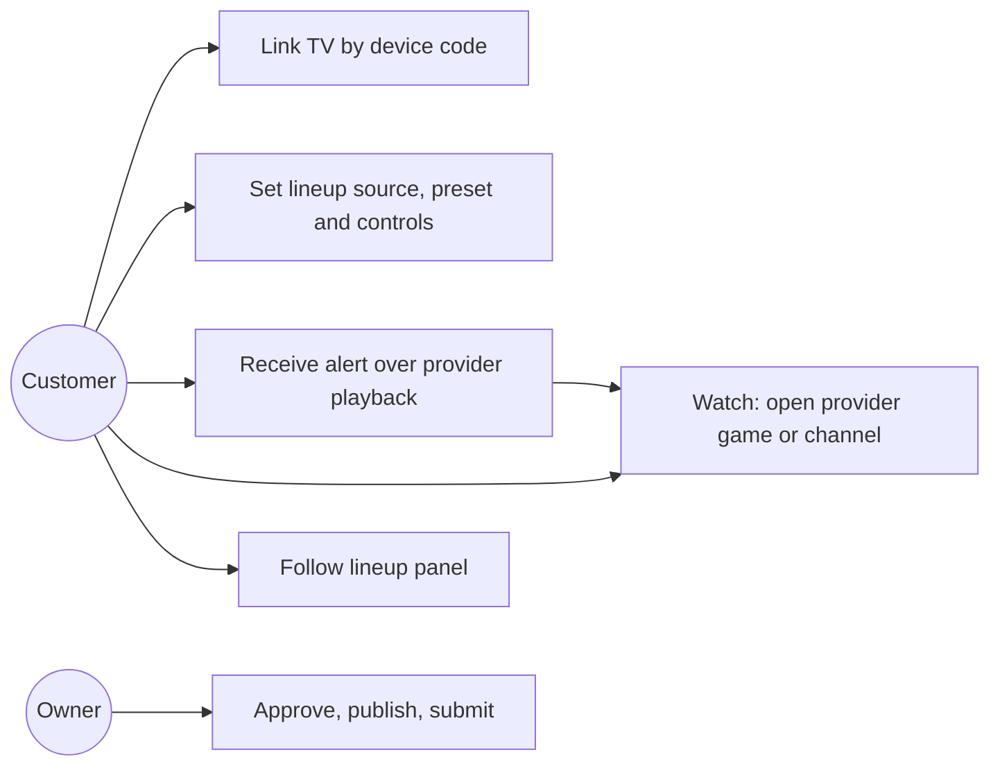
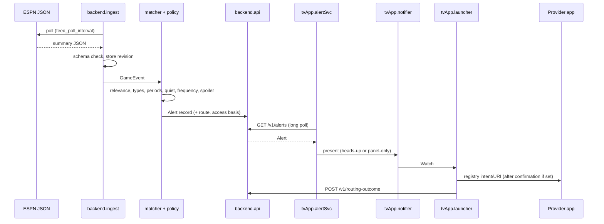
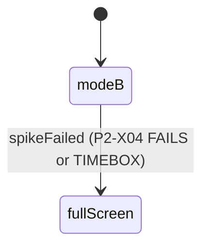

# Amazon Fantasy Companion — Design (Phase 2)

This design says how Phase 2 builds what the approved specification
defines. The specification and the register stay authoritative for *what*;
this file records *how*: code layout, component boundaries, contracts the
spec left as Phase 2 work (spec §2.1, §4.2.3, §4.7), spike protocols, gates,
lanes and the revision record. Model element names are those of the aligned
models in `models/` (`PanelMode.fullScreen`; no `tvApp.player`).

## Design lenses

Slices may cite only the lens names in this table in `design_lenses`.

| Lens | Question it answers |
|---|---|
| Contract-first | Does the slice build against a frozen contract (API, envelope, verdict, registry, fixture, presets) without changing it? |
| Evidence before dependence | Does product code depend only on routes a landed spike verdict shows working on the real stick? |
| Honest outcome | Does every surface keep unknown, stale, replay and denied states visible instead of smoothing them over? |
| Lightweight device | Are TV work queues, caches and history bounded, network and parsing off the main thread, and updates coalesced to changed rows? |
| Security controls | Are secrets server-side only, device sessions authorized per request, and local paths and account data kept out of tracked files and captures? |
| Free-tier boundary | Does backend work stay inside the Free-plan account without plan changes or paid-only services? |
| Couch UI | Is every control remote-reachable with visible focus, and does text meet legibility_min at 1080p? |
| Revision record | Does the landing add the changelog entry and does the technical-wave release follow `release-process`? |
| Developer feedback | Does the work carry a developer_feedback section the Scribe can ingest? |
| Owner boundary | Does the work stop at owner-only actions and the conditionals C1..C9? |

## Repository layout (Phase 2 target)

```
CHANGELOG.md                         revision record (landing procedure; DES-AFC-P2-REVREC)
README.md                            product, setup, judge access, limitations (P2-D03)
LICENSE                              Apache-2.0, selected SD-035 (P2-D03 prepares; OA-5 controls publication)
tools/ci/gate.sh                     + areas tvapp, backend (P2-G01; CONTRACT-AFC-P2-GATE-AREAS)
tools/ci/tests/                      gate tests for the new areas (P2-G01T)
.github/workflows/ci.yml             + jobs gate / tvapp, gate / backend (P2-G01)
docs/vnv/{tv-app,backend,device-integration}/AGENTS.md   (P2-D01)
docs/submission/{writeup.md,demo-plan.md,owner-checklist.md}   (P2-D04, P2-D05)
docs/developer-feedback/{observations.md,product-feedback.md,friction-log.md,feature-requests.md}   (Scribe)
spikes/sp1-device/ .. sp8-alexa/     VERDICT.md + probes (P2-X01..X07, X11)
evidence/visual/<slice>/             adb screencaps + geometry (rule 16; SD-024)
evidence/e2e/<date>/                 live-window run records (P2-X09, P2-X10)
evidence/demo/manifest.md            demo shot list with clip sha256 (clips themselves untracked)
tv-app/                              Gradle project from the starter (P2-A01..A05)
  settings.gradle.kts, gradle/libs.versions.toml, gradlew
  app/build.gradle.kts               minSdk 25 (AFC-PR-053)
  app/src/main/AndroidManifest.xml
  app/src/main/java/com/afc/companion/
    MainActivity.kt                  SHELL: navigation, full-screen panel host
    net/ApiClient.kt                 envelope, timeouts, bounded retry (CONTRACT-AFC-P2-API)
    link/LinkScreen.kt               device-code display (AFC-PR-038 TV side)
    profile/ProfileSettingsScreen.kt PROFILE: selections and every control
    detect/AppDetector.kt            DETECTOR
    alerts/AlertService.kt           ALERTSVC: long poll, bounded queue
    alerts/AlertNotifier.kt          NOTIFIER: heads-up with Watch / Dismiss
    watch/WatchLauncher.kt           LAUNCHER: registry route → intent/URI → RoutingOutcome
    panel/LineupPanel.kt             PANEL: modeB or fullScreen
  app/src/test/java/com/afc/companion/...        JVM unit tests (red slices)
  app/src/androidTest/java/com/afc/companion/... instrumented tests run on the stick
backend/
  template.yaml                      IAC: every function, route, table, schedule, parameter (P2-B01)
  requirements.txt, requirements-dev.txt (pinned, scanned)
  src/api/                           API router, envelope, errors
  src/device_auth/                   AUTH: device code, session token, confirm page
  src/feed_ingest/                   INGEST: ESPN client, schema validation, store
  src/feed_ingest/replay.py          REPLAY: labeled fixture source
  src/lineup/                        LINEUP: Yahoo read-only, manual source, presets
  src/matcher/                       MATCHER: identities, dedup, corrections
  src/alert_policy/                  POLICY: relevance and customer gates, templates
  src/provider_resolver/             RESOLVER: route + access basis; registry data
  src/panel/                         PANELSVC: PanelState, scoring basis, freshness
  fixtures/replay/                   captured ESPN fixtures (P2-X05)
  tests/unit/, tests/contract/, tests/deployed/
```

Paths in committed files are repository-relative (AC-AFC-P2-PATH-01). The
package `com.afc.companion` is a design choice; the starter's package is
renamed in P2-A01.

### Placement mapping (aligned model → realization)

| Model element | Register alias | Realization |
|---|---|---|
| tvApp.shell, tvApp.build, tvApp.manifest | SHELL, BUILD, MANIFEST | `MainActivity.kt`, `app/build.gradle.kts`, `AndroidManifest.xml` |
| tvApp.profileUI, tvApp.detector | PROFILE, DETECTOR | `profile/`, `detect/` |
| tvApp.alertSvc, tvApp.notifier, tvApp.launcher | ALERTSVC, NOTIFIER, LAUNCHER | `alerts/`, `watch/` |
| tvApp.panel; PanelMode.modeB, PanelMode.fullScreen | PANEL, SHELL | `panel/LineupPanel.kt` hosted by `MainActivity` (full screen) or the side-panel route the P2-X04 verdict names |
| backend.auth, backend.api | AUTH, API | `src/device_auth/`, `src/api/` |
| backend.ingest, backend.replay | INGEST, REPLAY | `src/feed_ingest/`, `replay.py`, `fixtures/replay/` |
| backend.lineup, backend.matcher, backend.policy | LINEUP, MATCHER, POLICY | `src/lineup/`, `src/matcher/`, `src/alert_policy/` |
| backend.resolver, backend.panelSvc | RESOLVER, PANELSVC | `src/provider_resolver/`, `src/panel/` |
| backend.iac; stores.*; stores.secrets | IAC, STORE, SECRET | `template.yaml`; DynamoDB tables; SSM SecureString |
| Settings.scoringPreset (ScoringPreset) | PROFILE, LINEUP | profile settings field; `src/lineup/presets.py` |

## Decisions

### DES-AFC-P2-SPIKES — Spikes first, time-boxed, verdict-driven

Spikes are evidence-only (OD-AFC-04): probes under `spikes/<sp>/`, verdict
in `spikes/<sp>/VERDICT.md` (CONTRACT-AFC-P2-VERDICT). Product slices that
depend on a route wait for its verdict to land.

| Spike | Slice | Question | Time box | Verdict drives |
|---|---|---|---|---|
| SP-1 device baseline | P2-X01 | Model, Fire OS, API level, adb, starter builds and installs; records first-install UTC time | 4 h | C1; min_sdk confirmation; spike_panel_max clock start |
| SP-4 panel beside provider video | P2-X04 | Is there a supported route (picture-in-picture of the provider, multi-window, overlay that leaves the video unobscured, provider/platform integration) to show provider video and our panel simultaneously with no overlap or crop? | Ends at first install + spike_panel_max | PanelMode.modeB vs PanelMode.fullScreen (AFC-PR-041, -047) |
| SP-2 heads-up notification | P2-X02 | Does a background service's high-importance notification with actions appear over Prime Video playback without foregrounding our app? | 6 h | AFC-PR-015 route; RISK-AFC-P2-02 |
| SP-3 provider links | P2-X03 | Per provider in order Prime Video (TNF), ESPN, DirecTV Stream, YouTube TV, then local broadcast: package identity, documented launch intent/URI, observed outcome; live Prime Video TNF check on 2026-10-15 | 10 h plus the TNF window | Provider registry (CONTRACT-AFC-P2-PROVIDER-REGISTRY); AFC-PR-029..031 |
| SP-7 detection | P2-X07 | Which installed-app facts are readable (package manager on the stick's API level); is current-viewing context exposed by a supported API? | 3 h | AFC-PR-003, -010 (unsupported → control hidden, limitation recorded) |
| SP-5 ESPN feed | P2-X05 | Scoreboard and summary endpoints, schema, update timing, correction evidence; fixture capture | First planned live window TNF 10-15; earlier games labeled historical | Fixture format; feed_poll_interval check; AFC-PR-012, -013, -064 |
| SP-6 Yahoo | P2-X06 | Approved and OAuth read works (roster by week, settings), or manual at T_yahoo | Until T_yahoo | C6; AFC-PR-001, -006, -007 |
| SP-8 Alexa (stretch) | P2-X11 | Verified Alexa route for announcements or tuning (C8) | Drop at 2026-10-21T12:00:00Z | AFC-PR-022, -036 |

SP-1 starts the spike_panel_max clock, so SP-4 runs next on the stick and
stops at the earlier of its verdict or first install + 24 h. A failed spike
is a verdict, not a repair.

### DES-AFC-P2-TV — TV app structure

- Kotlin, Jetpack Compose for TV as in the starter; minSdk 25
  (AFC-PR-053); single-activity shell (`MainActivity`) with screens Link,
  Profile/Settings and Panel; `AlertService` is a foreground service that
  long-polls alerts while monitoring is enabled (AFC-PR-009).
- Threading: all network, JSON parsing and scoring display computation run
  on `Dispatchers.IO`/`Default` coroutines; the UI thread only applies
  state (AFC-PR-063).
- Bounded state: alert queue and history ≤ alert_queue_max; panel holds
  one PanelState snapshot plus changed-row deltas; no images beyond
  provider icons decoded at display size; subscriptions cancelled when a
  screen leaves composition (AFC-PR-061, -062).
- The TV holds no Yahoo or AWS credential; it stores only its device
  session token in app-private storage (AFC-PR-055).
- `ApiClient` implements CONTRACT-AFC-P2-API: api_timeout, api_retry_max
  with exponential backoff for idempotent calls only, no automatic retry of
  link confirmation or Watch.
- Manifest and Gradle files are created complete by P2-A01; later edits
  take the `tv-app-manifest` / `tv-app-gradle` lease.
- The API base URL comes from Gradle property afcApiBaseUrl into BuildConfig.AFC_API_BASE_URL; empty shows "Backend not configured"; on-device and release builds pass -PafcApiBaseUrl=<afc-dev stack output ApiUrl>; the APK carries no secret.
- P2-A01 creates `net/ApiClient.kt` and `net/Dto.kt` for every API operation and the stub screens and components with final signatures (AFC-STUB marker), so A02..A05 replace stubs without editing shared files; only P2-A05 edits `MainActivity.kt`.

### DES-AFC-P2-ALERTPATH — Alert delivery on the TV

`AlertService` (foreground, low-priority ongoing notification as Fire OS
requires) calls `GET /v1/alerts?cursor=` with alert_poll_wait. Each new
alert record goes to `AlertNotifier`, which renders the customer's
presentation (AFC-PR-021): heads-up notification on a high-importance
channel with Watch and Dismiss actions (AFC-PR-015) via the route P2-X02
verifies, or panel-only. Watch is a `PendingIntent` into `WatchLauncher`;
Dismiss acknowledges locally. Alert text carries the verified player and
matchup context (AFC-PR-027), never claims a player is on the field or
will score from a red-zone entry (AFC-PR-028), and shows unknown access as
unknown (AFC-PR-032, -033). Voice announcement is offered only if P2-X11
verifies a route (AFC-PR-022).

### DES-AFC-P2-WATCH — Provider resolution and launch

The backend resolver (DES-AFC-P2-RESOLVE) returns a route; `WatchLauncher`
only executes it. It honors switching confirmation (AFC-PR-035): when
confirmation is on, a confirm dialog precedes launch. Launch uses only the
registry's intent or URI for the provider (CONTRACT-AFC-P2-PROVIDER-REGISTRY);
an absent package yields `appAbsent`; a refused launch or provider denial
yields `playbackDenied` with the provider's reason; otherwise a supported provider response for this attempt determines the
outcome. A successful launch call and the registry's historical
`verified_outcome` alone never establish `gameOpened`. When the current
destination/playback cannot be verified, report `accessUnknown` with that
reason; do not invent provider callbacks or an extra enum. P2-X03 records
any supported outcome-observation mechanism and its limits. Each attempt
reports exactly one RoutingOutcome back through the API (AFC-PR-031) and
shows it to the customer. Alexa-assisted tuning is offered only if P2-X11
verifies it (AFC-PR-036). Under PanelMode.fullScreen, Watch leaves our app
for the provider app (AFC-PR-048).

### DES-AFC-P2-PANEL — Lineup panel

`LineupPanel` renders the PanelState for the followed team and league
(AFC-PR-039): rows of player, points, game status; team total and progress;
scoring basis label (Yahoo league scoring, or PPR / Half-PPR). A value older
than stale_after shows "stale" and its age; a missing value shows
"unavailable", never zero (AFC-PR-040). Visibility and team/league switch
from the remote (AFC-PR-042, -043). Body text ≥ 24 px, scores ≥ 32 px at
1080p, measured on screencaps (AFC-PR-045). The mode is fixed by the P2-X04
verdict: modeB uses the verified side-by-side route with the video area to
the left at preserved aspect ratio (AFC-PR-041); fullScreen hosts the panel
full screen in our app with no stand-in video (AFC-PR-047). Refresh every
panel_refresh while visible, immediately on show; apply changed rows only.

### DES-AFC-P2-BACKEND — Serverless backend

- AWS SAM `backend/template.yaml`, Python 3.12 Lambdas, HTTP API, DynamoDB
  on-demand, EventBridge Scheduler, SSM SecureString. No paid-only service;
  any refusal or upgrade prompt stops the slice (RISK-AFC-P2-07, AFC-PR-054).
- Functions: `ApiFunction` (router for every `/v1/*` route and the `/link`
  page), `IngestFunction` (scheduled each minute only while a
  profile-relevant game is in progress, polling each such game every
  feed_poll_interval inside the invocation), `PolicyFunction` (stream
  consumer of the event table: matcher → policy → alert records → panel
  projections).
- Tables: `Profiles` (profile, settings, revision), `Links` (device code,
  session token hash, state), `Events` (game, event id, revision, source),
  `Alerts` (profile, cursor, alert), `Lineups` (profile, source, starters,
  scoring basis), `Panels` (profile, team/league, PanelState).
- P2-B01 writes the complete template (all functions, routes, tables,
  schedules, parameters, stack `afc-dev` in `samconfig.toml`), the
  `src/store/` accessors per table, the `src/pipeline/handler.py` chain
  (matcher.resolve → alert_policy.evaluate → provider_resolver.resolve →
  panel.project) and module stubs with final signatures, so B02..B07 change
  only their `src/<module>/` and tests; any later change to those shared
  files takes the `backend-template` lease. Deploys tag the stack with the
  deployed commit (`GitCommit=<sha>`).
- Heavy work stays on the backend (AFC-PR-059); the TV receives only
  profile-relevant updates (AFC-PR-060).

### DES-AFC-P2-AUTH — Device-code linking and sessions

`POST /v1/link` issues an 8-character code from an unambiguous base-32
alphabet (≥ 40 bits), TTL device_code_ttl, plus a polling handle.
`POST /v1/link/confirm` is called from the `/link` page on a phone or
browser: the customer signs in with Yahoo OAuth (when Yahoo is approved) or
with the owner-set link passphrase held in SSM SecureString (manual mode;
single-owner demo), then enters the code. Confirmation is one-time; an
expired or reused code returns 410. Linking returns a 256-bit opaque device
session token, stored only as a hash, sent as a bearer token, checked on
every request against the profile it is bound to (403 on any foreign
profile). API Gateway throttling bounds link attempts. Yahoo client secret
and tokens live only in SSM SecureString (AFC-PR-055). Realizes AFC-PR-038,
-055, -058.

### DES-AFC-P2-FEED — ESPN ingest and replay

ESPN scoreboard and summary JSON (endpoints recorded by P2-X05) are fetched
by `IngestFunction`, validated against a pinned JSON Schema in
`src/feed_ingest/schema/` before any store write (AFC-PR-064), normalized to
GameEvent (score, field position, possession, player ids, event time,
correctionOf) with a monotonic revision, and stored (AFC-PR-012). When the
endpoint fails feed_fail_limit times or the schema check fails on a
contract change, `replay.py` serves captured fixtures with `source: replay`
on every affected value (AFC-PR-013). Monitoring covers only
profile-relevant games during enabled periods, each decision labeled with
its observed-playback or profile-assumption basis (AFC-PR-008, -011).

### DES-AFC-P2-LINEUP — Lineup sources and scoring

One active source per profile (AFC-PR-007): Yahoo read-only OAuth
(AFC-PR-001: leagues, teams, roster by week, settings) or, when Yahoo is
not approved at T_yahoo, labeled manual entry from ESPN rosters
(AFC-PR-006). Manual lineups score under the selected preset
(CONTRACT-AFC-P2-PRESETS; default Half-PPR); Yahoo leagues use Yahoo league
scoring (AFC-PR-065). The preset selection persists in Settings
(AFC-PR-066).

### DES-AFC-P2-MATCH — Identity, deduplication, corrections

Canonical player id is the ESPN athlete id; Yahoo players map by
name + team + position with an explicit mapping table and recorded
confidence; unmatched players show unavailable rather than guessed
(AFC-PR-024). Event identity is ESPN game id + play id; an alert is keyed by
(profile, event id), so a re-fetched unchanged event emits
nothing (AFC-PR-025). If multiple alert types match one event, merge their
context into that single alert; never emit one alert per type. A correction is a new revision of the same event id;
it revises the existing alert and panel facts in place and emits no new
alert (AFC-PR-026, -046).

### DES-AFC-P2-POLICY — Alert policy

Gate order: relevance to the profile's starters or favorite teams → enabled
alert types (AFC-PR-016) → game-day periods (AFC-PR-019) → quiet hours
(AFC-PR-018) → frequency, alert_min_gap per game (AFC-PR-017) → spoiler
delay (AFC-PR-020) → emit (AFC-PR-014). Alert types: red-zone opportunity
(possession strictly inside red_zone_yards by a team with a relevant starter;
wording per AFC-PR-028), player score (scoring play listing a relevant
starter), close game (margin ≤ close_game_margin in the 4th quarter or
overtime, once per game per entry into that state). Commentary (OD-AFC-02):
fixed templates per excitement level Off / Mild / Hype, filled only from
event fields (AFC-PR-023). Detection and personalization data are used only
while opted in (AFC-PR-037).

### DES-AFC-P2-RESOLVE — Provider resolver

Inputs: game broadcaster (ESPN summary broadcast field), the customer's
installed apps (TV report, AFC-PR-003), verified or customer-confirmed
subscriptions (AFC-PR-004), local market and provider preference
(AFC-PR-034). Output: provider, channel, route from the registry, and an
access basis `verified`, `customerConfirmed` or `unknown` (AFC-PR-032;
never inferred from installation, AFC-PR-033). Local CBS/FOX/NBC: show the
channel; offer a carrying provider app if available, else no deep link
(AFC-PR-029). The spike order does not override customer preference.

### DES-AFC-P2-PANELSVC — Panel service

Computes PanelState per profile and team/league from the active lineup,
event facts and scoring basis: per-player points (null with reason when
unknown), game status, team total, progress, source and freshness per value,
and a revision (AFC-PR-039, -040, -044, -046, -065).

### DES-AFC-P2-GATE — Product gate areas

`tools/ci/gate.sh` gains `tvapp` and `backend` (CONTRACT-AFC-P2-GATE-AREAS).
The Actions workflow adds jobs `gate / tvapp` and `gate / backend` with path
filters `tv-app/**` and `backend/**`, SHA-pinned setup actions (JDK 17,
Python 3.12), `contents: read`, concurrency per ref (AC-AFC-CI-02 rules).
Phase 1 S09 has landed (origin/main 17b40b4) and `core.hooksPath=.githooks` is set, so local hooks run the gate.

### DES-AFC-P2-VISUAL — On-device visual review (rule 16)

For each changed screen and state: install the slice's debug APK on the
stick (`fire-tv-stick` lease), drive it with `adb shell input keyevent`
(D-pad, select, back), capture `adb exec-out screencap -p >
evidence/visual/<slice>/<state>.png`, record `adb shell dumpsys window`
geometry for panel/video layout, and measure text heights in pixels for
AFC-PR-045. Captures use sanitized fixture profiles; no account names.
Where provider video is protected, the capture shows black; the geometry
record plus an owner camera capture (OD-AFC-P2-02) evidence composition.
The stick has no phone width; the 1080p output is the only viewport.
Text evidence (adb, dumpsys, run logs) uses the .txt suffix; the root .gitignore ignores *.log.

### DES-AFC-P2-REVREC — Changelog and releases

Landing (ship-pull-request) adds one `CHANGELOG.md` `## [Unreleased]` line
under Added / Changed / Fixed / Removed, naming the change and linking the
pull request, after the PR number exists and before merge, under the
`main-landing` lease (no implementer edits `CHANGELOG.md`). The first Phase
2 landing creates the file if absent with a Keep a Changelog header. At
each technical-wave release checkpoint W1..W5, P2-R<n> runs `release-process`: moves `[Unreleased]`
under `## [<version>] - <date>`, bumps `versionName`/`versionCode` in
`tv-app/app/build.gradle.kts` (`tv-app-gradle` lease), drafts release notes
and the tag; publication waits for the owner (OA-8; OD-AFC-P2-03).

### DES-AFC-P2-SUB — Submission artifacts

`docs/submission/writeup.md` (AC-AFC-P2-SUB-03), `docs/submission/demo-plan.md`
(AC-AFC-P2-SUB-02), `docs/submission/owner-checklist.md` (every OA item with
its exact action and deadline), README (AC-AFC-P2-SUB-01). Demo clips are
captured by `adb shell screenrecord` (companion UI) and owner camera
(protected video) and tracked only by name and sha256 in
`evidence/demo/manifest.md`. External-context claims (YouTube TV Fantasy
View; AWS analytics viewing; NBA rights) carry public citations and an
"external context, not product capability" label.

### DES-AFC-P2-DX — Developer feedback

Every packet and return carries `developer_feedback` (AC-AFC-P2-DX-01). The
Scribe appends observations to `docs/developer-feedback/observations.md`
(Phase 1 log, DEC-AFC-SD-025 columns) at each return and wave boundary, and
P2-SCR1 assembles `product-feedback.md`, `feature-requests.md` and
`friction-log.md` (AC-AFC-P2-DX-02), sanitized.

### DES-AFC-P2-LANES — Lanes, worktrees, leases, landing, defects

- The frozen opensource-hackathon profile applies to all product and planning
  lanes under DEC-AFC-SD-041; defects retain the separate bug-triager binding.
  Light work uses light_implementer and the Scribe uses scribe. Preserve all
  13 existing TDD pairs; evidence/documentation-only slices use their declared
  verification method. Every Muse dispatch passes `--contributor-mode on`;
  role routes, ordered fallbacks, cadence, capabilities and holds are frozen.
- Before valid red tests, the Test Implementer prepares only the minimal
  scanned build/test harness and interface scaffolding needed to collect
  and run the tests; it implements none of the tested feature behavior.
  Missing tools, imports or collection are preparation failures, not red.
  A01T waits for X01's qualified JDK17/SDK/build-tools; B01T owns pinned
  Python test dependencies. Bootstrap files and test hashes are frozen in
  the red receipt before the Product Implementer continues.
- `tdd` lanes split each feature into a Test Implementer slice (`<id>T`,
  red: failing tests plus the CMD-RED receipt with each test file's sha256,
  left uncommitted in the shared pair worktree) and a Product Implementer
  slice (green: commits the tests first under the Test Implementer author
  identity, then the product code). `--no-verify` is never used.
- Worktrees: `$HOME/alphazede/worktrees/amazon-fantasy-companion-<lane>-<slice>`
  on branch `afc/p2-<slice-lowercase>`; one per running slice or TDD pair;
  never hidden directories; removed after merge with their branches.
- Leases as in the technical plan §Program plan.
- Review: one Reviewer per pull request at its integration step on the
  lane profile's reviewer route, OCR delegate mode, Reverify for APK claims
  or `Reverify: not applicable — <reason>`; one repair round; gate green;
  rebase or merge commit.
- Defects: any defect is triaged with `bug-hunter-triage` and its fix and
  review go to bug-triager (Implementer Muse Code / Muse Spark 1.3 / max;
  Reviewer Codex CLI / GPT-6 Astra / high) with the DEC-AFC-SD-037 packet
  fields; a lane-route defect packet states `BUG_ROUTE: <reason>`.

### Planning completion controls

TE-P2-F01 allocates deployed tests to their owning Test Implementers:
B01T owns shared deployed conftest and auth/API cases under backend-template;
B02T..B07T own disjoint feed_ingest, lineup, matcher, alert_policy,
provider_resolver and panel deployed-test directories. A02T owns profile
and detection instrumented tests. No acceptance case is dropped.

P2-G01T/G01 own qualification and gate binding of the SEIT coverage and
mutation tools, with build/dependency configuration under the existing
backend-template and tv-app-gradle leases. Pin and scan each tool before
use; check a known positive and negative fixture and publish exact commands,
report paths, source scopes and cost. A01T/A01 own the Android report task;
B01T/B01 own Python test dependencies. Unavailable tools remain typed gaps
and block the affected gate; they are never substituted with a unit-test
PASS. APK semantic Reverify support remains unproven and is surfaced at the
integrated review, with selected backend preserved.

## Contracts

### CONTRACT-AFC-P2-API — TV ↔ backend v1

The operations of spec §4.2.3 (`POST/GET /v1/link`, `POST /v1/link/confirm`,
`GET/PUT /v1/profile`, `GET /v1/alerts`, `GET /v1/panel`, `GET /v1/providers`)
plus `POST /v1/routing-outcome` (records each Watch attempt's RoutingOutcome,
AFC-PR-031) and `POST /v1/installed-apps` (TV detector report, AFC-PR-003).
Status codes 400/401/403/409/410/429/503 and the structured `error`
{code, message} as spec §4.2.3. Quantities: alert_poll_wait, api_timeout,
api_retry_max, device_code_ttl. Request and response bodies ≤ 64 KiB.
OpenAPI document `backend/src/api/openapi.yaml` is the frozen artifact
(written in P2-B01, changed only under its own review).

### CONTRACT-AFC-P2-ENVELOPE — Entity envelope

Every event, alert, profile and panel response: `schemaVersion`, opaque
`id`, monotonic per-entity `revision`, `source` (`live`, `replay`, `yahoo`,
`manual`), `eventTime` where applicable, `updatedAt` (RFC 3339 UTC), `data`.
Retries keep id and revision. Clients reject a revision older than the one
they hold.

### CONTRACT-AFC-P2-VERDICT — Spike verdict file

`spikes/<sp>/VERDICT.md` front matter: `spike`, `slice`, `verdict`
(`WORKS` / `PARTIAL` / `FAILS` / `TIMEBOX`), `device` (model, Fire OS,
API level), `started_at`, `ended_at`, `first_install_at` (SP-1 and SP-4),
`unblocks` (register UIDs), `conditional` (C1..C9 or `none`). Body: routes
tried (each with documentation source), observed result, evidence paths,
limits, developer_feedback IDs. No credential or account data.

### CONTRACT-AFC-P2-PROVIDER-REGISTRY — Provider registry

`backend/src/provider_resolver/registry.json`, written from the P2-X03
verdict: per provider `id`, `name`, `package`, `launch` (`type`:
`intent` | `uri`; `value` template with `{channel}` / `{event}` placeholders
only where documented), `doc_source`, `verified_outcome` (one RoutingOutcome
value observed on the stick), `channels_carried` (for local broadcast),
`verified_at`. `verified_outcome` describes the spike observation only, not
a current launch result. The registry also records the documented current-
attempt observation mechanism or explicitly none. Order of entries is the spike order; selection order is the
customer's preference.

### CONTRACT-AFC-P2-FIXTURE — Replay fixture

`backend/fixtures/replay/<game-id>/<seq>-<scoreboard|summary>.json`: the raw
ESPN response body as captured, plus `<game-id>/index.json` with capture
UTC times, endpoint, HTTP status and sha256 per file. Fixtures are never
edited; corrections are captured as later sequence files.

### CONTRACT-AFC-P2-PRESETS — Manual scoring presets

`backend/src/lineup/presets.py`, exactly two tables (AFC-PR-065):
PPR — reception 1.0; Half-PPR — reception 0.5; both — rushing and receiving
yards 0.1 per yard (1 per 10), rushing or receiving TD 6, passing yards
0.04 per yard (1 per 25), passing TD 4, interception thrown −1, fumble lost
−2. Default Half-PPR.

### CONTRACT-AFC-P2-GATE-AREAS — Product gate areas

Extends CONTRACT-AFC-GATE (Phase 1). `gate.sh tvapp`: when `tv-app/` exists,
runs `./tv-app/gradlew -p tv-app testDebugUnitTest lintDebug assembleDebug`; exit 3
(GAP) when the JDK or Android SDK is missing. `gate.sh backend`: when `backend/` exists, runs `python3.12 -m pytest backend/tests/unit backend/tests/contract` and `cfn-lint backend/template.yaml`; exit 3 when python3.12 or cfn-lint is missing. Deployed tests (`backend/tests/deployed`) are not gate
checks; they run against aws-afc-dev as SEIT procedures. When the area's
directory does not exist: exit 0 with `gate: <area>: PASS no <dir>/ tree`.

## Diagrams

The SysML v2 views of the aligned models (`models/view-structure.svg`,
`view-interfaces.svg`, `view-states.svg`, `view-data.svg`; digests in
`specialists/sm-p2-delta-receipt.md`) are the context/boundary and structure
views. The Mermaid views below are the use-case and operational-flow views
for owner review; they project the models and add no element.

Use cases (outcome view):



Operational flow (alert → Watch):



Panel mode (aligned PanelMode):


