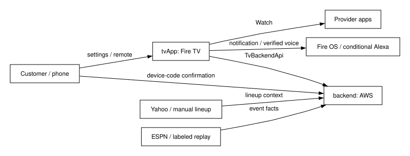
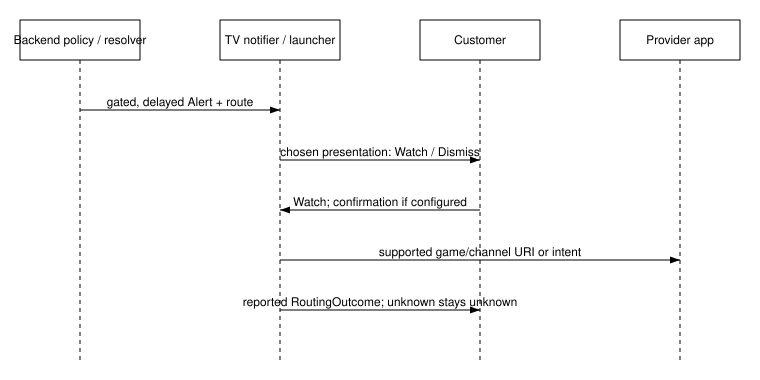
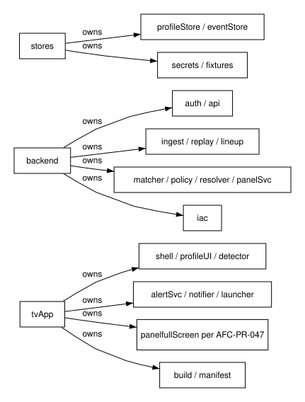
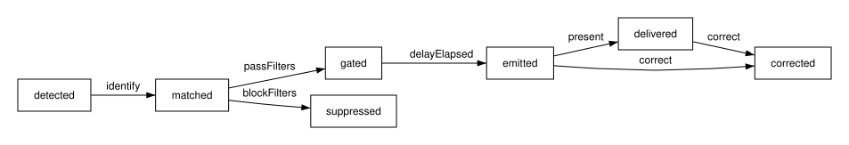
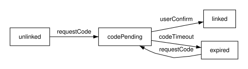
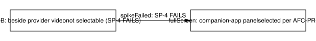
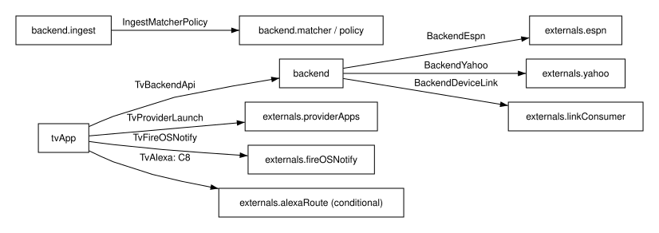
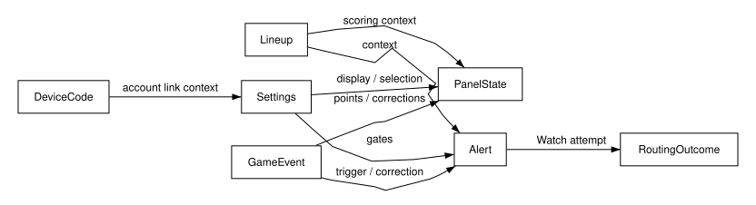

# Amazon Fantasy Companion Architecture Specification

**Document ID:** AFC-D1  
**Revision:** 0.3 (2026-10-12)

> Generated by `spec_build.py` from the section sources; edit those, not this file.

## Revision History

| Rev | Date | Author | Summary | Changed sections | Links |
|---|---|---|---|---|---|
| 0.1 | 2026-10-12 | Product Implementer, ST-4 | Draft architecture from the gated register and ST-3d models; implementation and acceptance pending |  |  |
| 0.2 | 2026-10-12 | Product Implementer, ST-4 generation 3 | Specification prose and SD-035 decisions; SD-036 external future context; 66 UIDs with three withdrawn | [1 Introduction](#1-introduction), [1.1 Background](#11-background), [1.1.1 Identification](#111-identification), [1.1.2 System context](#112-system-context), [1.2 Baseline](#12-baseline), [1.2.1 Baselines](#121-baselines), [1.3 Feature set](#13-feature-set), [1.4 Scope](#14-scope), [1.4.1 Purpose and scope](#141-purpose-and-scope), [1.4.2 Stakeholders and their concerns](#142-stakeholders-and-their-concerns), [1.5 Assumptions](#15-assumptions), [1.6 Terms](#16-terms), [1.6.1 Requirements](#161-requirements), [2 Open items](#2-open-items), [2.1 Risks and unresolved evidence](#21-risks-and-unresolved-evidence), [3 Use model](#3-use-model), [3.1 Operational concept](#31-operational-concept), [4 Feature architecture](#4-feature-architecture), [4.1 Feature decomposition](#41-feature-decomposition), [4.1.1 Profile and viewing availability](#411-profile-and-viewing-availability), [4.1.10 Device-code linking](#4110-device-code-linking), [4.1.11 Lineup panel content and remote operation](#4111-lineup-panel-content-and-remote-operation), [4.1.12 Panel consistency and video composition](#4112-panel-consistency-and-video-composition), [4.1.13 Withdrawn requirements: AFC-PR-049, AFC-PR-050 and AFC-PR-051](#4113-withdrawn-requirements-afc-pr-049-afc-pr-050-and-afc-pr-051), [4.1.2 Lineup source and scoring](#412-lineup-source-and-scoring), [4.1.3 Monitoring and viewing context](#413-monitoring-and-viewing-context), [4.1.4 Event ingest and replay](#414-event-ingest-and-replay), [4.1.5 Relevance, identity and corrections](#415-relevance-identity-and-corrections), [4.1.6 Alert policy gates](#416-alert-policy-gates), [4.1.7 Alert presentation and commentary](#417-alert-presentation-and-commentary), [4.1.8 Provider resolution and Watch](#418-provider-resolution-and-watch), [4.1.9 Customer controls](#419-customer-controls), [4.1.99 Allocation](#4199-allocation), [4.2 Feature interfaces](#42-feature-interfaces), [4.2.1 Internal interfaces](#421-internal-interfaces), [4.2.2 External interfaces](#422-external-interfaces), [4.2.3 Interfaces and contracts](#423-interfaces-and-contracts), [4.3 Data model](#43-data-model), [4.4 Lightweight-device design](#44-lightweight-device-design), [4.5 Fault behavior](#45-fault-behavior), [4.6 Architecture views](#46-architecture-views), [4.7 Model correspondence](#47-model-correspondence), [4.8 Rationale](#48-rationale), [4.8.1 Future direction: analytics viewing and other sports](#481-future-direction-analytics-viewing-and-other-sports), [5 Security](#5-security), [5.1 Security considerations](#51-security-considerations), [5.2 Security features](#52-security-features), [5.3 Security interfaces](#53-security-interfaces), [6 Programming model](#6-programming-model), [7 Verification](#7-verification), [7.1 Verification approach](#71-verification-approach), [7.1.1 Profile and access](#711-profile-and-access), [7.1.10 Panel content and remote](#7110-panel-content-and-remote), [7.1.11 Panel consistency and modes](#7111-panel-consistency-and-modes), [7.1.12 Full-screen panel handoff](#7112-full-screen-panel-handoff), [7.1.13 Platform and protection](#7113-platform-and-protection), [7.1.14 Scope and backend boundaries](#7114-scope-and-backend-boundaries), [7.1.15 TV resource design](#7115-tv-resource-design), [7.1.2 Lineup and scoring](#712-lineup-and-scoring), [7.1.3 Monitoring and consent](#713-monitoring-and-consent), [7.1.4 Feed integrity](#714-feed-integrity), [7.1.5 Alert relevance](#715-alert-relevance), [7.1.6 Policy timing](#716-policy-timing), [7.1.7 Presentation](#717-presentation), [7.1.8 Provider handoff](#718-provider-handoff), [7.1.9 Routing controls and linking](#719-routing-controls-and-linking) | [PR](https://github.com/1wgrumph/amazon-fantasy-companion/pull/10) · [Diff](https://github.com/1wgrumph/amazon-fantasy-companion/pull/10/files) |
| 0.3 | 2026-10-12 | Product Implementer, ST-4 generation 5 | Make references and generated Appendix A clickable; record changed sections with PR and diff links; approved product content retained | [1 Introduction](#1-introduction), [1.1 Background](#11-background), [1.1.1 Identification](#111-identification), [1.2 Baseline](#12-baseline), [1.2.1 Baselines](#121-baselines), [1.3 Feature set](#13-feature-set), [1.4 Scope](#14-scope), [1.4.1 Purpose and scope](#141-purpose-and-scope), [1.4.2 Stakeholders and their concerns](#142-stakeholders-and-their-concerns), [1.6 Terms](#16-terms), [1.6.1 Requirements](#161-requirements), [2 Open items](#2-open-items), [2.1 Risks and unresolved evidence](#21-risks-and-unresolved-evidence), [4.1 Feature decomposition](#41-feature-decomposition), [4.1.12 Panel consistency and video composition](#4112-panel-consistency-and-video-composition), [4.1.13 Withdrawn requirements: AFC-PR-049, AFC-PR-050 and AFC-PR-051](#4113-withdrawn-requirements-afc-pr-049-afc-pr-050-and-afc-pr-051), [4.1.2 Lineup source and scoring](#412-lineup-source-and-scoring), [4.1.3 Monitoring and viewing context](#413-monitoring-and-viewing-context), [4.1.9 Customer controls](#419-customer-controls), [4.1.99 Allocation](#4199-allocation), [4.2.2 External interfaces](#422-external-interfaces), [4.2.3 Interfaces and contracts](#423-interfaces-and-contracts), [4.3 Data model](#43-data-model), [4.4 Lightweight-device design](#44-lightweight-device-design), [4.6 Architecture views](#46-architecture-views), [4.7 Model correspondence](#47-model-correspondence), [4.8 Rationale](#48-rationale), [4.8.1 Future direction: analytics viewing and other sports](#481-future-direction-analytics-viewing-and-other-sports), [5.3 Security interfaces](#53-security-interfaces), [7 Verification](#7-verification), [7.1 Verification approach](#71-verification-approach), [7.1.1 Profile and access](#711-profile-and-access), [7.1.10 Panel content and remote](#7110-panel-content-and-remote), [7.1.11 Panel consistency and modes](#7111-panel-consistency-and-modes), [7.1.12 Full-screen panel handoff](#7112-full-screen-panel-handoff), [7.1.13 Platform and protection](#7113-platform-and-protection), [7.1.14 Scope and backend boundaries](#7114-scope-and-backend-boundaries), [7.1.15 TV resource design](#7115-tv-resource-design), [7.1.2 Lineup and scoring](#712-lineup-and-scoring), [7.1.3 Monitoring and consent](#713-monitoring-and-consent), [7.1.4 Feed integrity](#714-feed-integrity), [7.1.5 Alert relevance](#715-alert-relevance), [7.1.6 Policy timing](#716-policy-timing), [7.1.7 Presentation](#717-presentation), [7.1.8 Provider handoff](#718-provider-handoff), [7.1.9 Routing controls and linking](#719-routing-controls-and-linking) | [PR](https://github.com/1wgrumph/amazon-fantasy-companion/pull/10) · [Diff](https://github.com/1wgrumph/amazon-fantasy-companion/pull/10/files) |

## Table of Contents

- [1 Introduction](#1-introduction)
  - [1.1 Background](#11-background)
    - [1.1.1 Identification](#111-identification)
    - [1.1.2 System context](#112-system-context)
  - [1.2 Baseline](#12-baseline)
    - [1.2.1 Baselines](#121-baselines)
  - [1.3 Feature set](#13-feature-set)
  - [1.4 Scope](#14-scope)
    - [1.4.1 Purpose and scope](#141-purpose-and-scope)
    - [1.4.2 Stakeholders and their concerns](#142-stakeholders-and-their-concerns)
  - [1.5 Assumptions](#15-assumptions)
  - [1.6 Terms](#16-terms)
    - [1.6.1 Requirements](#161-requirements)
- [2 Open items](#2-open-items)
  - [2.1 Risks and unresolved evidence](#21-risks-and-unresolved-evidence)
- [3 Use model](#3-use-model)
  - [3.1 Operational concept](#31-operational-concept)
- [4 Feature architecture](#4-feature-architecture)
  - [4.1 Feature decomposition](#41-feature-decomposition)
    - [4.1.1 Profile and viewing availability](#411-profile-and-viewing-availability)
    - [4.1.2 Lineup source and scoring](#412-lineup-source-and-scoring)
    - [4.1.3 Monitoring and viewing context](#413-monitoring-and-viewing-context)
    - [4.1.4 Event ingest and replay](#414-event-ingest-and-replay)
    - [4.1.5 Relevance, identity and corrections](#415-relevance-identity-and-corrections)
    - [4.1.6 Alert policy gates](#416-alert-policy-gates)
    - [4.1.7 Alert presentation and commentary](#417-alert-presentation-and-commentary)
    - [4.1.8 Provider resolution and Watch](#418-provider-resolution-and-watch)
    - [4.1.9 Customer controls](#419-customer-controls)
    - [4.1.10 Device-code linking](#4110-device-code-linking)
    - [4.1.11 Lineup panel content and remote operation](#4111-lineup-panel-content-and-remote-operation)
    - [4.1.12 Panel consistency and video composition](#4112-panel-consistency-and-video-composition)
    - [4.1.13 Withdrawn requirements: AFC-PR-049, AFC-PR-050 and AFC-PR-051](#4113-withdrawn-requirements-afc-pr-049-afc-pr-050-and-afc-pr-051)
    - [4.1.99 Allocation](#4199-allocation)
  - [4.2 Feature interfaces](#42-feature-interfaces)
    - [4.2.1 Internal interfaces](#421-internal-interfaces)
    - [4.2.2 External interfaces](#422-external-interfaces)
    - [4.2.3 Interfaces and contracts](#423-interfaces-and-contracts)
  - [4.3 Data model](#43-data-model)
  - [4.4 Lightweight-device design](#44-lightweight-device-design)
  - [4.5 Fault behavior](#45-fault-behavior)
  - [4.6 Architecture views](#46-architecture-views)
  - [4.7 Model correspondence](#47-model-correspondence)
  - [4.8 Rationale](#48-rationale)
    - [4.8.1 Future direction: analytics viewing and other sports](#481-future-direction-analytics-viewing-and-other-sports)
- [5 Security](#5-security)
  - [5.1 Security considerations](#51-security-considerations)
  - [5.2 Security features](#52-security-features)
  - [5.3 Security interfaces](#53-security-interfaces)
- [6 Programming model](#6-programming-model)
- [7 Verification](#7-verification)
  - [7.1 Verification approach](#71-verification-approach)
    - [7.1.1 Profile and access](#711-profile-and-access)
    - [7.1.2 Lineup and scoring](#712-lineup-and-scoring)
    - [7.1.3 Monitoring and consent](#713-monitoring-and-consent)
    - [7.1.4 Feed integrity](#714-feed-integrity)
    - [7.1.5 Alert relevance](#715-alert-relevance)
    - [7.1.6 Policy timing](#716-policy-timing)
    - [7.1.7 Presentation](#717-presentation)
    - [7.1.8 Provider handoff](#718-provider-handoff)
    - [7.1.9 Routing controls and linking](#719-routing-controls-and-linking)
    - [7.1.10 Panel content and remote](#7110-panel-content-and-remote)
    - [7.1.11 Panel consistency and modes](#7111-panel-consistency-and-modes)
    - [7.1.12 Full-screen panel handoff](#7112-full-screen-panel-handoff)
    - [7.1.13 Platform and protection](#7113-platform-and-protection)
    - [7.1.14 Scope and backend boundaries](#7114-scope-and-backend-boundaries)
    - [7.1.15 TV resource design](#7115-tv-resource-design)
- [Appendix A — Requirement Traceability Matrix](#appendix-a--requirement-traceability-matrix)

## List of Tables

- Table 1 (T4): Input authority and status — 1.2.1 Baselines
- Table 2 (T4): Source-to-design coverage — 1.3 Feature set
- Table 3 (T4): Stakeholders and architectural response — 1.4.2 Stakeholders and their concerns
- Table 4 (T7): Assumptions requiring evidence — 1.5 Assumptions
- Table 5 (T8): Terms used by this architecture — 1.6 Terms
- Table 6 (T7): Remaining owner prerequisites — 2 Open items
- Table 7 (T7): Typed conditionals and remaining risk — 2.1 Risks and unresolved evidence
- Table 8 (T2): RoutingOutcome wire and display vocabulary — 4.1.8 Provider resolution and Watch
- Table 9 (T5): Settings consumers — 4.1.9 Customer controls
- Table 10 (T4): Model-to-realization allocation — 4.1.99 Allocation
- Table 11 (T2): Internal interface contracts — 4.2.1 Internal interfaces
- Table 12 (T2): External model contracts — 4.2.2 External interfaces
- Table 13 (T2): Proposed v1 operation signatures — 4.2.3 Interfaces and contracts
- Table 14 (T5): Native data fields and proposed wire refinement — 4.3 Data model
- Table 15 (T4): Fault response and recovery — 4.5 Fault behavior
- Table 16 (T4): View provenance — 4.6 Architecture views
- Table 17 (T4): Research-topic disposition — 4.8 Rationale
- Table 18 (T6): Threats and intended controls — 5.1 Security considerations
- Table 19 (T1): Profile and access verification approach — 7.1.1 Profile and access
- Table 20 (T1): Lineup and scoring verification approach — 7.1.2 Lineup and scoring
- Table 21 (T1): Monitoring and consent verification approach — 7.1.3 Monitoring and consent
- Table 22 (T1): Feed integrity verification approach — 7.1.4 Feed integrity
- Table 23 (T1): Alert relevance verification approach — 7.1.5 Alert relevance
- Table 24 (T1): Policy timing verification approach — 7.1.6 Policy timing
- Table 25 (T1): Presentation verification approach — 7.1.7 Presentation
- Table 26 (T1): Provider handoff verification approach — 7.1.8 Provider handoff
- Table 27 (T1): Routing controls and linking verification approach — 7.1.9 Routing controls and linking
- Table 28 (T1): Panel content and remote verification approach — 7.1.10 Panel content and remote
- Table 29 (T1): Panel consistency and modes verification approach — 7.1.11 Panel consistency and modes
- Table 30 (T1): Full-screen panel handoff verification approach — 7.1.12 Full-screen panel handoff
- Table 31 (T1): Platform and protection verification approach — 7.1.13 Platform and protection
- Table 32 (T1): Scope and backend boundaries verification approach — 7.1.14 Scope and backend boundaries
- Table 33 (T1): TV resource design verification approach — 7.1.15 TV resource design

## List of Figures

- Figure 1 (F1): System boundary derived from V-ST3b-1 and V-ST3b-2 — 1.1.2 System context
- Figure 2 (F5): Alert-to-Watch sequence projected from the interface and state models — 3.1 Operational concept
- Figure 3 (F2): Feature placement projected from V-ST3b-1 — 4.1 Feature decomposition
- Figure 4 (F7): Alert lifecycle projected from V-ST3b-3 — 4.1.5 Relevance, identity and corrections
- Figure 5 (F7): Device-link states projected from V-ST3b-3 — 4.1.10 Device-code linking
- Figure 6 (F7): Retained PanelMode model; fallback branch superseded by [SD-035](../../docs/plans/2026-10-12-amazon-fantasy-companion-phase-2/requirements-register.md#owner-questions-and-open-items-dec-afc-sd-035-2026-10-12) — 4.1.12 Panel consistency and video composition
- Figure 7 (F3): Interface boundaries projected from V-ST3b-2 — 4.2 Feature interfaces
- Figure 8 (F3): Data dependencies projected from V-ST3b-4 — 4.3 Data model

## 1 Introduction

The companion is a tune-in alert system that connects fantasy relevance to a customer-controlled viewing action.

This is D1, a draft product architecture specification for the Fire TV track and AWS Builder mini challenge. The [gated register](../../docs/plans/2026-10-12-amazon-fantasy-companion-phase-2/requirements-register.md) owns requirement statements; section front matter binds UIDs and generates [Appendix A](#appendix-a--requirement-traceability-matrix). This document specifies realization and verification approach without replacing the [register](../../docs/plans/2026-10-12-amazon-fantasy-companion-phase-2/requirements-register.md) or claiming the product exists.

The central experience is an alert during third-party viewing, followed by Watch and a supported game/channel handoff. The lineup panel is equally in scope, with a full-screen companion-app fallback when it cannot sit beside provider video. This preserves the alert and Watch outcome in AFC-PR-015 and AFC-PR-030 without misrepresenting the composition evidence for AFC-PR-041. [Section 7](#7-verification) separates document checks from the real-device demonstrations that establish those outcomes.

### 1.1 Background

The architecture retains the complete selected experience from [issue #1](https://github.com/1wgrumph/amazon-fantasy-companion/issues/1).

[Product intent](https://github.com/1wgrumph/amazon-fantasy-companion/issues/1) supplies retained items 1, 2, 3, 4, and 6 plus the owner-added lineup panel. [Later scope decisions](../../docs/plans/2026-10-11-amazon-fantasy-companion/scope-decision-batch.md#decisions) select ESPN, the 2018 Fire OS stick, AWS Free-plan hosting and bounded fallbacks. Earlier research into other platforms and feeds is evidence input, not an additional product target. Sunday simultaneous games remain a functional scenario; Thursday is only a possible initial demonstration.

The [register](../../docs/plans/2026-10-12-amazon-fantasy-companion-phase-2/requirements-register.md) reconciles those choices into the current baseline. Coverage in [1.3](#13-feature-set) and [Appendix A](#appendix-a--requirement-traceability-matrix) checks that changing the panel fallback has not dropped the alert, Watch or lightweight-device concerns in AFC-PR-015, AFC-PR-030 and AFC-PR-059.

#### 1.1.1 Identification

AFC-D1 revision 0.3 is a reviewable draft built from section sources.

The source root is [`spec/amazon-fantasy-companion/`](./); the generated document is [`spec/amazon-fantasy-companion/amazon-fantasy-companion.md`](amazon-fantasy-companion.md). Its revision history identifies this candidate, while Git identifies the exact bytes. Do not edit the generated document.

ST-4 generation 3 revises D1 under [DEC-AFC-SD-034](../../docs/plans/2026-10-11-amazon-fantasy-companion/journey.json), [DEC-AFC-SD-035](../../docs/plans/2026-10-12-amazon-fantasy-companion-phase-2/requirements-register.md#owner-questions-and-open-items-dec-afc-sd-035-2026-10-12) and [DEC-AFC-SD-036](../../docs/plans/2026-10-11-amazon-fantasy-companion/journey.json). Prose, requirement traceability and reproducible builds identify the candidate without claiming a Requirements System host binding; [SD-027](../../docs/plans/2026-10-11-amazon-fantasy-companion/journey.json) keeps the [register](../../docs/plans/2026-10-12-amazon-fantasy-companion-phase-2/requirements-register.md) in Markdown. Mechanical author verification is distinct from independent review, ST-5 owner acceptance, and publication. No runtime deployment, device verification, or submission is asserted.

#### 1.1.2 System context

The TV presents relevant state while the backend owns event processing and provider resolution.

The TV app consumes the backend API, presents alerts and the panel, and invokes provider-supported routes. Yahoo supplies lineup context; ESPN supplies live event facts; labeled manual and replay sources substitute only under their specified conditions. The phone/browser completes device linking. Provider apps and OS services remain outside this repository and outside the companion's control.

**Figure 1 (F1): System boundary derived from V-ST3b-1 and V-ST3b-2**

AFC-PR-058 and AFC-PR-059 motivate this boundary: integration and event processing stay behind a small TV API so the stick only handles presentation and handoff. Deployed API tests and source inspection verify the split; provider behavior still requires its own target-device demonstration.

### 1.2 Baseline

The [gated register](../../docs/plans/2026-10-12-amazon-fantasy-companion-phase-2/requirements-register.md) and [ST-3d model sources](../../docs/plans/2026-10-12-amazon-fantasy-companion-phase-2/models/views.md) define the design input baseline.

Use the baselines below before interpreting prior planning material. The tree at the dispatch base is greenfield product work: planned Kotlin files and backend modules are allocations, not discovered implementations. Source disagreements remain explicit open items rather than reasons to invent an integration.

The distinction matters for AFC-PR-047 and AFC-PR-066: the [amended register](../../docs/plans/2026-10-12-amazon-fantasy-companion-phase-2/requirements-register.md) supersedes older model meanings. The correspondence check in [4.7](#47-model-correspondence) records those differences rather than treating a successful model parse as proof of the current product.

#### 1.2.1 Baselines

D1 uses the 66-UID [register](../../docs/plans/2026-10-12-amazon-fantasy-companion-phase-2/requirements-register.md) after [SD-035](../../docs/plans/2026-10-12-amazon-fantasy-companion-phase-2/requirements-register.md#owner-questions-and-open-items-dec-afc-sd-035-2026-10-12) and retains the earlier SysON-parsed models as explicitly qualified design inputs.

**Table 1 (T4): Input authority and status**

| Source | Identity | Authority / evidence |
|---|---|---|
| Register | [gated register](../../docs/plans/2026-10-12-amazon-fantasy-companion-phase-2/requirements-register.md); AFC-PR-001 through AFC-PR-066 | [Markdown register](../../docs/plans/2026-10-12-amazon-fantasy-companion-phase-2/requirements-register.md) under [SD-027](../../docs/plans/2026-10-11-amazon-fantasy-companion/journey.json), amended by [SD-035](../../docs/plans/2026-10-12-amazon-fantasy-companion-phase-2/requirements-register.md#owner-questions-and-open-items-dec-afc-sd-035-2026-10-12); 63 active draft requirements and three withdrawn UIDs; product verification pending |
| Models | [native models and views](../../docs/plans/2026-10-12-amazon-fantasy-companion-phase-2/models/views.md) | ST-3d digest `14fb815b78c2c6817d556c36d351b22dd3996db5f5a7e34a87251ce69bfdcfe5` |
| Allocation | [allocation.md](../../docs/plans/2026-10-12-amazon-fantasy-companion-phase-2/models/allocation.md) | Earlier 65-UID model mapping; [SD-035](../../docs/plans/2026-10-12-amazon-fantasy-companion-phase-2/requirements-register.md#owner-questions-and-open-items-dec-afc-sd-035-2026-10-12) changes and AFC-PR-066 await Phase 2 model alignment |
| Parse receipt | [sm-syson-receipt.md](../../docs/plans/2026-10-12-amazon-fantasy-companion-phase-2/specialists/sm-syson-receipt.md) | Records zero errors/warnings in SysON project `2a033855-6bae-4fe1-975c-00bbb9419100`; no runtime feasibility proof |
| Scope | [scope-decision-batch.md](../../docs/plans/2026-10-11-amazon-fantasy-companion/scope-decision-batch.md) | [SD-001](../../docs/plans/2026-10-11-amazon-fantasy-companion/journey.json) onward and typed conditionals; later owner amendments take precedence |
| Dispatch base | `4d9b549696408ddaa5f432bac4911cbc349cb874` | ST-4-g3 input checkout |
| Build tools | [VENDORED.md](../../tools/spec/VENDORED.md) | HQ commit [`04678835350b529b44ab69ee5f805ca21cab5e76`](https://github.com/alphazede/Alphazedehq/commit/04678835350b529b44ab69ee5f805ca21cab5e76); link, revision and appendix anchor rules re-vendored in ST-4 generation 5 |

Baseline verification compares the [register](../../docs/plans/2026-10-12-amazon-fantasy-companion-phase-2/requirements-register.md) UID set with [Appendix A](#appendix-a--requirement-traceability-matrix) and checks model references against the recorded revision. This preserves the earlier model evidence without extending its coverage to decisions it predates.

### 1.3 Feature set

Profiles, monitoring, alerts, Watch, controls, and the panel form one product.

**Table 2 (T4): Source-to-design coverage**

| Issue source | Design coverage | Boundary |
|---|---|---|
| Item 1 | [4.1.1](#411-profile-and-viewing-availability) profile; [4.1.2](#412-lineup-source-and-scoring) lineup | Read-only Yahoo or labeled manual; access is separate from installation |
| Item 2 | [4.1.3](#413-monitoring-and-viewing-context) monitoring; [4.1.4](#414-event-ingest-and-replay) ingest | Enabled periods; observed versus assumed context |
| Item 3 | [4.1.5](#415-relevance-identity-and-corrections) relevance; [4.1.6](#416-alert-policy-gates) policy; [4.1.7](#417-alert-presentation-and-commentary) presentation | Grounded context, deduplication and correction |
| Item 4 | [4.1.8](#418-provider-resolution-and-watch) Watch | Provider contract required; explicit outcomes |
| Item 6 | [4.1.9](#419-customer-controls) controls; [4.1.10](#4110-device-code-linking) linking | Customer authority and supported conditional voice |
| Lineup panel | [4.1.11](#4111-lineup-panel-content-and-remote-operation) content; [4.1.12](#4112-panel-consistency-and-video-composition) composition/fallback; [4.1.13](#4113-withdrawn-requirements-afc-pr-049-afc-pr-050-and-afc-pr-051) withdrawal | Remote operation; unobscured provider video when supported, otherwise full-screen panel |
| Lightweight design | [4.4](#44-lightweight-device-design) | Structural design only; no hardware benchmark |
| Developer feedback and submission | 7 and evidence/ST-4 receipt | D1 captures lane feedback; Scribe and program lanes own submission preparation |

This coverage preserves the customer journey across AFC-PR-001, AFC-PR-014, AFC-PR-030 and AFC-PR-039. The per-UID approaches in [section 7](#7-verification) check each part independently, so a successful panel demonstration cannot substitute for Watch.

### 1.4 Scope

D1 describes the product architecture within the owner-approved platform and publication boundaries.

D1 informs Phase 2 implementation. The program plan (D2), milestones (D3), and shared tooling (D4) remain separately owned deliverables. They are not silently considered complete because the spec builds. Source research topics are accounted for in [4.8](#48-rationale) and the open-item [register](../../docs/plans/2026-10-12-amazon-fantasy-companion-phase-2/requirements-register.md).

The platform, hosting and exclusion concerns remain AFC-PR-052, AFC-PR-054 and AFC-PR-057. Their inspection and demonstration cases constrain implementation; document completion conveys no account, deployment or publication evidence.

#### 1.4.1 Purpose and scope

The target is the owner’s 2018 Fire OS stick with a serverless backend and no social features.

Kotlin/Jetpack Compose placement follows the selected Fire TV starter, with a planned minSdk of 25. The exact model and OS remain unconfirmed; an older or unsuitable device triggers C1, not a purchase or platform change. AWS service selection is constrained to the owner-created Free-plan account and deployment-time eligibility checks.

Apache-2.0 is the selected project license under [SD-035](../../docs/plans/2026-10-12-amazon-fantasy-companion-phase-2/requirements-register.md#owner-questions-and-open-items-dec-afc-sd-035-2026-10-12); choosing it does not publish the repository or license provider content.

Messaging, message boards, community rooms, shared chat and watch parties are excluded. QR convenience, dual-platform Vega support, and hardware performance benchmarking are not added. Owner-only publication and credential actions stay outside product implementation authority.

AFC-PR-052 and AFC-PR-053 are checked by a real-stick demonstration and build inspection; AFC-PR-054 requires template and deployment evidence. AFC-PR-057 is checked against source and UI surfaces. Those checks keep provisional platform assumptions distinct from delivered capability.

#### 1.4.2 Stakeholders and their concerns

Customer control and honest evidence govern the design.

**Table 3 (T4): Stakeholders and architectural response**

| Stakeholder | Concern | Response |
|---|---|---|
| Viewer | Useful alerts without lost viewing control | Conjunctive settings gates, explicit Watch, remote focus |
| Owner | Real-device outcome within time and cost constraints | Bounded spikes, C1–C9, no paid upgrade or publication by implication |
| Provider and data source | Supported access and lawful use | Documented route contracts, read-only OAuth, terms review |
| Implementer and verifier | Stable interfaces and traceability | Model correspondence, per-UID cases, explicit unresolved contracts |
| Judges | Actual demonstrated behavior | Labeled replay inputs, redacted functional evidence; no invented performance claims |

The response is implemented through the settings, resolution and presentation boundaries: AFC-PR-018 protects quiet hours, AFC-PR-032 preserves unknown access, and AFC-PR-043 preserves remote operation. [Section 7](#7-verification) pairs backend evidence with customer-observable demonstrations because neither alone covers these concerns.

### 1.5 Assumptions

Feasibility assumptions remain open until the target-device and service spikes provide evidence.

**Table 4 (T7): Assumptions requiring evidence**

| Assumption | Needed evidence | If unmet |
|---|---|---|
| Target supports app and provider playback | Exact model/OS and install demonstration | C1 owner return |
| Heads-up notification works over provider playback | Watch/Dismiss while provider continues playing | Report unmet core behavior; full-screen panel fallback does not waive it |
| Supported provider game/channel contract exists | Identifier source, supported URI/intent, real-device route outcome | Keep gap visible; app-home success is insufficient |
| Panel can coexist beside provider video | Unobscured aspect-preserving composition within 24 hours | C5 full-screen companion-app panel |
| Yahoo access arrives in time | Owner approval status and authorized read | C6 at T_yahoo |
| Selected services fit Free plan | Account and template deployment evidence | C4 owner decision before paid usage |

These assumptions sit at external boundaries for AFC-PR-015, AFC-PR-030, AFC-PR-041 and AFC-PR-054. Each spike retains its result and limitation, so an unmet assumption activates only its stated fallback and cannot waive another product obligation.

### 1.6 Terms

Source, freshness, access and delivery are independent concepts.

**Table 5 (T8): Terms used by this architecture**

| Term | Meaning | Do not infer |
|---|---|---|
| Observed playback | Supported, opted-in viewing-context observation | Universal cross-app visibility |
| Profile assumption | Monitoring based on explicit configuration | Current playback observation |
| Verified access | Supported integration or explicit customer confirmation with basis | Entitlement from installed app |
| Replay | Fixture event source labeled on affected values | Live feed access |
| Beside-video composition | Panel beside supported provider video, preserving aspect ratio | Permission to capture, cover or resize another app arbitrarily |
| Full-screen panel fallback | Lineup panel alone in the companion app under [SD-035](../../docs/plans/2026-10-12-amazon-fantasy-companion-phase-2/requirements-register.md#owner-questions-and-open-items-dec-afc-sd-035-2026-10-12) | Replacement of real-provider alerts and Watch |
| Correction | Revision of a resolved event and its dependent state | A second independent alert for the same event |
| Unavailable / stale | Missing value / aged value under stale_after | A fabricated zero or silently fresh value |

Keeping these concepts separate prevents the access and data-quality errors addressed by AFC-PR-032 and AFC-PR-040. Contract fixtures and UI demonstrations check the labels independently rather than collapsing them into a single healthy/unhealthy flag.

#### 1.6.1 Requirements

Requirement statements remain solely in the [gated register](../../docs/plans/2026-10-12-amazon-fantasy-companion-phase-2/requirements-register.md).

Read the [gated register](../../docs/plans/2026-10-12-amazon-fantasy-companion-phase-2/requirements-register.md) for normative statements, rationale, allocation and positive/negative criteria. This specification cites UIDs rather than copying statements. [Appendix A](#appendix-a--requirement-traceability-matrix) is generated from section bindings and includes every [register](../../docs/plans/2026-10-12-amazon-fantasy-companion-phase-2/requirements-register.md) UID. [Section 7.1](#71-verification-approach) subsections identify the corresponding verification case and approach for each UID. Requirements-engineering owns statement quality; ST-4 does not amend the [register](../../docs/plans/2026-10-12-amazon-fantasy-companion-phase-2/requirements-register.md).

AFC-PR-049, AFC-PR-050 and AFC-PR-051 remain withdrawn trace entries; all other [register](../../docs/plans/2026-10-12-amazon-fantasy-companion-phase-2/requirements-register.md) UIDs bind active draft scope. The build creates the matrix from section metadata, and set comparison detects either a missing [register](../../docs/plans/2026-10-12-amazon-fantasy-companion-phase-2/requirements-register.md) UID or an invented one.

## 2 Open items

Four owner prerequisites remain open; [SD-035](../../docs/plans/2026-10-12-amazon-fantasy-companion-phase-2/requirements-register.md#owner-questions-and-open-items-dec-afc-sd-035-2026-10-12)'s resolved product choices are design inputs, not questions to ask again.

The [current register](../../docs/plans/2026-10-12-amazon-fantasy-companion-phase-2/requirements-register.md) owns Q6–Q8. Q10 is a separate Alphazedehq task: the owner chose restoration, so only completion evidence remains outstanding. These items affect the real-device and service evidence for AFC-PR-052, AFC-PR-001 and AFC-PR-054; they do not prevent preparation of this specification.

**Table 6 (T7): Remaining owner prerequisites**

| ID | Current state | Closure evidence |
|---|---|---|
| Q6 | Stick found; exact model and Fire OS version unrecorded | Record model/OS and disposition under C1 |
| Q7 | Yahoo application not submitted | Owner application/approval status; C6 applies at T_yahoo |
| Q8 | AWS Free-plan account not created | Owner account readiness, without credential values |
| Q10 | S8 engineering-methods ledger restoration chosen, not completed | Alphazedehq restoration receipt; no waiver question remains |

Phase 2 integration and contract evidence is separately listed in [2.1](#21-risks-and-unresolved-evidence) and [4.2.3](#423-interfaces-and-contracts). Provider launch contracts, authentication details and transport bounds remain engineering work; they do not reopen the settled provider order, scoring presets, freshness threshold or license.

### 2.1 Risks and unresolved evidence

Fallbacks preserve the stated outcome only within their explicit boundaries.

**Table 7 (T7): Typed conditionals and remaining risk**

| ID / type | Trigger | Disposition and retained obligation |
|---|---|---|
| C1 enforced_rule | Fire OS 5, older/unsuitable model, or provider incompatibility | Return to owner; no device purchase or silent switch |
| C2 expected_outcome | ESPN outage or contract change | Labeled replay on every affected value; preserve event validation |
| C3 enforced_rule | Public submission using ESPN data | Flag terms to owner; no permission inferred from public JSON |
| C4 enforced_rule | AWS requires paid plan/service | Owner decision before upgrade; account Free eligibility is unverified |
| C5 expected_outcome | Panel/provider spike fails or exceeds 24 h from first install | Full-screen panel in the companion app; real-provider alert/Watch still required |
| C6 expected_outcome | Yahoo approval absent at 2026-10-16T19:00:00Z | Labeled manual lineup from ESPN rosters; one active source |
| C7 enforced_rule | Committed local absolute path | Block until removed; scan only authorized candidate paths here |
| C8 enforced_rule | Voice route unimplemented or unverified | Do not offer voice; control alone is not integration proof |
| C9 enforced_rule | Visibility, reviewer access, submission or external feedback | Owner action; owner handles credential values |

The provider spike also covers supported package detection, subscription basis, local-market routing, launch result observation and background notification delivery. No supplied model proves OS permissions, third-party video resizing, cross-app playback inspection, or arbitrary Alexa commands. Missing essential provider interfaces become documented integration gaps; no external proposal is sent by this lane.

C10–C14 belong to shared skills/CI work (D4), not new product requirements. Their existing canonical authority remains the [scope-decision batch](../../docs/plans/2026-10-11-amazon-fantasy-companion/scope-decision-batch.md). Schedule and submission obligations remain in [D2/D3](../../docs/plans/2026-10-11-amazon-fantasy-companion/scope-decision-batch.md#deliverables) and [issue #1](https://github.com/1wgrumph/amazon-fantasy-companion/issues/1); D1 does not narrow them.

The remaining contract work also includes code/session security details in [4.2.3](#423-interfaces-and-contracts) and explicit timeout, retry, payload, queue and cache bounds for AFC-PR-038, AFC-PR-058 and AFC-PR-062. None is treated as proved by this document build; Phase 2 records contract fixtures, inspection and real-device results before acceptance.

## 3 Use model

The viewer stays in control from setup through alert dismissal or viewing handoff.

Setup links the TV to the customer account and captures fantasy selections, supported viewing services, local market and explicit overrides. A selected schedule enables monitoring. The viewer can inspect the lineup panel, suppress intrusive presentation, or choose Watch on an alert. Dismiss leaves playback alone.

The same flow supports simultaneous Sunday games because relevance, deduplication and provider resolution use canonical game/player identities rather than the currently foregrounded broadcast alone.

AFC-PR-002 and AFC-PR-009 supply the persistent customer context; AFC-PR-015 and AFC-PR-035 protect viewing control. Restart, dismissal and confirmation demonstrations exercise those boundaries, while multi-game fixtures check relevance independent of the foreground game.

### 3.1 Operational concept

An alert leads to a deliberate Watch action and a verified provider destination.

With a linked profile and enabled period, the backend obtains lineup and event facts, matches identities, applies policy and spoiler delay, and sends a relevant alert. The notification exposes Watch and Dismiss during third-party playback when heads-up is selected. Watch respects switching confirmation and invokes the provider contract. Only observed arrival at the intended game/channel establishes the successful handoff case.

The preferred composition reserves the right side for the lineup panel and fits provider video into the remaining area without crop or overlap. AFC-PR-041 drives this layout, while AFC-PR-047 bounds the feasibility spike to 24 hours from first app install. A failure or timeout selects the full-screen lineup panel inside the companion app. AFC-PR-048 preserves alerts and Watch to real provider apps in that fallback. Separate demonstrations prove composition or the declared fallback and the alert-to-provider handoff; a panel screenshot cannot establish successful tuning.

**Figure 2 (F5): Alert-to-Watch sequence projected from the interface and state models**

## 4 Feature architecture

The feature architecture keeps one backend truth and a small TV presentation layer.

The decomposition below follows the retained issue items and the model allocations. Backend ingestion can be shared across relevant viewers, but filtering and delivery stay profile-scoped. No planned module name establishes implementation completion.

AFC-PR-058 through AFC-PR-060 motivate this division: the API exposes a small product surface while processing and filtering remain backend responsibilities. Source inspection and deployed API cases check placement and profile relevance separately.

### 4.1 Feature decomposition

Each feature is assigned to the existing model elements.

**Figure 3 (F2): Feature placement projected from V-ST3b-1**

Detailed element ownership is recorded in [4.1.99](#4199-allocation). The figure groups owned parts for readability and does not replace the native structure model.

Separating the AFC-PR-059 processing work from AFC-PR-061 rendering work keeps integration and presentation changes independently testable. The allocation and interface tables identify where each case collects evidence; they are not evidence that the allocated module has been built.

#### 4.1.1 Profile and viewing availability

The profile separates fantasy selections, detected app facts and access evidence.

`tvApp.profileUI` edits persisted selections through `backend.api` into `stores.profileStore`. `backend.lineup` retrieves Yahoo league/roster context with read-only OAuth; selected starting slots come from weekly roster position, never player eligibility. `tvApp.detector` reports only platform-permitted installed-app facts. `backend.resolver` retains the basis of verified access separately from installation and local-market information. Customer overrides survive refresh and restart.

Customer confirmation is an explicit input, not a claim of automated provider entitlement verification. Missing supported detection leaves manual review/configuration available; the unproven detection path remains a spike risk.

For AFC-PR-001 through AFC-PR-005, backend tests check Yahoo scope, roster semantics and access basis; device demonstrations check installed-app facts, persistent selections and overrides. This division catches both incorrect source interpretation and a UI that fails to retain the customer’s correction.

#### 4.1.2 Lineup source and scoring

One active lineup source supplies both event matching and scoring, with an explicit scoring context carried to the panel.

`backend.lineup` owns the source switch required by AFC-PR-006 and AFC-PR-007. At T_yahoo (2026-10-16T19:00:00Z), absent Yahoo approval, it accepts manual lineups constructed from ESPN rosters and labels the source manual. Consumers observe one atomic source selection; setup before any configured lineup is not a second active source. Starter changes and source switches invalidate derived values together so alerts and the panel cannot retain conflicting lineup revisions.

AFC-PR-065 places manual scoring in `backend.panelSvc` and `backend.lineup`; its [register](../../docs/plans/2026-10-12-amazon-fantasy-companion-phase-2/requirements-register.md) table is the sole authority for coefficients. The customer selects PPR or Half-PPR through the profile, with Half-PPR as the default, and the panel shows the selected preset name beside the manual source label. AFC-PR-066 makes that choice persistent across restart. Yahoo lineups use their own league scoring settings and never the manual preset table. Keeping source and scoring basis together avoids silently applying a convenient default to a different league.

The cases in [7.1.2](#712-lineup-and-scoring) compare computed manual points with the selected [register](../../docs/plans/2026-10-12-amazon-fantasy-companion-phase-2/requirements-register.md) table, exercise a preset change and restart, and check that source switching neither duplicates the active lineup nor applies manual presets to Yahoo.

#### 4.1.3 Monitoring and viewing context

Monitoring uses enabled periods and labels the evidence behind every decision.

`backend.ingest` monitors the relevant game set selected by `backend.policy`; quiet hours and game-day settings bound this set. The profile carries the schedule/game-day mode explicitly. Supported, opted-in viewing observations can refine context; otherwise decisions carry `profile-assumption`, never `observed-playback`.

Master detection/personalization opt-out disables use of detection data and profile-based personalization. It does not authorize silently resuming detection when settings refresh. Schedule-driven monitoring remains possible as specified by the [register](../../docs/plans/2026-10-12-amazon-fantasy-companion-phase-2/requirements-register.md), with its basis labeled; observed context cannot be reconstructed from an assumption. The exact OS mechanism is a spike output.

The AFC-PR-008 through AFC-PR-011 cases check relevant game sets, schedule changes and provenance; AFC-PR-037 checks opt-out without detection or personalization. Observing the absence of forbidden reads is necessary because a correct-looking label alone cannot establish consent enforcement.

#### 4.1.4 Event ingest and replay

Validation precedes any mutation of stored game events.

`backend.ingest` treats ESPN unofficial JSON as untrusted input and normalizes the event contract only after complete response validation. A rejected response leaves stored events unchanged. Endpoint outage or a changed contract selects `backend.replay` and `stores.fixtures` for affected values with source labeling propagated to alerts and panel data.

Replay is a data-source substitution; the full-screen panel fallback changes presentation. Either can occur independently, so the API carries source provenance even when the panel layout changes. Source timestamps and correction references survive normalization. A transport retry cannot turn malformed or old content into fresh live facts.

AFC-PR-012 and AFC-PR-064 are verified with valid and malformed responses, comparing stored events before and after rejection. AFC-PR-013 follows replay labels to every affected output so an outage cannot look like successful live ingestion.

#### 4.1.5 Relevance, identity and corrections

Canonical event identity governs alert emission and correction propagation.

`backend.matcher` reconciles Yahoo, ESPN and provider identifiers before policy decisions. A red-zone event is a team opportunity inside the 20-yard line; it cannot prove a selected player is on the field or will score. AFC-PR-014 fixes close-game classification at a score margin within 8 points in the 4th quarter or overtime. `backend.policy` evaluates both the score margin and game period; a similar margin earlier in the game does not qualify.

The event store supplies deduplication identity. An unchanged event produces no new alert, and a scoring correction updates the existing alert record and the panel’s derived state. Distinct entities cannot be merged merely because names resemble each other. Identity ambiguity remains unknown rather than generating confident player commentary.

**Figure 4 (F7): Alert lifecycle projected from V-ST3b-3**

The AFC-PR-014 cases exercise the settled period and margin boundaries. AFC-PR-024 and AFC-PR-025 check canonical identity and repeated retrieval; AFC-PR-026 checks corrections on both surfaces, and AFC-PR-028 rejects player-participation or scoring predictions inferred from team field position.

#### 4.1.6 Alert policy gates

All policy gates apply together before delivery.

`backend.policy` evaluates enabled alert types, frequency, quiet hours and game-day periods against one settings context, then holds eligible alerts for the selected spoiler delay. Delivery time is no earlier than source event time plus the configured delay. A later settings change cannot authorize delivery that the current policy suppresses; delayed work must preserve the current customer controls.

The modeled `gated` state represents this hold; `suppressed` represents a blocked event. Frequency semantics and timer resource bounds are Phase 2 contract tuning, not a license for unlimited queues. Repeated polling does not bypass the per-event emission invariant.

AFC-PR-016 through AFC-PR-020 are verified against controlled event streams and recorded emission times. Repeating the stream with different settings exposes a gate that is stored correctly but ignored at delivery.

#### 4.1.7 Alert presentation and commentary

Presentation preserves the verified trigger context and the customer’s intrusion settings.

`tvApp.alertSvc` receives profile-relevant updates; `tvApp.notifier` uses the selected presentation. Heads-up includes Watch and Dismiss over third-party playback; panel-only produces no heads-up. The alert retains the triggering player/matchup basis from data even when optional commentary is omitted.

Commentary is backend-generated under the selected Off, Mild or Hype excitement level from AFC-PR-023. Event facts and identity are never determined by generated text. Off produces no commentary, and any named entity must be present in the triggering evidence. Voice announcements require both enabled settings and a separately implemented and verified voice route; notification availability does not establish speech capability.

AFC-PR-015 and AFC-PR-021 require the actual selected presentation on the stick. AFC-PR-022 separately proves the voice route, AFC-PR-023 checks commentary against the triggering entities and level, and AFC-PR-027 demonstrates the retained player/matchup context. This prevents optional commentary from becoming the authority for an alert.

#### 4.1.8 Provider resolution and Watch

Watch targets a supported event/channel contract and reports the actual routing outcome.

`backend.resolver` combines installed-app facts, verified subscriptions or explicit customer confirmation, local market and preference to select a provider/channel under AFC-PR-029. Watch identifies the broadcast channel and preserves the basis for whether this customer can watch in this location and subscription plan. A provider’s own out-of-region or not-in-plan answer is retained as the reason for `playbackDenied`; no response or unverifiable access remains `accessUnknown`. These are access results, not evidence that a successful app launch reached the game.

The Phase 2 link-contract spikes run in order: Prime Video (TNF), ESPN app, DirecTV Stream app, then YouTube TV. That evidence-gathering order does not override the customer’s preference among available services. For local CBS/FOX/NBC broadcasts, the result displays the channel and offers a provider app known to carry it; when no carrying app is available, it provides no deep link. `tvApp.launcher` invokes only a supported URI/intent obtained from the provider spike. Do not invent a URI format or use arbitrary control of another app.

Exactly one of the six modeled outcomes records each attempt. An OS launch acknowledgement proves at most app launch; it does not prove game playback. Unknown access stays visible on alert, route and panel surfaces. The concrete observation mechanism for game arrival is part of the spike; absent such evidence, a route cannot be marked `gameOpened`.

**Table 8 (T2): RoutingOutcome wire and display vocabulary**

| Model / proposed wire value | Customer meaning | Evidence distinction |
|---|---|---|
| gameOpened | game opened | Intended game/channel reached |
| searchOpened | search or details opened | Intermediate content screen; not successful direct tuning |
| appHomeOpened | app home opened | Only app-home arrival |
| appAbsent | app absent | Supported package unavailable |
| accessUnknown | access unknown | Access unverifiable |
| playbackDenied | playback denied | Provider refused playback |

The cases for AFC-PR-029 through AFC-PR-033 check channel and access inputs, local-broadcast no-link behavior, each routing outcome and real game arrival. Provider denial evidence remains useful evidence of an unsuccessful handoff; it is never relabeled successful tuning.

#### 4.1.9 Customer controls

Settings are the single configuration source for policy, routes and panel rendering.

Provider preference orders available services; it does not create access. Switching confirmation blocks a viewing switch until the configured customer action is satisfied. An automatic switch can exist only when explicitly configured and supported; this draft does not presume that platform capability. Alexa-assisted tuning requires its own verified route and opt-in.

**Table 9 (T5): Settings consumers**

| Setting family | Modeled fields | Consumer |
|---|---|---|
| Fantasy context | fantasySelections, teamLeague | lineup, policy and panel |
| Timing and noise | alertTypes, frequency, quietHours, gameDayPeriods, spoilerDelay | policy |
| Presentation | presentation, voice, excitement | notifier and backend commentary |
| Routing | providerPref, switchingConfirm | resolver and launcher |
| Panel | panelPrefs | panel and panelSvc |
| Consent | detectionOptIn | detector and policy |

The UI exposes each control separately even where the model groups them. Source values are persisted through the profile API, with customer overrides protected from later detection refresh.

AFC-PR-034 and AFC-PR-035 are verified by changing preference and confirmation settings; AFC-PR-036 requires the separate Alexa demonstration. AFC-PR-037 and AFC-PR-044 check that consent and panel state follow the stored profile. The manual preset control is specified in [4.1.2](#412-lineup-source-and-scoring) under AFC-PR-066, pending corresponding model detail.

#### 4.1.10 Device-code linking

A pending code links the TV only after the customer completes the phone/browser action.

`backend.auth` issues the code and expiry, while `backend.api` lets the TV observe status. Code issuance alone cannot create an authenticated link. Expiration leads to an explicit expired state and a new request, not automatic reauthorization. The deployment contract must bind a confirmed code to the intended device and account and prevent replay of a completed code.

**Figure 5 (F7): Device-link states projected from V-ST3b-3**

AFC-PR-038 is demonstrated with the real stick and phone/browser completion path. Expired and previously completed codes are rejected at the backend boundary; the design uses that boundary to avoid treating possession of a displayed code as completed customer authorization.

#### 4.1.11 Lineup panel content and remote operation

The panel is a remote-operated view of lineup, scoring and freshness.

`backend.panelSvc` computes player points, game status, total and progress using the active scoring context; `tvApp.panel` displays the result. Missing values remain unavailable; old values remain stale. AFC-PR-040 fixes `stale_after` at 60 seconds; freshness is evaluated per value from its source timestamp, not from the time a cached response arrives. A value without a scoring basis is not presented as a confirmed score.

The remote toggles visibility, changes followed team/league and reaches every focusable control with visible focus. AFC-PR-045 sets a 1080p floor of 24 px for body text and 32 px for scores, together with owner acceptance from the couch on the stick. Meeting the pixel floor alone does not establish acceptance. Hidden state suspends unnecessary display work and refreshes before a newly shown panel is treated as current.

The AFC-PR-039 and AFC-PR-040 demonstrations compare scoring context and per-value labels with controlled inputs. AFC-PR-042 and AFC-PR-043 exercise every operation from the remote; AFC-PR-045 combines measured text sizes with the owner’s couch judgment.

#### 4.1.12 Panel consistency and video composition

The panel shares alert facts and degrades to a full-screen companion-app view when beside-video composition cannot be demonstrated.

For AFC-PR-041, the shell reserves the area left of the right-side panel for provider video with its aspect ratio preserved. Covering or cropping the broadcast does not meet that target. The spike tests a supported composition route on the real stick; no architecture drawing grants control of a provider’s player. Under AFC-PR-047, failure or more than 24 hours from first app install selects the full-screen panel, with no stand-in video. This keeps the lineup useful while preserving the product’s tune-in focus.

AFC-PR-044 and AFC-PR-046 keep settings, starter changes and scoring corrections shared between policy and panel state. Suppressed alerts do not imply contradictory facts, and a hidden panel refreshes on show. AFC-PR-048 keeps alerts and Watch connected to the real provider apps even when the panel occupies the companion screen. [Section 7.1.11](#7111-panel-consistency-and-modes) tests shared facts and demonstrates the composition or fallback; [7.1.12](#7112-full-screen-panel-handoff) demonstrates provider handoff from the fallback.

The figure below retains the earlier native `PanelMode` element for traceability. Its Mode A sample-footage branch is superseded by [SD-035](../../docs/plans/2026-10-12-amazon-fantasy-companion-phase-2/requirements-register.md#owner-questions-and-open-items-dec-afc-sd-035-2026-10-12) and retained pending Phase 2 design; it is not the current product fallback. The figure annotation identifies that mismatch without changing the read-only model.

**Figure 6 (F7): Retained PanelMode model; fallback branch superseded by [SD-035](../../docs/plans/2026-10-12-amazon-fantasy-companion-phase-2/requirements-register.md#owner-questions-and-open-items-dec-afc-sd-035-2026-10-12)**

#### 4.1.13 Withdrawn requirements: AFC-PR-049, AFC-PR-050 and AFC-PR-051

[SD-035](../../docs/plans/2026-10-12-amazon-fantasy-companion-phase-2/requirements-register.md#owner-questions-and-open-items-dec-afc-sd-035-2026-10-12) withdraws AFC-PR-049, AFC-PR-050 and AFC-PR-051 because the owner rejected Mode A sample footage.

The UIDs remain bound here so [Appendix A](#appendix-a--requirement-traceability-matrix) explicitly records their withdrawn status. Their footage-license, playback-label and footage-exclusion cases are retired, not pending implementation or verification. No replacement requirement text is created in this specification. AFC-PR-047 and AFC-PR-048 instead govern the full-screen panel and real-provider handoff.

`tvApp.player`, the PLAYER allocation and the native `PanelMode.modeA` element still reflect the withdrawn design. They are retained pending Phase 2 design per [SD-035](../../docs/plans/2026-10-12-amazon-fantasy-companion-phase-2/requirements-register.md#owner-questions-and-open-items-dec-afc-sd-035-2026-10-12); their presence does not authorize a player implementation or media acquisition. Document verification checks that the three withdrawn UIDs remain in [Appendix A](#appendix-a--requirement-traceability-matrix) and do not appear as active product cases.

#### 4.1.99 Allocation

The [native allocation table](../../docs/plans/2026-10-12-amazon-fantasy-companion-phase-2/models/allocation.md) remains the authority for every model-element binding.

[allocation.md](../../docs/plans/2026-10-12-amazon-fantasy-companion-phase-2/models/allocation.md) maps the original 65 UIDs to structure, interface, state and data elements. It predates [SD-035](../../docs/plans/2026-10-12-amazon-fantasy-companion-phase-2/requirements-register.md#owner-questions-and-open-items-dec-afc-sd-035-2026-10-12): AFC-PR-066 is allocated to PROFILE and LINEUP by the [current register](../../docs/plans/2026-10-12-amazon-fantasy-companion-phase-2/requirements-register.md), while the three withdrawn UIDs retain their historical model links. [Appendix A](#appendix-a--requirement-traceability-matrix) covers all 66 [register](../../docs/plans/2026-10-12-amazon-fantasy-companion-phase-2/requirements-register.md) UIDs. This table maps the planned realization boundaries without asserting code exists.

**Table 10 (T4): Model-to-realization allocation**

| Model element group | Register aliases | Planned placement / ownership |
|---|---|---|
| tvApp.shell, build, manifest | SHELL, BUILD, MANIFEST | [MainActivity.kt](../../docs/plans/2026-10-12-amazon-fantasy-companion-phase-2/models/allocation.md); [build.gradle.kts](../../docs/plans/2026-10-12-amazon-fantasy-companion-phase-2/models/allocation.md); [AndroidManifest.xml](../../docs/plans/2026-10-12-amazon-fantasy-companion-phase-2/models/allocation.md) in tv-app/ |
| tvApp.profileUI, detector | PROFILE, DETECTOR | [ProfileSettingsScreen.kt](../../docs/plans/2026-10-12-amazon-fantasy-companion-phase-2/models/allocation.md); [AppDetector.kt](../../docs/plans/2026-10-12-amazon-fantasy-companion-phase-2/models/allocation.md) |
| tvApp.alertSvc, notifier, launcher | ALERTSVC, NOTIFIER, LAUNCHER | [AlertService.kt](../../docs/plans/2026-10-12-amazon-fantasy-companion-phase-2/models/allocation.md); [AlertNotifier.kt](../../docs/plans/2026-10-12-amazon-fantasy-companion-phase-2/models/allocation.md); [WatchLauncher.kt](../../docs/plans/2026-10-12-amazon-fantasy-companion-phase-2/models/allocation.md) |
| tvApp.panel, player | PANEL, PLAYER | [LineupPanel.kt](../../docs/plans/2026-10-12-amazon-fantasy-companion-phase-2/models/allocation.md); [CompanionPlayer.kt](../../docs/plans/2026-10-12-amazon-fantasy-companion-phase-2/models/allocation.md) is a retained Mode A model allocation pending Phase 2 design per [SD-035](../../docs/plans/2026-10-12-amazon-fantasy-companion-phase-2/requirements-register.md#owner-questions-and-open-items-dec-afc-sd-035-2026-10-12), not an active footage feature |
| backend.auth, api | AUTH, API | backend/src/device_auth/; backend/src/api/ |
| backend.ingest, replay | INGEST, REPLAY | backend/src/feed_ingest/; [replay.py](../../docs/plans/2026-10-12-amazon-fantasy-companion-phase-2/models/allocation.md) and backend/fixtures/replay/ |
| backend.lineup, matcher, policy | LINEUP, MATCHER, POLICY | backend/src/lineup/; matcher/; alert_policy/ |
| backend.resolver, panelSvc | RESOLVER, PANELSVC | backend/src/provider_resolver/; backend/src/panel/ |
| backend.iac | IAC | [backend/template.yaml](../../docs/plans/2026-10-12-amazon-fantasy-companion-phase-2/models/allocation.md); Free-tier-constrained SAM deployment |
| stores.profileStore, eventStore | STORE | DynamoDB profile/settings/link data and event/dedup/correction state |
| stores.secrets, fixtures | SECRET, REPLAY | SSM SecureString; backend/fixtures/replay/ |
| externals | Interface endpoints | Yahoo, ESPN, providers, OS, Alexa, phone/browser; not repository components |

Trace inspection checks the [current register](../../docs/plans/2026-10-12-amazon-fantasy-companion-phase-2/requirements-register.md) allocation as well as this historical model map. In particular, AFC-PR-047 retains PLAYER in the [register](../../docs/plans/2026-10-12-amazon-fantasy-companion-phase-2/requirements-register.md) but receives the full-screen behavior specified by [SD-035](../../docs/plans/2026-10-12-amazon-fantasy-companion-phase-2/requirements-register.md#owner-questions-and-open-items-dec-afc-sd-035-2026-10-12); retaining the alias does not restore footage.

### 4.2 Feature interfaces

Eight model interfaces define the boundaries D1 refines.

**Figure 7 (F3): Interface boundaries projected from V-ST3b-2**

The API paths and JSON mappings below are D1 contract design, not evidence of deployed endpoints. Phase 2 binds concrete external schemas and timing values through spikes. The native model's primitive attributes are placeholders, not a completed wire schema.

AFC-PR-058 drives the TV/backend surface, while AFC-PR-030 depends on a provider-owned launch contract. Contract tests establish the internal signatures; real-stick spikes establish the external route. Keeping those proofs separate avoids inferring provider support from a passing local API test.

#### 4.2.1 Internal interfaces

Internal delivery preserves canonical identity, revisions and profile relevance.

**Table 11 (T2): Internal interface contracts**

| Interface / producer → consumer | Payload and operation | Failure / consistency rule |
|---|---|---|
| TvBackendApi: tvApp.apiPort ↔ backend.apiPort | Link, profile, alerts long-poll, panel, providers over HTTPS JSON | Authorize linked device/profile; return explicit unavailable/error state, never another profile’s data |
| IngestMatcherPolicy: ingest → matcher → policy | Validated GameEvent, active Lineup and Settings; derived Alert | Reject before store mutation; one canonical identity per event; policy gates before emission |
| IngestMatcherPolicy: correction → policy and panelSvc | correctionOf plus corrected event revision | Revise existing alert and panel facts; never duplicate emission |
| TvBackendApi: panelSvc/API → TV | Profile-relevant PanelState snapshot and changed values | Refresh after hidden/offline interval; reject older state revisions |

A stable identity/revision envelope is a D1 refinement needed to carry the model's deduplication and correction semantics. Cursor retry replays the same identified records, not new event identities. A missing/expired cursor requests a fresh snapshot; it cannot silently omit corrections. Authorization is evaluated for each request, not trusted from a client-supplied profile identifier.

AFC-PR-024 through AFC-PR-026 are checked by duplicate and correction fixtures across the pipeline. AFC-PR-058 and AFC-PR-060 are checked against the deployed API with isolated profile inputs, including a foreign-profile request that cannot cross the authorization boundary.

#### 4.2.2 External interfaces

External adapters bind only supported contracts and retain explicit uncertainty.

**Table 12 (T2): External model contracts**

| Interface and ends | Transferred content | Unverified dependency / failure |
|---|---|---|
| BackendEspn: backend.espnPort ↔ externals.espn | NFL events with score, field position, possession, player IDs, event time, corrections | Unofficial schema and terms; invalid batch leaves store unchanged; outage/changed contract invokes labeled replay |
| BackendYahoo: backend.yahooPort ↔ externals.yahoo | Read-only leagues, teams, weekly rosters and scoring; server-side refresh | Application approval separate from user OAuth; C6 selects manual when approval absent at deadline |
| TvProviderLaunch: tvApp.launchPort → providerApps | Supported provider-specific game/channel URI or intent | Provider ID source and route contract pending; exactly one RoutingOutcome |
| TvFireOSNotify: tvApp.notifyPort → fireOSNotify | Chosen alert presentation, Watch/Dismiss actions | Heads-up over real provider playback unverified on target |
| TvAlexa: tvApp.alexaPort ↔ alexaRoute | Conditional voice announcements / tuning | C8; separate proofs for speech and tuning; no arbitrary utterance API presumed |
| BackendDeviceLink: backend.linkPort → linkConsumer | DeviceCode and customer confirmation | Customer action and expiry enforced; no credentials entered on TV |

Yahoo endpoint candidates from [issue #1](https://github.com/1wgrumph/amazon-fantasy-companion/issues/1) are `/users;use_login=1/games;game_keys=nfl/teams`, `/team/{team_key}/roster;week={week}`, and `/league/{league_key}/settings`. These are research candidates requiring authenticated validation, not promised current responses. ESPN endpoint selection is likewise an integration output; no undocumented URL is invented here.

AFC-PR-001 and AFC-PR-012 require source-contract evidence; AFC-PR-013 checks labeled substitution. AFC-PR-030 and AFC-PR-036 require actual target-device route demonstrations. Research endpoint names are deliberately insufficient for any of those results.

#### 4.2.3 Interfaces and contracts

The TV API exposes a small authenticated contract with explicit failure semantics.

**Table 13 (T2): Proposed v1 operation signatures**

| Operation | Request → response | Contract |
|---|---|---|
| POST /v1/link | Device initiation → DeviceCode {code, expires} and polling handle | Unlinked bootstrap only; no profile data or Yahoo credentials returned |
| GET /v1/link | Pending handle → unlinked/codePending/linked/expired | Poll safely; linkage only after customer confirmation |
| POST /v1/link/confirm | Phone/browser authenticated account plus code → linked/expired or error | One-time account/device binding; expired/replayed codes cannot link |
| GET /v1/profile; PUT /v1/profile | Linked device; validated selections/settings → canonical Settings and revision | Full validated profile revision update; conflicts require read/merge, no silent overwrite |
| GET /v1/alerts | Linked device and optional cursor → Alert records plus cursor | Bounded long poll; empty result is no change, not feed health evidence |
| GET /v1/panel | Linked device and selected team/league → PanelState and scoring basis | Snapshot with row values, timestamps, freshness and source labels |
| GET /v1/providers | Linked device, event identity → resolved route and access basis | No installed-app-to-entitlement inference; return explicit unknown |

Transport design uses JSON over TLS. Event and state responses carry a versioned envelope: `schemaVersion`, stable `id`, monotonic per-entity `revision`, `source` (live/replay or Yahoo/manual as appropriate), source `eventTime` where applicable, `updatedAt`, and data. UTC timestamps use RFC 3339; IDs are opaque strings. A retry preserves entity identity and revision. Correction ordering is per event; no global delivery-order guarantee is implied.

Invalid input returns a structured `error` with code and safe message and no partial mutation. Authentication failure is 401, authorization failure 403, malformed data 400, stale profile revision 409, expired link 410, rate limiting 429, unavailable service 503. Clients honor retry guidance with bounded backoff; user-visible values retain freshness/source labels while offline. Do not retry non-idempotent link confirmation as a new authorization or relaunch Watch automatically after an uncertain outcome. Concrete timeout, polling, payload-size and retry limits remain engineering evidence gaps in [section 2.1](#21-risks-and-unresolved-evidence) and must be set before contract acceptance.

These signatures refine interface responsibilities without claiming external providers implement this API. Yahoo secrets/tokens are never part of the TV wire payload. The device-session credential format and lifecycle, code entropy/expiry/rate limits, and authorization tests require Phase 2 security contract closure; an unfinished auth contract cannot be accepted as a deployed API.

The AFC-PR-058 and AFC-PR-060 tests exercise operation coverage and profile isolation, while AFC-PR-038 demonstrates linking and AFC-PR-055 inspects secret containment. AFC-PR-064 checks the no-partial-mutation boundary using rejected input. These checks establish behavior, not merely schema shape.

### 4.3 Data model

The data model distinguishes event facts, derived alerts, lineup context and rendered state.

**Table 14 (T5): Native data fields and proposed wire refinement**

| Native item | Native fields | D1 interpretation / refinement |
|---|---|---|
| GameEvent | score, fieldPosition, possession, playerIds, eventTime, correctionOf | Typed score/position in adapter schema; playerIds becomes canonical-ID array; nullable correctionOf references a prior event |
| Alert | alertType, triggerContext, providerRoute, commentary, emittedAt | Typed red-zone/player-score/close-game alert; structured evidence and route; optional commentary; UTC emission time |
| Lineup | source, team, league, starters, scoring | Yahoo/manual discriminator; stable team/league IDs, starter IDs and Yahoo league scoring or selected PPR/Half-PPR manual scoring context |
| PanelState | visible, teamTotal, progress, freshness | Boolean visibility; row projections add player ID, points, game status and per-value source/freshness; unknown points remain null |
| Settings | fantasySelections, teamLeague, alertTypes, frequency, quietHours, gameDayPeriods, spoilerDelay, presentation, voice, excitement, providerPref, switchingConfirm, panelPrefs, detectionOptIn | Existing grouped fields; Phase 2 adds persistent manual preset selection from AFC-PR-066 and types the String placeholders |
| RoutingOutcome | gameOpened, searchOpened, appHomeOpened, appAbsent, accessUnknown, playbackDenied | Closed six-value vocabulary; display wording in [4.1.8](#418-provider-resolution-and-watch) |
| DeviceCode | code, expires | Opaque one-time code with UTC expiry; no OAuth secret |

String-typed fields in the native model express logical content, not permission to pass unchecked strings across trust boundaries. Phase 2 schema fixtures pin score units, statistic names, optionality and timing policy. A missing number is null with a reason; zero is a valid known score. Access basis and source provenance are retained independently from freshness. The profile and event stores own durable state; the TV holds only bounded view caches.

**Figure 8 (F3): Data dependencies projected from V-ST3b-4**

For AFC-PR-007, AFC-PR-026 and AFC-PR-046, revision-aware fixtures check single-source selection and correction agreement. AFC-PR-039 and AFC-PR-040 demonstrations check the visible scoring basis and age labels; retaining null separately from zero prevents missing input from becoming a false score.

### 4.4 Lightweight-device design

The design reduces TV work without claiming measured device performance.

API aggregation, full-game monitoring, matching and commentary stay in the backend. Only relevant updates reach the TV. A compact 2D panel coalesces bursts into changed rows/values; hidden panels suspend update application and refresh on show. Dispose timers and subscriptions when no longer needed.

Declare limits for event queues, history, images and caches before implementation acceptance; the current spec does not invent hardware-derived capacities. Decode images at displayed size and release hidden-screen resources. Network work, parsing and computation run off the rendering thread. Avoid tight polling, continuous tickers, blur-heavy layers and large animated imagery. Background delivery needs supported OS behavior, not an assumption that the UI process stays alive.

Use supported player/compositor paths and preserve hardware decoding; do not copy or decode/re-encode provider video to make space for the panel. [Issue #1](https://github.com/1wgrumph/amazon-fantasy-companion/issues/1)'s 100 MB background-RAM guidance is a design reference only, not an app allocation, benchmark result, foreground limit or acceptance threshold. No zero-lag, frame-rate or measured physical-device latency claim is made. Functional demonstrations remain required.

AFC-PR-059 and AFC-PR-063 are checked by responsibility and thread-placement inspection; AFC-PR-060 and AFC-PR-061 exercise filtered and burst updates. AFC-PR-062 requires explicit bounds in source. These establish structural safeguards without asserting measured hardware capacity.

### 4.5 Fault behavior

Unavailable inputs produce labeled degradation instead of invented facts.

**Table 15 (T4): Fault response and recovery**

| Fault | Visible / stored behavior | Recovery evidence |
|---|---|---|
| Malformed ESPN response | Reject before write; stored events unchanged | Valid later batch or labeled replay; byte-identity assertion for rejected batch |
| Feed outage / changed contract | Labeled replay on affected values | Explicit source transition; no replay value reclassified live without live evidence |
| Aged or missing panel input | Stale/unavailable per value; no fabricated zero | Fresh snapshot with source time and scoring context |
| Access cannot be verified | access unknown; no inclusion promise | Supported provider confirmation/evidence |
| Provider absent or denied | app absent / playback denied | Customer configuration or successful supported retry; no automatic switch loop |
| Scoring correction / starter change | Update shared facts and derived alert/panel state | Both surfaces agree, hidden panel refreshes on show |
| Network loss / expired cursor | Retain labels and recover snapshot | Bounded retries; old revisions cannot overwrite newer state |
| Expired device code | expired; no link | Customer requests and confirms a new code |
| Panel composition unavailable | Full-screen companion-app panel after C5 | Full-screen panel demonstration; real provider Watch still proven |

The AFC-PR-013, AFC-PR-026 and AFC-PR-064 cases exercise substitution, correction and rejection independently. AFC-PR-032 and AFC-PR-040 demonstrations then check what the viewer sees, because intact backend state alone cannot prove honest degradation on the TV.

### 4.6 Architecture views

Every figure is a derived projection of the supplied models.

**Table 16 (T4): View provenance**

| Spec figure | Native/view source | Omission / interpretation |
|---|---|---|
| system-context, structure | [AFC-Structure](../../docs/plans/2026-10-12-amazon-fantasy-companion-phase-2/models/views.md) / V-ST3b-1 | Groups owned parts; no claim of deployed resources |
| interfaces, watch-flow | [AFC-Interfaces](../../docs/plans/2026-10-12-amazon-fantasy-companion-phase-2/models/views.md) / V-ST3b-2 and [AFC-States](../../docs/plans/2026-10-12-amazon-fantasy-companion-phase-2/models/views.md) | Sequence combines named boundaries; no latency guarantees |
| alert-lifecycle, panel-mode, device-link | [AFC-States](../../docs/plans/2026-10-12-amazon-fantasy-companion-phase-2/models/views.md) / V-ST3b-3 | Retained native states/triggers; panel-mode annotates the superseded fallback pending [SD-035](../../docs/plans/2026-10-12-amazon-fantasy-companion-phase-2/requirements-register.md#owner-questions-and-open-items-dec-afc-sd-035-2026-10-12) design alignment |
| data | [AFC-Data](../../docs/plans/2026-10-12-amazon-fantasy-companion-phase-2/models/views.md) / V-ST3b-4 | Logical dependencies; field detail stays in dictionary |

Model provenance is fixed by the digest in [1.2.1](#121-baselines). Figures use editable YAML rendered into SVG and draw.io with the vendored kit; those are derived architecture drawings, not new SysML source. The original [model SVG views](../../docs/plans/2026-10-12-amazon-fantasy-companion-phase-2/models/views.md) remain the source views. A rebuild of the Markdown does not itself rerender diagrams; the verification workflow renders and lints them separately.

Figure lint checks layout, and trace inspection checks correspondence to the cited model sources and [SD-035](../../docs/plans/2026-10-12-amazon-fantasy-companion-phase-2/requirements-register.md#owner-questions-and-open-items-dec-afc-sd-035-2026-10-12) annotations. For AFC-PR-041 and AFC-PR-047, neither test establishes video integration; only the real-stick composition/fallback evidence does.

### 4.7 Model correspondence

Text and diagrams preserve the native model’s scope and explicitly identify refinements.

The four packages are self-contained; cross-package linkage is by documented element names and the allocation companion, not formal imported flow bindings. `AFCData` imports `ScalarValues` for its primitive types. The ST-3d receipt closes the earlier parser-unavailable gap; it does not validate wire contracts or real-device behavior.

AlertLifecycle follows detected → matched → gated → emitted → delivered, with matched → suppressed and emitted/delivered → corrected. The retained PanelMode model starts in modeB and transitions only to modeA on spikeFailed. Its Mode A sample-footage meaning is superseded by [SD-035](../../docs/plans/2026-10-12-amazon-fantasy-companion-phase-2/requirements-register.md#owner-questions-and-open-items-dec-afc-sd-035-2026-10-12) and retained pending Phase 2 design, along with `tvApp.player` and PLAYER. The current fallback is the full-screen companion-app panel in [4.1.12](#4112-panel-consistency-and-video-composition); the old transition is not an implementation instruction. DeviceLink starts unlinked, requests codePending, then links on userConfirm or expires on codeTimeout; expired can request again. [Sections 4.1.5](#415-relevance-identity-and-corrections), [4.1.10](#4110-device-code-linking) and [4.1.12](#4112-panel-consistency-and-video-composition) draw these separately.

Identity/revision envelopes, JSON typing, authorization/error handling and API operation signatures are D1 refinements of the named interfaces. They do not amend native models or claim model conformance beyond the recorded parse. The model also predates the persistent manual preset choice in AFC-PR-066; PROFILE and LINEUP allocation comes from the [amended register](../../docs/plans/2026-10-12-amazon-fantasy-companion-phase-2/requirements-register.md) pending model alignment. Model omissions such as cancellation, account unlink/revocation lifecycle and transport tuning remain Phase 2 contract work, not silently completed state transitions.

Correspondence is checked by comparing names, transitions and allocation links with the unchanged model files. AFC-PR-047 and AFC-PR-066 make the known version differences visible, preserving the model evidence while keeping the [amended register](../../docs/plans/2026-10-12-amazon-fantasy-companion-phase-2/requirements-register.md) authoritative.

### 4.8 Rationale

The chosen design uses the approved sources and keeps research limits intact.

**Table 17 (T4): Research-topic disposition**

| [Issue #1](https://github.com/1wgrumph/amazon-fantasy-companion/issues/1) topic | Architecture disposition | Caveat / remaining evidence |
|---|---|---|
| Amazon Builder Tools | Development guidance for platform/focus/integration work | No installed-tool or cross-app authority claim |
| Yahoo OAuth and endpoints | Backend lineup and league context | Read-only access; approval and authenticated schema proof pending |
| Direct NFL portal / alternate feeds | Supporting research; [SD-004](../../docs/plans/2026-10-11-amazon-fantasy-companion/journey.json) selects ESPN | No direct NFL API dependency or official-feed claim |
| Fire OS notifications | TvFireOSNotify integration spike | Older documentation does not prove target behavior |
| Alexa Video Skills / DIRECTV example | Conditional TvAlexa route | Receiving directives is not authority to issue arbitrary commands |
| Apple partner/universal-link research | Reference pattern for provider-owned routing | No Apple implementation or public-partner-data assumption |
| Roku content IDs / deep links | Reference pattern for explicit game/channel IDs | No Roku ECP production dependency |
| Vega links / Fire TV launcher | Provider-contract research for Watch | Vega guidance is not Fire OS APK capability evidence |
| Device tiers and 100 MB guidance | Lightweight structural design in [4.4](#44-lightweight-device-design) | Exact stick unknown; no dual-platform scope or hardware benchmark |
| Judging story and video | Preserve actual alert → Watch → game, panel and reliability evidence | Proposed storyboard is not implementation proof |
| Eligibility, repository, rights, submission | [Issue #1](https://github.com/1wgrumph/amazon-fantasy-companion/issues/1) and [D2/D3 canonical workflow](../../docs/plans/2026-10-11-amazon-fantasy-companion/scope-decision-batch.md#deliverables) | Apache-2.0 selected by [SD-035](../../docs/plans/2026-10-12-amazon-fantasy-companion-phase-2/requirements-register.md#owner-questions-and-open-items-dec-afc-sd-035-2026-10-12); owner-only visibility/submission; judge access through 2026-11-20 |
| Continuous developer feedback | [ST-4 evidence receipt](../../docs/plans/2026-10-12-amazon-fantasy-companion-phase-2/evidence/ST-4/g3/receipt.json) for tools used; Scribe consolidation | No external feedback sent; no bonus guaranteed |

The source research is preserved by disposition rather than converted into normative vendor promises. The owner's later scope choices resolve earlier alternatives: Fire TV plus AWS Builder, ESPN feed, no device purchase, and explicit fallback deadlines. No paid sports-data contract is introduced.

The design rationale is evaluated against the [register](../../docs/plans/2026-10-12-amazon-fantasy-companion-phase-2/requirements-register.md) and source coverage, including AFC-PR-030 for tuning and AFC-PR-039 for lineup context. External examples motivate a design direction; only the product’s own verification cases can establish its behavior.

YouTube TV Fantasy View is external competitive context for the lineup experience. Its [2020 introduction](https://blog.youtube/news-and-events/introducing-fantasy-view-youtube-tv/) describes linking NFL.com and viewing team, player and matchup scores during live games. The [current views help page](https://support.google.com/youtubetv/answer/9119412) instead names ESPN and Yahoo; its linked [Fantasy Football View instructions](https://support.google.com/youtubetv/answer/15583839) describe fantasy access while watching a live NFL game on a smart TV or streaming device. These sources establish an existing fantasy-score viewing experience alongside games; they do not establish tune-in alerts or cross-provider Watch. No evidence for those two capabilities was found in the cited pages, which is a limit of this comparison, not proof that they cannot exist.

The companion’s architectural emphasis is the tune-in path in AFC-PR-014, AFC-PR-029 and AFC-PR-030: identify a relevant moment, name the broadcast channel, represent the customer’s access honestly, and hand off to a supported provider. The panel adds lineup context, but its full-screen fallback keeps that tune-in purpose intact when provider-video composition is unavailable.

#### 4.8.1 Future direction: analytics viewing and other sports

[SD-036](../../docs/plans/2026-10-11-amazon-fantasy-companion/journey.json) identifies an AWS-powered analytics viewing experience on Prime Video and a possible extension to NBA viewing as future discussion, without adding either to the product baseline.

Amazon describes [Prime Vision with Next Gen Stats](https://www.aboutamazon.com/news/aws/prime-video-thursday-night-football-next-gen-stats-ai-features) as an alternate Thursday Night Football stream with analytics and on-screen insights supported by AWS. The NFL independently describes [Next Gen Stats](https://operations.nfl.com/game-operations-logistics/technology/performance-tracking-data-next-gen-stats) as player-tracking data and analytics running on AWS infrastructure. These are external examples of an analytics-focused viewing experience, not capabilities, data access or integrations delivered by this companion.

Prime Video’s NBA rights run from 2025–26 through 2035–36. [NBA media agreement announcement](https://www.nba.com/news/nba-media-agreements-2024).

The sport-agnostic parts are the alert policy’s scheduling, frequency, spoiler-delay and consent gates; the Watch handoff’s channel/access resolution and explicit outcomes; and the panel’s remote-operated presentation, freshness labels and incremental updates. Their current obligations remain AFC-PR-016 through AFC-PR-020, AFC-PR-029 through AFC-PR-033, and AFC-PR-039 through AFC-PR-045. Reuse here is an architectural inference about responsibilities, not a claim that the present interfaces already support every sport.

The feed adapter and manual scoring presets are NFL-specific, as are red-zone and close-game classification. An NBA extension would need its own feed and identity mapping, event semantics, scoring context, schedule/channel contracts and real-device evidence. A Prime Vision direction would first need supported stream selection and authorized analytics access; AWS hosting alone supplies neither. These boundaries preserve the present tune-in system while allowing later evaluation of a richer viewing experience.

A future proposal would be verified against public integration contracts, permitted data use and actual provider behavior before any new requirement or capability claim. ST-4 verifies only the accuracy and bounded wording of this external context; it implements no analytics stream, Next Gen Stats feed or NBA support.

## 5 Security

The trust boundary protects customer identity, consent and server-held secrets.

The TV is a client, external feeds and provider routes are untrusted inputs, and AWS owns profile/event processing. The backend authenticates and authorizes profile access before returning data. Yahoo client secrets and tokens remain server-side in SSM SecureString; the APK and repository contain no values. Device linking uses the customer's phone/browser action instead of TV credential entry.

This is a design boundary, not a security review result. Phase 2 must close session lifecycle, code expiry/entropy/rate limiting and account-revocation behavior before deployment acceptance.

Inspection and adversarial contract cases for AFC-PR-037, AFC-PR-038 and AFC-PR-055 check consent, linking and secret containment; the path scan checks AFC-PR-056. These controls stay at the trust boundary so a modified TV client cannot become its own authority.

### 5.1 Security considerations

Untrusted inputs cannot become authority merely by reaching the backend or TV.

**Table 18 (T6): Threats and intended controls**

| Threat | Control placement | Required evidence |
|---|---|---|
| Malformed feed corrupts events | INGEST validates whole response before writes | Rejected batch leaves store byte-identical |
| Cross-customer profile access | API derives authorized account/device scope | Foreign identifiers cannot read/update another profile |
| Device-code guessing or replay | AUTH expires, limits attempts and consumes confirmation once | No link without intended customer action; expired/completed code rejected |
| Yahoo token exposure | SECRET in SSM; least-privilege backend access; redact logs | No values in source, APK, API payload or evidence |
| Untrusted route invokes arbitrary app action | RESOLVER registry and LAUNCHER supported-contract validation | Only verified provider identifiers/URI contract accepted |
| Consent bypass | PROFILE/DETECTOR/POLICY honor master opt-in | Disabled detection yields no reads or personalization decisions |
| Private-path disclosure | Candidate shape scan at author/CI boundary | No local absolute path in shipped content |

AFC-PR-055 and AFC-PR-056 motivate containment of secrets and machine details; AFC-PR-064 motivates validation before mutation. The table identifies where the controls act and the evidence that can falsify them, avoiding a security claim based only on successful happy-path requests.

### 5.2 Security features

Customer actions and verified capabilities gate intrusive behavior.

Detection opt-in, voice enablement and switching confirmation are separate controls; one does not authorize another. The customer can review and override detected profile data. Device-code completion binds a TV only after the authenticated phone/browser action. Background notifications do not bypass OS permission limits.

No specification content authorizes credential retrieval, paid account changes, repository visibility flips, or submission. The owner controls those actions per C9. Functional evidence uses sanitized fixture/profile data and excludes account/customer details.

AFC-PR-022 and AFC-PR-036 require verified voice routes as well as opt-in. AFC-PR-035 and AFC-PR-038 demonstrations check the required customer actions, while AFC-PR-037 tests prove that disabled sensing stays disabled after profile refresh.

### 5.3 Security interfaces

API and provider boundaries preserve access evidence and avoid secret transfer.

Use TLS for TV/backend and external service calls; authorize every profile-scoped operation. Store OAuth material only in SSM SecureString and scope runtime access to the needed parameters. TV-facing results carry access status and basis rather than raw subscription credentials. Installation facts alone cannot produce verified inclusion.

A URI handler or successful intent dispatch is not an entitlement check. Keep safe diagnostic identifiers and explicit route outcomes while excluding tokens and raw customer data from logs/screenshots. Open security contract items in [4.2.3](#423-interfaces-and-contracts) are prerequisites to implementing the public-facing path; D1 does not certify them as realized.

AFC-PR-004, AFC-PR-032 and AFC-PR-033 are checked with installed-but-unverified services and explicit access evidence. AFC-PR-055 inspection and AFC-PR-058 API tests check that safe status is returned without secret transfer or cross-profile access.

## 6 Programming model

Implement the modeled parts behind typed adapters and one shared source of facts.

Planned Kotlin components follow the Fire TV starter and contextual placements; the backend is organized by the modeled auth, API, ingest, lineup, matcher, policy, resolver and panel responsibilities. Keep adapters swappable for Yahoo/manual and ESPN/replay without forking downstream truth. Avoid adding a framework or abstraction solely to mirror a diagram.

Treat the schema, identity and revision contracts as shared API artifacts during Phase 2. A UI cache is not the scoring source of truth. Apply row-level updates off the network/parsing path, cancel unneeded subscriptions and retain only declared bounded history. Provider-specific route handling belongs in the registry/launcher boundary, not scattered through notification rendering.

This arrangement supports AFC-PR-058 and AFC-PR-059 without turning every model element into a framework layer. Contract tests exercise adapters at their real boundaries, and the AFC-PR-061 through AFC-PR-063 checks verify incremental rendering, bounded state and thread placement.

## 7 Verification

D1 verification proves document integrity while product verification remains future work.

ST-4 builds, lints, checks traceability, scans paths and compares a second build byte-for-byte. Those checks establish a reproducible architecture candidate only. Independent review and owner acceptance are separate; no author realization result substitutes for them.

Phase 2 verification follows the [register](../../docs/plans/2026-10-12-amazon-fantasy-companion-phase-2/requirements-register.md)'s method and environment per UID. Real-stick demonstrations capture the actual notification, Watch, panel/video and remote behaviors using sanitized evidence under `evidence/visual/`. Hardware benchmarks remain excluded. The Scribe consolidates per-tool feedback and friction; this lane records only tools actually exercised.

### 7.1 Verification approach

Every UID retains its gated method, case and positive/negative evidence boundary.

The following thematic subsections project verification approaches from the [gated register](../../docs/plans/2026-10-12-amazon-fantasy-companion-phase-2/requirements-register.md). Case IDs are VCASE-AFC-PR-NNN; all 63 active product cases remain **not executed** in ST-4. The cases for the three withdrawn UIDs are retired and traced in [4.1.13](#4113-withdrawn-requirements-afc-pr-049-afc-pr-050-and-afc-pr-051), not awaiting execution. A planned test is not a passing result. Preserve [register](../../docs/plans/2026-10-12-amazon-fantasy-companion-phase-2/requirements-register.md) environments and positive/negative criteria when implementing cases; the [SD-035](../../docs/plans/2026-10-12-amazon-fantasy-companion-phase-2/requirements-register.md#owner-questions-and-open-items-dec-afc-sd-035-2026-10-12) parameters are settled, while target and integration evidence must be collected before relevant cases can be accepted.

Inspection checks planned implementation structure and configuration. Demonstration checks the real target and customer-observable flow. Tests exercise the contracted data/control behavior. Real-device functional evidence does not become a performance benchmark, and replay labels do not waive actual notification/provider behavior.

#### 7.1.1 Profile and access

Profile verification separates retained customer choices from detected facts and verified access. This protects the viewer from a refreshed detector result silently changing their selections or being mistaken for a subscription; the cases below combine backend checks with restart and override demonstrations on the stick.

**Table 19 (T1): Profile and access verification approach**

| UID / case | Allocated element(s) | Method, environment and acceptance evidence |
|---|---|---|
| AFC-PR-001 / VCASE-AFC-PR-001 | LINEUP | Test, backend, AWS Free-plan deployment ([SD-005](../../docs/plans/2026-10-11-amazon-fantasy-companion/journey.json)). Positive: roster distinguishes active slots from bench and returns scoring settings. Negative: no write-scope call is attempted and no player eligibility value is used as a starting-slot fact. VCASE-AFC-PR-001. |
| AFC-PR-002 / VCASE-AFC-PR-002 | PROFILE, API, STORE | Demonstration, system, real stick ([SD-001](../../docs/plans/2026-10-11-amazon-fantasy-companion/journey.json)) + backend. Positive: select, restart, selections retained. Negative: no selection silently dropped. VCASE-AFC-PR-002. |
| AFC-PR-003 / VCASE-AFC-PR-003 | DETECTOR | Demonstration, tv-app, real stick ([SD-001](../../docs/plans/2026-10-11-amazon-fantasy-companion/journey.json)). Positive: each installed supported app reported installed. Negative: absent app never reported installed. VCASE-AFC-PR-003. |
| AFC-PR-004 / VCASE-AFC-PR-004 | RESOLVER, API | Test, backend, AWS deployment. Positive: verified marking carries basis integration or confirmation. Negative: installed-app fact alone never yields verified. VCASE-AFC-PR-004. |
| AFC-PR-005 / VCASE-AFC-PR-005 | PROFILE, STORE | Demonstration, tv-app, real stick ([SD-001](../../docs/plans/2026-10-11-amazon-fantasy-companion/journey.json)). Positive: override of a detected app and of local market persists across restart and feed refresh. Negative: refresh never silently discards an override. VCASE-AFC-PR-005. |

Execution status for every active case: not executed. The [register](../../docs/plans/2026-10-12-amazon-fantasy-companion-phase-2/requirements-register.md) owns the criteria; this table identifies the evidence to collect, not an acceptance result.

#### 7.1.2 Lineup and scoring

Lineup verification checks a single source and its scoring basis together. This catches both mixed Yahoo/manual state and a persistent preset choice that the backend ignores; the backend arithmetic checks and real-stick selection demonstration exercise different ends of the same contract.

**Table 20 (T1): Lineup and scoring verification approach**

| UID / case | Allocated element(s) | Method, environment and acceptance evidence |
|---|---|---|
| AFC-PR-006 / VCASE-AFC-PR-006 | LINEUP | Test, backend, AWS deployment. Positive: at/after T_yahoo without approval, manual entry activates and is labeled manual. Negative: manual values never presented as Yahoo values. VCASE-AFC-PR-006. |
| AFC-PR-007 / VCASE-AFC-PR-007 | LINEUP | Test, backend, AWS deployment. Positive: source query returns exactly one active source. Negative: switchover never leaves zero or two active. VCASE-AFC-PR-007. |
| AFC-PR-065 / VCASE-AFC-PR-065 | PANELSVC, LINEUP | Test, backend, AWS deployment. Positive: manual lineup points equal the selected preset table applied to feed statistics, and default selection is Half-PPR. Negative: any manual point without a table row fails; any third preset or Yahoo-league use of a preset table fails; manual scoring labeled with the selected preset ('PPR' or 'Half-PPR'). VCASE-AFC-PR-065. |
| AFC-PR-066 / VCASE-AFC-PR-066 | PROFILE, LINEUP | Demonstration, system, real stick ([SD-001](../../docs/plans/2026-10-11-amazon-fantasy-companion/journey.json)) + backend. Positive: preset change alters manual points per PR-065 and persists across restart; default is Half-PPR. Negative: no third preset offered and no silent preset change. VCASE-AFC-PR-066. |

Execution status for every active case: not executed. The [register](../../docs/plans/2026-10-12-amazon-fantasy-companion-phase-2/requirements-register.md) owns the criteria; this table identifies the evidence to collect, not an acceptance result.

#### 7.1.3 Monitoring and consent

Monitoring verification combines schedule boundaries with consent and decision provenance. An enabled schedule cannot authorize unsupported sensing, so backend tests and target-device demonstrations check the monitoring decision and the absence of detection reads when disabled.

**Table 21 (T1): Monitoring and consent verification approach**

| UID / case | Allocated element(s) | Method, environment and acceptance evidence |
|---|---|---|
| AFC-PR-008 / VCASE-AFC-PR-008 | INGEST, POLICY | Test, backend, AWS deployment. Positive: game with a selected player or favorite team inside an enabled period is monitored. Negative: irrelevant game, or any game in quiet hours, is not monitored. VCASE-AFC-PR-008. |
| AFC-PR-009 / VCASE-AFC-PR-009 | PROFILE, POLICY | Demonstration, system, real stick ([SD-001](../../docs/plans/2026-10-11-amazon-fantasy-companion/journey.json)) + backend. Positive: mode change alters the monitored game set per PR-008. Negative: no monitoring outside the recorded enablement. VCASE-AFC-PR-009. |
| AFC-PR-010 / VCASE-AFC-PR-010 | DETECTOR, PROFILE | Demonstration, tv-app, real stick ([SD-001](../../docs/plans/2026-10-11-amazon-fantasy-companion/journey.json)). Positive: enabled detection uses a documented supported mechanism. Negative: disabled detection yields no viewing-context reads (decisions label profile-assumption per PR-011). VCASE-AFC-PR-010. |
| AFC-PR-011 / VCASE-AFC-PR-011 | POLICY | Test, backend, AWS deployment. Positive: every decision record carries exactly one basis label. Negative: no decision ships unlabeled. VCASE-AFC-PR-011. |
| AFC-PR-037 / VCASE-AFC-PR-037 | PROFILE, POLICY | Test, system, backend + settings UI. Positive: opt-out yields monitoring without detection data or personalization. Negative: no detection-basis decision while opted out (labels per PR-011). VCASE-AFC-PR-037. |

Execution status for every active case: not executed. The [register](../../docs/plans/2026-10-12-amazon-fantasy-companion-phase-2/requirements-register.md) owns the criteria; this table identifies the evidence to collect, not an acceptance result.

#### 7.1.4 Feed integrity

Feed verification compares stored state before and after ingestion and follows source labels through fallback. Rejecting a malformed batch before mutation prevents partially credible game state; the cases use deployed-backend fixtures to distinguish rejection from labeled replay substitution.

**Table 22 (T1): Feed integrity verification approach**

| UID / case | Allocated element(s) | Method, environment and acceptance evidence |
|---|---|---|
| AFC-PR-012 / VCASE-AFC-PR-012 | INGEST | Test, backend, AWS deployment. Positive: each listed field lands in the event cache. Negative: schema-invalid response handled per PR-064, never partially stored. VCASE-AFC-PR-012. |
| AFC-PR-013 / VCASE-AFC-PR-013 | REPLAY, INGEST | Test, backend, AWS deployment with fixtures. Positive: outage run marks every affected value replay. Negative: no substituted value presented as live. VCASE-AFC-PR-013. |
| AFC-PR-064 / VCASE-AFC-PR-064 | INGEST | Test, backend, AWS deployment. Positive: invalid fixture rejected, stored events byte-identical. Negative: any partial store from an invalid response fails. VCASE-AFC-PR-064. |

Execution status for every active case: not executed. The [register](../../docs/plans/2026-10-12-amazon-fantasy-companion-phase-2/requirements-register.md) owns the criteria; this table identifies the evidence to collect, not an acceptance result.

#### 7.1.5 Alert relevance

Relevance verification checks identity before deciding whether an event warrants an alert. Canonical IDs and grounded trigger context prevent duplicate alerts and invented player claims; the cases exercise matching and boundaries, then demonstrate the context the viewer actually sees.

**Table 23 (T1): Alert relevance verification approach**

| UID / case | Allocated element(s) | Method, environment and acceptance evidence |
|---|---|---|
| AFC-PR-014 / VCASE-AFC-PR-014 | POLICY, MATCHER | Test, backend, AWS deployment. Positive: each of the three types fires for a matching selection. Negative: non-matching event, or matching event of a disabled type, emits nothing; red zone means inside the 20-yard line; close_game_margin ([DEC-AFC-SD-035](../../docs/plans/2026-10-12-amazon-fantasy-companion-phase-2/requirements-register.md#owner-questions-and-open-items-dec-afc-sd-035-2026-10-12), P1) is within 8 points in the 4th quarter or overtime. VCASE-AFC-PR-014. Alert text claims no player-level inference per PR-028. |
| AFC-PR-024 / VCASE-AFC-PR-024 | MATCHER | Test, backend, AWS deployment. Positive: same player/event across sources resolves to one identity. Negative: no two identities for one entity, no merged distinct entities. VCASE-AFC-PR-024. |
| AFC-PR-025 / VCASE-AFC-PR-025 | MATCHER, POLICY | Test, backend, AWS deployment. Positive: repeated retrieval of an unchanged event emits nothing further. Negative: no second alert for one resolved event. VCASE-AFC-PR-025. |
| AFC-PR-027 / VCASE-AFC-PR-027 | POLICY, MATCHER | Demonstration, system, real stick ([SD-001](../../docs/plans/2026-10-11-amazon-fantasy-companion/journey.json)) + backend. Positive: alert shows the triggering player and matchup from lineup and feed data. Negative: no alert without its triggering context. VCASE-AFC-PR-027. |
| AFC-PR-028 / VCASE-AFC-PR-028 | POLICY | Test, system, backend + TV surfaces. Positive: red-zone alert text makes only team-level claims. Negative: any player-on-field or will-score claim from a red-zone entry fails. VCASE-AFC-PR-028. |

Execution status for every active case: not executed. The [register](../../docs/plans/2026-10-12-amazon-fantasy-companion-phase-2/requirements-register.md) owns the criteria; this table identifies the evidence to collect, not an acceptance result.

#### 7.1.6 Policy timing

Policy verification exercises all delivery gates against the same event stream. Comparing settings on identical events isolates policy behavior from feed variation, while timestamps establish that spoiler delay and permitted viewing periods constrain actual emission.

**Table 24 (T1): Policy timing verification approach**

| UID / case | Allocated element(s) | Method, environment and acceptance evidence |
|---|---|---|
| AFC-PR-016 / VCASE-AFC-PR-016 | PROFILE, POLICY | Test, system, backend + settings UI. Positive: enabled type fires on matching event. Negative: disabled type fires on nothing. VCASE-AFC-PR-016. |
| AFC-PR-017 / VCASE-AFC-PR-017 | PROFILE, POLICY | Test, system, backend + settings UI. Positive: restrictive setting yields fewer alerts than permissive for an identical event stream. Negative: no alert beyond the setting on any run. VCASE-AFC-PR-017. |
| AFC-PR-018 / VCASE-AFC-PR-018 | PROFILE, POLICY | Test, system, backend + settings UI. Positive: triggering event inside quiet hours emits nothing. Negative: no quiet-hours alert on any run. VCASE-AFC-PR-018. |
| AFC-PR-019 / VCASE-AFC-PR-019 | PROFILE, POLICY | Test, system, backend + settings UI. Positive: triggering event inside a game-day period emits (subject to other filters). Negative: nothing emits outside game-day periods. VCASE-AFC-PR-019. |
| AFC-PR-020 / VCASE-AFC-PR-020 | PROFILE, POLICY | Test, backend, AWS deployment. Positive: delivery timestamp minus event timestamp is at least the set delay. Negative: no alert delivered early. VCASE-AFC-PR-020. |

Execution status for every active case: not executed. The [register](../../docs/plans/2026-10-12-amazon-fantasy-companion-phase-2/requirements-register.md) owns the criteria; this table identifies the evidence to collect, not an acceptance result.

#### 7.1.7 Presentation

Presentation verification separates selected behavior from platform capability. A settings control cannot establish working heads-up or voice delivery; real-stick demonstrations prove the selected surface, and backend checks prove that excitement commentary stays within event evidence.

**Table 25 (T1): Presentation verification approach**

| UID / case | Allocated element(s) | Method, environment and acceptance evidence |
|---|---|---|
| AFC-PR-015 / VCASE-AFC-PR-015 | NOTIFIER, ALERTSVC, MANIFEST | Demonstration, system, real stick ([SD-001](../../docs/plans/2026-10-11-amazon-fantasy-companion/journey.json)); evidence under evidence/visual/ ([SD-024](../../docs/plans/2026-10-11-amazon-fantasy-companion/journey.json)). Positive: provider playback continues while the alert shows Watch/Dismiss. Negative: no companion-app foregrounding, and no heads-up while panel-only presentation is selected. VCASE-AFC-PR-015. |
| AFC-PR-021 / VCASE-AFC-PR-021 | PROFILE, NOTIFIER | Demonstration, tv-app, real stick ([SD-001](../../docs/plans/2026-10-11-amazon-fantasy-companion/journey.json)). Positive: each offered presentation renders as chosen. Negative: panel-only choice shows no heads-up. VCASE-AFC-PR-021. |
| AFC-PR-022 / VCASE-AFC-PR-022 | PROFILE, NOTIFIER | Demonstration, tv-app, real stick ([SD-001](../../docs/plans/2026-10-11-amazon-fantasy-companion/journey.json)). Positive: enabled announcements speak over the verified route. Negative: no voice when disabled or when the route is unverified. VCASE-AFC-PR-022. |
| AFC-PR-023 / VCASE-AFC-PR-023 | PROFILE, POLICY | Test, backend, AWS deployment. Positive: every named entity in commentary appears in the triggering event data. Negative: level off attaches nothing, and no model output determines an event, score, or player identity; level change alters commentary for an identical event; excitement_levels ([DEC-AFC-SD-035](../../docs/plans/2026-10-12-amazon-fantasy-companion-phase-2/requirements-register.md#owner-questions-and-open-items-dec-afc-sd-035-2026-10-12), P2) are Off / Mild / Hype. VCASE-AFC-PR-023. |

Execution status for every active case: not executed. The [register](../../docs/plans/2026-10-12-amazon-fantasy-companion-phase-2/requirements-register.md) owns the criteria; this table identifies the evidence to collect, not an acceptance result.

#### 7.1.8 Provider handoff

Watch verification separates channel resolution, access evidence and actual arrival. Installed-app detection or a successful launch callback can mask an unusable route, so backend cases inspect resolution inputs and real-stick cases report the observed destination and any provider denial.

**Table 26 (T1): Provider handoff verification approach**

| UID / case | Allocated element(s) | Method, environment and acceptance evidence |
|---|---|---|
| AFC-PR-029 / VCASE-AFC-PR-029 | RESOLVER | Test, backend, AWS deployment. Positive: resolution output names provider and channel with inputs recorded; local-broadcast games (CBS/FOX/NBC) resolve to the channel plus a carrying provider app when one is available. Negative: no resolution from installed-app fact alone; no deep link when no carrying app is available. VCASE-AFC-PR-029. |
| AFC-PR-030 / VCASE-AFC-PR-030 | LAUNCHER | Demonstration, system, real stick ([SD-001](../../docs/plans/2026-10-11-amazon-fantasy-companion/journey.json)); evidence under evidence/visual/ ([SD-024](../../docs/plans/2026-10-11-amazon-fantasy-companion/journey.json)). Positive: correct game/channel opens. Negative: app-home landing does not satisfy; app launch alone does not satisfy. VCASE-AFC-PR-030. |
| AFC-PR-031 / VCASE-AFC-PR-031 | LAUNCHER | Demonstration, tv-app, real stick ([SD-001](../../docs/plans/2026-10-11-amazon-fantasy-companion/journey.json)). Positive: each attempted route reports exactly one enum value. Negative: no silent outcome, no invented value. VCASE-AFC-PR-031. |
| AFC-PR-032 / VCASE-AFC-PR-032 | RESOLVER, LAUNCHER | Test, system, backend + TV surfaces. Positive: unverifiable access reads unknown on alerts, Watch routing, and panel. Negative: no unverified access reads verified or included. VCASE-AFC-PR-032. |
| AFC-PR-033 / VCASE-AFC-PR-033 | RESOLVER, LAUNCHER | Test, system, backend + TV surfaces. Positive: installed-without-verified-subscription reads unknown per PR-032. Negative: any inclusion promise from install fact alone fails. VCASE-AFC-PR-033. |

Execution status for every active case: not executed. The [register](../../docs/plans/2026-10-12-amazon-fantasy-companion-phase-2/requirements-register.md) owns the criteria; this table identifies the evidence to collect, not an acceptance result.

#### 7.1.9 Routing controls and linking

Routing-control verification proves that customer settings govern each handoff and that linking requires the customer action. Tests exercise provider preference, while real-device demonstrations establish confirmation, conditional Alexa tuning and phone/browser completion.

**Table 27 (T1): Routing controls and linking verification approach**

| UID / case | Allocated element(s) | Method, environment and acceptance evidence |
|---|---|---|
| AFC-PR-034 / VCASE-AFC-PR-034 | PROFILE, RESOLVER | Test, system, backend + settings UI. Positive: preference change reroutes a contested game. Negative: no available-service choice contradicts the recorded preference. VCASE-AFC-PR-034. |
| AFC-PR-035 / VCASE-AFC-PR-035 | PROFILE, LAUNCHER | Demonstration, system, real stick ([SD-001](../../docs/plans/2026-10-11-amazon-fantasy-companion/journey.json)). Positive: confirmation-required setting blocks switching until confirmed. Negative: no automatic switch unless explicitly configured and supported. VCASE-AFC-PR-035. |
| AFC-PR-036 / VCASE-AFC-PR-036 | LAUNCHER | Demonstration, tv-app, real stick ([SD-001](../../docs/plans/2026-10-11-amazon-fantasy-companion/journey.json)). Positive: enabled control over a verified route offers tuning. Negative: no Alexa offer when disabled or the route is unverified. VCASE-AFC-PR-036. |
| AFC-PR-038 / VCASE-AFC-PR-038 | AUTH, API | Demonstration, system, real stick + phone/browser page. Positive: code entry on phone/browser links the TV app. Negative: no link completes without the customer's code action. VCASE-AFC-PR-038. |

Execution status for every active case: not executed. The [register](../../docs/plans/2026-10-12-amazon-fantasy-companion-phase-2/requirements-register.md) owns the criteria; this table identifies the evidence to collect, not an acceptance result.

#### 7.1.10 Panel content and remote

Panel verification checks scoring basis, freshness and couch operation together. Correct numbers are insufficient when they are stale, unreadable or unreachable by remote; the demonstration measures the typography floor and also records owner acceptance on the target stick.

**Table 28 (T1): Panel content and remote verification approach**

| UID / case | Allocated element(s) | Method, environment and acceptance evidence |
|---|---|---|
| AFC-PR-039 / VCASE-AFC-PR-039 | PANEL, PANELSVC | Demonstration, system, real stick ([SD-001](../../docs/plans/2026-10-11-amazon-fantasy-companion/journey.json)) + backend; evidence under evidence/visual/ ([SD-024](../../docs/plans/2026-10-11-amazon-fantasy-companion/journey.json)). Positive: lineup, points, statuses, and total match the Yahoo league context (or PR-065 selected preset table for manual). Negative: no value shown without its scoring basis. VCASE-AFC-PR-039. |
| AFC-PR-040 / VCASE-AFC-PR-040 | PANEL, PANELSVC | Demonstration, tv-app, real stick ([SD-001](../../docs/plans/2026-10-11-amazon-fantasy-companion/journey.json)). Positive: withheld feed and missing value produce stale and unavailable labels. Negative: no silently old or silently missing value; stale_after is 60 seconds ([DEC-AFC-SD-035](../../docs/plans/2026-10-12-amazon-fantasy-companion-phase-2/requirements-register.md#owner-questions-and-open-items-dec-afc-sd-035-2026-10-12), P3). VCASE-AFC-PR-040. |
| AFC-PR-042 / VCASE-AFC-PR-042 | PANEL, PROFILE | Demonstration, tv-app, real stick ([SD-001](../../docs/plans/2026-10-11-amazon-fantasy-companion/journey.json)); evidence under evidence/visual/ ([SD-024](../../docs/plans/2026-10-11-amazon-fantasy-companion/journey.json)). Positive: remote toggles visibility and changes team/league. Negative: no panel control requires another input device. VCASE-AFC-PR-042. |
| AFC-PR-043 / VCASE-AFC-PR-043 | PANEL | Demonstration, tv-app, real stick ([SD-001](../../docs/plans/2026-10-11-amazon-fantasy-companion/journey.json)); evidence under evidence/visual/ ([SD-024](../../docs/plans/2026-10-11-amazon-fantasy-companion/journey.json)). Positive: every focusable element reachable with a visible focus indicator. Negative: no remote-dead operation. VCASE-AFC-PR-043. |
| AFC-PR-045 / VCASE-AFC-PR-045 | PANEL | Demonstration, tv-app, real stick ([SD-001](../../docs/plans/2026-10-11-amazon-fantasy-companion/journey.json)). Positive: owner accepts lineup text as couch-legible in the demonstration and body text measures at least 24 px with scores at least 32 px at 1080p. Negative: owner rejection or under-size text fails the case. VCASE-AFC-PR-045. |

Execution status for every active case: not executed. The [register](../../docs/plans/2026-10-12-amazon-fantasy-companion-phase-2/requirements-register.md) owns the criteria; this table identifies the evidence to collect, not an acceptance result.

#### 7.1.11 Panel consistency and modes

Panel consistency verification follows changed facts into both visible surfaces and then checks the supported layout. Shared-source tests catch disagreement across corrections and starter changes; real-stick demonstrations distinguish aspect-preserving composition from the declared full-screen fallback.

**Table 29 (T1): Panel consistency and modes verification approach**

| UID / case | Allocated element(s) | Method, environment and acceptance evidence |
|---|---|---|
| AFC-PR-026 / VCASE-AFC-PR-026 | MATCHER, POLICY, PANELSVC | Test, system, AWS deployment. Positive: correction updates the alert record and the panel value. Negative: no corrected fact left stale in either surface. VCASE-AFC-PR-026. |
| AFC-PR-041 / VCASE-AFC-PR-041 | PANEL, SHELL | Demonstration, tv-app, real stick ([SD-001](../../docs/plans/2026-10-11-amazon-fantasy-companion/journey.json)); evidence under evidence/visual/ ([SD-024](../../docs/plans/2026-10-11-amazon-fantasy-companion/journey.json)). Positive: simultaneous panel and video with no overlap and preserved aspect (dimension-compared capture). Negative: any overlap or crop fails. VCASE-AFC-PR-041. |
| AFC-PR-044 / VCASE-AFC-PR-044 | PANEL, PANELSVC | Test, system, backend + TV panel. Positive: settings change appears on the panel. Negative: no panel content contradicts recorded settings. VCASE-AFC-PR-044. |
| AFC-PR-046 / VCASE-AFC-PR-046 | PANELSVC, POLICY | Test, system, AWS deployment. Positive: starter change and correction reach both surfaces with identical corrected facts. Negative: no fact present in one surface and contradicted in the other (suppressed alerts do not break fact agreement; hidden panel refreshes on show). VCASE-AFC-PR-046. |
| AFC-PR-047 / VCASE-AFC-PR-047 | PANEL, PLAYER | Demonstration, tv-app, real stick ([SD-001](../../docs/plans/2026-10-11-amazon-fantasy-companion/journey.json)); evidence under evidence/visual/ ([SD-024](../../docs/plans/2026-10-11-amazon-fantasy-companion/journey.json)). Positive: full-screen lineup panel in the companion app. Negative: no stand-in video, no provider video claimed, and no silent substitution of phone screen, app-switch dashboard, or covering panel. VCASE-AFC-PR-047. |

Execution status for every active case: not executed. The [register](../../docs/plans/2026-10-12-amazon-fantasy-companion-phase-2/requirements-register.md) owns the criteria; this table identifies the evidence to collect, not an acceptance result.

#### 7.1.12 Full-screen panel handoff

Fallback verification preserves the real-provider handoff while the lineup occupies the companion screen. Full-screen panel operation cannot count as tuning success, so the demonstration follows Watch into the provider and records its actual routing outcome. The retired footage cases are recorded only in [4.1.13](#4113-withdrawn-requirements-afc-pr-049-afc-pr-050-and-afc-pr-051).

**Table 30 (T1): Full-screen panel handoff verification approach**

| UID / case | Allocated element(s) | Method, environment and acceptance evidence |
|---|---|---|
| AFC-PR-048 / VCASE-AFC-PR-048 | NOTIFIER, LAUNCHER | Demonstration, system, real stick ([SD-001](../../docs/plans/2026-10-11-amazon-fantasy-companion/journey.json)). Positive: full-screen-panel alert Watch opens the real provider route. Negative: no alert or Watch trapped in the companion app. VCASE-AFC-PR-048. |

Execution status for every active case: not executed. The [register](../../docs/plans/2026-10-12-amazon-fantasy-companion-phase-2/requirements-register.md) owns the criteria; this table identifies the evidence to collect, not an acceptance result.

#### 7.1.13 Platform and protection

Platform verification inspects the build and deployment declarations and demonstrates operation on the actual target. Configuration claims alone cannot establish device compatibility, Free-plan eligibility or server-side secret containment; each case keeps its distinct evidence boundary.

**Table 31 (T1): Platform and protection verification approach**

| UID / case | Allocated element(s) | Method, environment and acceptance evidence |
|---|---|---|
| AFC-PR-052 / VCASE-AFC-PR-052 | SHELL, MANIFEST | Demonstration, tv-app, real 2018 stick ([SD-001](../../docs/plans/2026-10-11-amazon-fantasy-companion/journey.json)). Positive: install, launch, and operate on the target. Negative: no target-only failure waived without a C1 owner return. VCASE-AFC-PR-052. |
| AFC-PR-053 / VCASE-AFC-PR-053 | BUILD | Inspection, tv-app, source review of [build.gradle.kts](../../docs/plans/2026-10-12-amazon-fantasy-companion-phase-2/models/allocation.md). Positive: declaration reads 25. Negative: any other value fails. VCASE-AFC-PR-053. |
| AFC-PR-054 / VCASE-AFC-PR-054 | IAC | Inspection, backend, [template.yaml](../../docs/plans/2026-10-12-amazon-fantasy-companion-phase-2/models/allocation.md) review + deployment record. Positive: only Free-tier services (Lambda, HTTP API, DynamoDB on-demand, Scheduler, SSM) declared and deployed. Negative: any paid service or undeleted paid resource fails. VCASE-AFC-PR-054. |
| AFC-PR-055 / VCASE-AFC-PR-055 | SECRET, IAC | Inspection, backend, source + APK + parameter review. Positive: parameters exist and code reads only them. Negative: any secret value in APK or repo fails. VCASE-AFC-PR-055. |
| AFC-PR-056 / VCASE-AFC-PR-056 | BUILD, IAC | Inspection, system, repository grep over tracked sources. Positive: grep for home-rooted and root-anchored local paths returns nothing. Negative: any committed local absolute path blocks per C7. VCASE-AFC-PR-056. |

Execution status for every active case: not executed. The [register](../../docs/plans/2026-10-12-amazon-fantasy-companion-phase-2/requirements-register.md) owns the criteria; this table identifies the evidence to collect, not an acceptance result.

#### 7.1.14 Scope and backend boundaries

Scope verification checks both excluded surfaces and the backend responsibility boundary. Source inspection establishes where work lives; deployed API tests establish that the TV receives the required operations and only profile-relevant updates.

**Table 32 (T1): Scope and backend boundaries verification approach**

| UID / case | Allocated element(s) | Method, environment and acceptance evidence |
|---|---|---|
| AFC-PR-057 / VCASE-AFC-PR-057 | SHELL, API | Inspection, system, source and UI review. Positive: no messaging surface or endpoint exists. Negative: any listed feature present fails. VCASE-AFC-PR-057. |
| AFC-PR-058 / VCASE-AFC-PR-058 | API | Test, system, deployed API. Positive: each operation responds per its contract. Negative: no TV behavior depends on an unexposed operation. VCASE-AFC-PR-058. |
| AFC-PR-059 / VCASE-AFC-PR-059 | INGEST, MATCHER, POLICY | Inspection, backend, source review. Positive: each listed function implemented backend-side. Negative: no listed function implemented TV-side. VCASE-AFC-PR-059. |
| AFC-PR-060 / VCASE-AFC-PR-060 | API | Test, backend, AWS deployment. Positive: update stream for a fixture profile contains only profile-relevant updates. Negative: any irrelevant update fails. VCASE-AFC-PR-060. |

Execution status for every active case: not executed. The [register](../../docs/plans/2026-10-12-amazon-fantasy-companion-phase-2/requirements-register.md) owns the criteria; this table identifies the evidence to collect, not an acceptance result.

#### 7.1.15 TV resource design

TV resource verification inspects bounded structures and thread placement and exercises burst updates. This establishes the lightweight design obligations without substituting an unrequested hardware benchmark for functional evidence.

**Table 33 (T1): TV resource design verification approach**

| UID / case | Allocated element(s) | Method, environment and acceptance evidence |
|---|---|---|
| AFC-PR-061 / VCASE-AFC-PR-061 | PANEL, NOTIFIER | Test, tv-app, instrumented build or review. Positive: burst input updates only changed rows/values. Negative: whole-screen rerender on a burst fails; hidden panel suspends update application and refreshes on show. VCASE-AFC-PR-061. |
| AFC-PR-062 / VCASE-AFC-PR-062 | ALERTSVC, PANEL | Inspection, tv-app, source review. Positive: each named resource has a declared limit. Negative: any unbounded named resource fails. VCASE-AFC-PR-062. |
| AFC-PR-063 / VCASE-AFC-PR-063 | ALERTSVC, PANEL, DETECTOR | Inspection, tv-app, source review. Positive: network, parse, and compute paths dispatch off the render thread. Negative: any such work on the render thread fails. VCASE-AFC-PR-063. |

Execution status for every active case: not executed. The [register](../../docs/plans/2026-10-12-amazon-fantasy-companion-phase-2/requirements-register.md) owns the criteria; this table identifies the evidence to collect, not an acceptance result.

## Appendix A — Requirement Traceability Matrix

| Requirement | Sections |
|---|---|
| AFC-PR-001 | [4.1.1 Profile and viewing availability](#411-profile-and-viewing-availability), [4.2.2 External interfaces](#422-external-interfaces), [7.1.1 Profile and access](#711-profile-and-access) |
| AFC-PR-002 | [4.1.1 Profile and viewing availability](#411-profile-and-viewing-availability), [7.1.1 Profile and access](#711-profile-and-access) |
| AFC-PR-003 | [4.1.1 Profile and viewing availability](#411-profile-and-viewing-availability), [7.1.1 Profile and access](#711-profile-and-access) |
| AFC-PR-004 | [4.1.1 Profile and viewing availability](#411-profile-and-viewing-availability), [5.3 Security interfaces](#53-security-interfaces), [7.1.1 Profile and access](#711-profile-and-access) |
| AFC-PR-005 | [4.1.1 Profile and viewing availability](#411-profile-and-viewing-availability), [7.1.1 Profile and access](#711-profile-and-access) |
| AFC-PR-006 | [4.1.2 Lineup source and scoring](#412-lineup-source-and-scoring), [7.1.2 Lineup and scoring](#712-lineup-and-scoring) |
| AFC-PR-007 | [4.1.2 Lineup source and scoring](#412-lineup-source-and-scoring), [4.3 Data model](#43-data-model), [7.1.2 Lineup and scoring](#712-lineup-and-scoring) |
| AFC-PR-008 | [4.1.3 Monitoring and viewing context](#413-monitoring-and-viewing-context), [7.1.3 Monitoring and consent](#713-monitoring-and-consent) |
| AFC-PR-009 | [4.1.3 Monitoring and viewing context](#413-monitoring-and-viewing-context), [7.1.3 Monitoring and consent](#713-monitoring-and-consent) |
| AFC-PR-010 | [4.1.3 Monitoring and viewing context](#413-monitoring-and-viewing-context), [7.1.3 Monitoring and consent](#713-monitoring-and-consent) |
| AFC-PR-011 | [4.1.3 Monitoring and viewing context](#413-monitoring-and-viewing-context), [7.1.3 Monitoring and consent](#713-monitoring-and-consent) |
| AFC-PR-012 | [4.1.4 Event ingest and replay](#414-event-ingest-and-replay), [4.2.2 External interfaces](#422-external-interfaces), [7.1.4 Feed integrity](#714-feed-integrity) |
| AFC-PR-013 | [4.1.4 Event ingest and replay](#414-event-ingest-and-replay), [4.2.2 External interfaces](#422-external-interfaces), [4.5 Fault behavior](#45-fault-behavior), [7.1.4 Feed integrity](#714-feed-integrity) |
| AFC-PR-014 | [4.1.5 Relevance, identity and corrections](#415-relevance-identity-and-corrections), [7.1.5 Alert relevance](#715-alert-relevance) |
| AFC-PR-015 | [3.1 Operational concept](#31-operational-concept), [4.1.7 Alert presentation and commentary](#417-alert-presentation-and-commentary), [7.1.7 Presentation](#717-presentation) |
| AFC-PR-016 | [4.1.6 Alert policy gates](#416-alert-policy-gates), [7.1.6 Policy timing](#716-policy-timing) |
| AFC-PR-017 | [4.1.6 Alert policy gates](#416-alert-policy-gates), [7.1.6 Policy timing](#716-policy-timing) |
| AFC-PR-018 | [4.1.6 Alert policy gates](#416-alert-policy-gates), [7.1.6 Policy timing](#716-policy-timing) |
| AFC-PR-019 | [4.1.6 Alert policy gates](#416-alert-policy-gates), [7.1.6 Policy timing](#716-policy-timing) |
| AFC-PR-020 | [4.1.6 Alert policy gates](#416-alert-policy-gates), [7.1.6 Policy timing](#716-policy-timing) |
| AFC-PR-021 | [4.1.7 Alert presentation and commentary](#417-alert-presentation-and-commentary), [7.1.7 Presentation](#717-presentation) |
| AFC-PR-022 | [4.1.7 Alert presentation and commentary](#417-alert-presentation-and-commentary), [5.2 Security features](#52-security-features), [7.1.7 Presentation](#717-presentation) |
| AFC-PR-023 | [4.1.7 Alert presentation and commentary](#417-alert-presentation-and-commentary), [7.1.7 Presentation](#717-presentation) |
| AFC-PR-024 | [4.1.5 Relevance, identity and corrections](#415-relevance-identity-and-corrections), [4.2.1 Internal interfaces](#421-internal-interfaces), [7.1.5 Alert relevance](#715-alert-relevance) |
| AFC-PR-025 | [4.1.5 Relevance, identity and corrections](#415-relevance-identity-and-corrections), [4.2.1 Internal interfaces](#421-internal-interfaces), [7.1.5 Alert relevance](#715-alert-relevance) |
| AFC-PR-026 | [4.1.5 Relevance, identity and corrections](#415-relevance-identity-and-corrections), [4.2.1 Internal interfaces](#421-internal-interfaces), [4.3 Data model](#43-data-model), [4.5 Fault behavior](#45-fault-behavior), [7.1.11 Panel consistency and modes](#7111-panel-consistency-and-modes) |
| AFC-PR-027 | [4.1.7 Alert presentation and commentary](#417-alert-presentation-and-commentary), [7.1.5 Alert relevance](#715-alert-relevance) |
| AFC-PR-028 | [4.1.5 Relevance, identity and corrections](#415-relevance-identity-and-corrections), [7.1.5 Alert relevance](#715-alert-relevance) |
| AFC-PR-029 | [4.1.8 Provider resolution and Watch](#418-provider-resolution-and-watch), [7.1.8 Provider handoff](#718-provider-handoff) |
| AFC-PR-030 | [3.1 Operational concept](#31-operational-concept), [4.1.8 Provider resolution and Watch](#418-provider-resolution-and-watch), [4.2.2 External interfaces](#422-external-interfaces), [7.1.8 Provider handoff](#718-provider-handoff) |
| AFC-PR-031 | [4.1.8 Provider resolution and Watch](#418-provider-resolution-and-watch), [7.1.8 Provider handoff](#718-provider-handoff) |
| AFC-PR-032 | [4.1.8 Provider resolution and Watch](#418-provider-resolution-and-watch), [4.5 Fault behavior](#45-fault-behavior), [5.3 Security interfaces](#53-security-interfaces), [7.1.8 Provider handoff](#718-provider-handoff) |
| AFC-PR-033 | [4.1.8 Provider resolution and Watch](#418-provider-resolution-and-watch), [5.3 Security interfaces](#53-security-interfaces), [7.1.8 Provider handoff](#718-provider-handoff) |
| AFC-PR-034 | [4.1.9 Customer controls](#419-customer-controls), [7.1.9 Routing controls and linking](#719-routing-controls-and-linking) |
| AFC-PR-035 | [3.1 Operational concept](#31-operational-concept), [4.1.9 Customer controls](#419-customer-controls), [5.2 Security features](#52-security-features), [7.1.9 Routing controls and linking](#719-routing-controls-and-linking) |
| AFC-PR-036 | [4.1.9 Customer controls](#419-customer-controls), [4.2.2 External interfaces](#422-external-interfaces), [5.2 Security features](#52-security-features), [7.1.9 Routing controls and linking](#719-routing-controls-and-linking) |
| AFC-PR-037 | [4.1.3 Monitoring and viewing context](#413-monitoring-and-viewing-context), [4.1.9 Customer controls](#419-customer-controls), [5 Security](#5-security), [5.2 Security features](#52-security-features), [7.1.3 Monitoring and consent](#713-monitoring-and-consent) |
| AFC-PR-038 | [4.1.10 Device-code linking](#4110-device-code-linking), [4.2.3 Interfaces and contracts](#423-interfaces-and-contracts), [5 Security](#5-security), [5.2 Security features](#52-security-features), [7.1.9 Routing controls and linking](#719-routing-controls-and-linking) |
| AFC-PR-039 | [4.1.11 Lineup panel content and remote operation](#4111-lineup-panel-content-and-remote-operation), [4.3 Data model](#43-data-model), [7.1.10 Panel content and remote](#7110-panel-content-and-remote) |
| AFC-PR-040 | [4.1.11 Lineup panel content and remote operation](#4111-lineup-panel-content-and-remote-operation), [4.3 Data model](#43-data-model), [4.5 Fault behavior](#45-fault-behavior), [7.1.10 Panel content and remote](#7110-panel-content-and-remote) |
| AFC-PR-041 | [4.1.12 Panel consistency and video composition](#4112-panel-consistency-and-video-composition), [7.1.11 Panel consistency and modes](#7111-panel-consistency-and-modes) |
| AFC-PR-042 | [4.1.11 Lineup panel content and remote operation](#4111-lineup-panel-content-and-remote-operation), [7.1.10 Panel content and remote](#7110-panel-content-and-remote) |
| AFC-PR-043 | [4.1.11 Lineup panel content and remote operation](#4111-lineup-panel-content-and-remote-operation), [7.1.10 Panel content and remote](#7110-panel-content-and-remote) |
| AFC-PR-044 | [4.1.9 Customer controls](#419-customer-controls), [4.1.12 Panel consistency and video composition](#4112-panel-consistency-and-video-composition), [7.1.11 Panel consistency and modes](#7111-panel-consistency-and-modes) |
| AFC-PR-045 | [4.1.11 Lineup panel content and remote operation](#4111-lineup-panel-content-and-remote-operation), [7.1.10 Panel content and remote](#7110-panel-content-and-remote) |
| AFC-PR-046 | [4.1.12 Panel consistency and video composition](#4112-panel-consistency-and-video-composition), [4.3 Data model](#43-data-model), [7.1.11 Panel consistency and modes](#7111-panel-consistency-and-modes) |
| AFC-PR-047 | [3.1 Operational concept](#31-operational-concept), [4.1.12 Panel consistency and video composition](#4112-panel-consistency-and-video-composition), [7.1.11 Panel consistency and modes](#7111-panel-consistency-and-modes) |
| AFC-PR-048 | [3.1 Operational concept](#31-operational-concept), [4.1.12 Panel consistency and video composition](#4112-panel-consistency-and-video-composition), [7.1.12 Full-screen panel handoff](#7112-full-screen-panel-handoff) |
| AFC-PR-049 | [4.1.13 Withdrawn requirements: AFC-PR-049, AFC-PR-050 and AFC-PR-051](#4113-withdrawn-requirements-afc-pr-049-afc-pr-050-and-afc-pr-051) |
| AFC-PR-050 | [4.1.13 Withdrawn requirements: AFC-PR-049, AFC-PR-050 and AFC-PR-051](#4113-withdrawn-requirements-afc-pr-049-afc-pr-050-and-afc-pr-051) |
| AFC-PR-051 | [4.1.13 Withdrawn requirements: AFC-PR-049, AFC-PR-050 and AFC-PR-051](#4113-withdrawn-requirements-afc-pr-049-afc-pr-050-and-afc-pr-051) |
| AFC-PR-052 | [1.4.1 Purpose and scope](#141-purpose-and-scope), [7.1.13 Platform and protection](#7113-platform-and-protection) |
| AFC-PR-053 | [1.4.1 Purpose and scope](#141-purpose-and-scope), [7.1.13 Platform and protection](#7113-platform-and-protection) |
| AFC-PR-054 | [1.4.1 Purpose and scope](#141-purpose-and-scope), [7.1.13 Platform and protection](#7113-platform-and-protection) |
| AFC-PR-055 | [4.2.3 Interfaces and contracts](#423-interfaces-and-contracts), [5 Security](#5-security), [5.1 Security considerations](#51-security-considerations), [5.3 Security interfaces](#53-security-interfaces), [7.1.13 Platform and protection](#7113-platform-and-protection) |
| AFC-PR-056 | [5 Security](#5-security), [5.1 Security considerations](#51-security-considerations), [7.1.13 Platform and protection](#7113-platform-and-protection) |
| AFC-PR-057 | [1.4.1 Purpose and scope](#141-purpose-and-scope), [7.1.14 Scope and backend boundaries](#7114-scope-and-backend-boundaries) |
| AFC-PR-058 | [1.1.2 System context](#112-system-context), [4.2.1 Internal interfaces](#421-internal-interfaces), [4.2.3 Interfaces and contracts](#423-interfaces-and-contracts), [5.3 Security interfaces](#53-security-interfaces), [7.1.14 Scope and backend boundaries](#7114-scope-and-backend-boundaries) |
| AFC-PR-059 | [1.1.2 System context](#112-system-context), [4.4 Lightweight-device design](#44-lightweight-device-design), [7.1.14 Scope and backend boundaries](#7114-scope-and-backend-boundaries) |
| AFC-PR-060 | [4.2.1 Internal interfaces](#421-internal-interfaces), [4.2.3 Interfaces and contracts](#423-interfaces-and-contracts), [4.4 Lightweight-device design](#44-lightweight-device-design), [7.1.14 Scope and backend boundaries](#7114-scope-and-backend-boundaries) |
| AFC-PR-061 | [4.4 Lightweight-device design](#44-lightweight-device-design), [7.1.15 TV resource design](#7115-tv-resource-design) |
| AFC-PR-062 | [4.4 Lightweight-device design](#44-lightweight-device-design), [7.1.15 TV resource design](#7115-tv-resource-design) |
| AFC-PR-063 | [4.4 Lightweight-device design](#44-lightweight-device-design), [7.1.15 TV resource design](#7115-tv-resource-design) |
| AFC-PR-064 | [4.1.4 Event ingest and replay](#414-event-ingest-and-replay), [4.2.3 Interfaces and contracts](#423-interfaces-and-contracts), [4.5 Fault behavior](#45-fault-behavior), [5.1 Security considerations](#51-security-considerations), [7.1.4 Feed integrity](#714-feed-integrity) |
| AFC-PR-065 | [4.1.2 Lineup source and scoring](#412-lineup-source-and-scoring), [7.1.2 Lineup and scoring](#712-lineup-and-scoring) |
| AFC-PR-066 | [4.1.2 Lineup source and scoring](#412-lineup-source-and-scoring), [7.1.2 Lineup and scoring](#712-lineup-and-scoring) |
